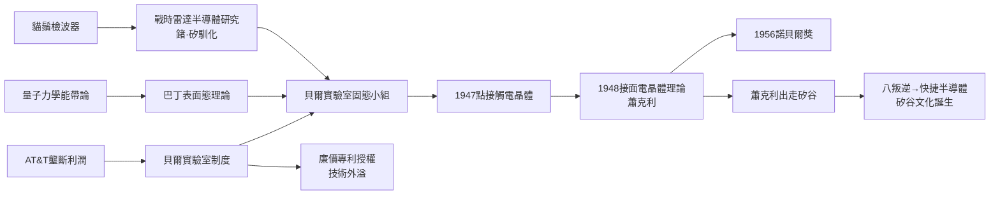

# 第 1 節 蕭克利、巴丁與布拉頓：貝爾實驗室與電晶體（Transistor）的發明

## 1947 年 12 月：固體裡的第一次「放大」

1947 年 12 月 23 日，紐約默里丘（Murray Hill）的貝爾實驗室裡，約翰·巴丁（John Bardeen）與華特·布拉頓（Walter Brattain）展示了一個其貌不揚的裝置：一塊鍺片上兩根相距僅數十微米的金觸鬚——**點接觸電晶體**（point-contact transistor）。輸入端微弱的訊號，竟能在輸出端被放大。人類第一次用「固體中流動的電子與電洞」實現了電壓控制與訊號放大，真空管的玻璃、燈絲、真空都被淘汰了。1948 年，蕭克利（William Shockley）在同事成果的刺激下閉門推導，提出**接面電晶體**（junction transistor）理論——以 p-n 接面夾層控制載子流動，結構更穩定、更可量產，成為日後所有晶片的祖先。「Transistor」之名由同事皮爾斯創造，取「transfer resistor」（跨越電阻）之意。

三人共同獲得 1956 年諾貝爾物理學獎。但故事的高潮不止於此：巴丁因與固執的蕭克利不合，離開貝爾實驗室轉往伊利諾大學，後來二度獲諾貝爾獎（超導 BCS 理論）；蕭克利則出走西岸，意外點燃了矽谷。

## 淵源：戰時雷達與「貓鬚檢波器」

電晶體的種子早在二戰埋下。雷達需要微波檢波器，真空管在高頻下失效，工程師們回頭拾起了二十世紀初的**貓鬚檢波器**——金屬針尖壓在矽或鍺晶體上的整流接點。戰時為提升檢波器的可靠度，普度大學、貝爾實驗室等機構對鍺、矽的純化與摻雜做了大量隱密研究——半導體從「實驗室的怪材料」變成「被徹底馴化的材料」。戰後，貝爾實驗室的凱利（Mervin Kelly）判定：電話交換網路的繼電器與真空管都不可靠，固態電子元件是長期解方，遂於 1945 年重組固態物理小組，交由蕭克利領軍、巴丁與布拉頓為核心。**戰爭淬鍊材料，制度部署人力**，電晶體於是在正確的地點、正確的時間被「組織」出來。

## 理論前提：量子力學的能帶論

沒有量子力學，就沒有電晶體。1930 年代建立的**能帶理論**（布洛赫、威爾遜等）闡明：晶體中電子的能量分裂為「導帶」與「價帶」，中間隔著能隙；摻入微量雜質可以讓半導體中出現帶負電的「電子」或帶正電的「電洞」，從而操控導電。巴丁正是以量子理論指出表面能階（表面態）會屏蔽電場——這解釋了為何先前的「場效應」實驗屢屢失敗，也指點了點接觸的突破。**理論預測、實驗驗證、再由理論升級設計**（點接觸 → 接面 → 平面製程），這是二十世紀科學—工程協同的教科書案例：電晶體不是工匠的偶然，而是量子力學的工程化。

## 制度引擎：壟斷利潤養出的基礎研究

貝爾實驗室是 AT&T 電話壟斷帝國的研發部門。AT&T 的壟斷受「威爾遜原則」約束（以「萬能服務」換取管制容忍），其超額利潤的一部分被制度化地投入**不受時程壓力的基礎研究**。貝爾實驗室因此同時產出電晶體、資訊論（香農，1948）、宇宙微波背景的發現（1964）——壟斷資本意外成為基礎科學的贊助人。而貝爾實驗室的另一項制度選擇影響更深：受反壟斷壓力，它以**象徵性授權金（25,000 美元）向全世界開放電晶體專利**，並舉辦研討會把技術教給三十多家公司。這一「技術外溢」決策，直接餵養了半導體產業的全球擴散。

## 八叛逆與矽谷的誕生

1955–56 年，蕭克利回到家鄉帕洛阿圖創辦蕭克利半導體實驗室，網羅了一批天才青年。但他的管理風格暴烈多疑（傳說他以測謊器篩選員工），1957 年，八位核心工程師集體辭職——世稱「**八叛逆**」（Traitorous Eight）——在投資人費爾柴爾德支持下創立**快捷半導體**（Fairchild Semiconductor）。快捷發明了平面製程與積體電路的關鍵路徑，其員工又陸續衍生出英特爾（Noyce、Moore）、超微（AMD）等數十家公司。「八叛逆」的出走開創了矽谷的文化基因：股權激勵、跳槽與衍生公司（spin-off）合法化、容忍失敗、人才流動高於忠誠。發明始於壟斷企業的實驗室，產業卻誕生於叛逆者的車庫——制度與文化的演化，與技術同樣關鍵。

## 因果鏈條

**文字鏈**：雷達戰需馴化半導體 → 能帶論提供理論地圖 → 貝爾實驗室以壟斷利潤組織研發 → 電晶體問世並開放專利 → 人才流動衍生矽谷 → 為積體電路鋪路。
