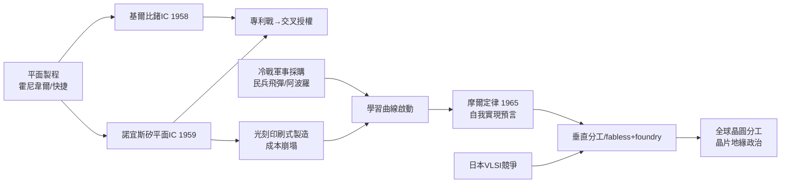

# 第 2 節 積體電路（IC）：積體電路如何將數百萬電晶體縮小至晶片上？

## 1958–1959：兩條路徑的平行發明

1958 年夏，德州儀器（TI）的新人傑克·基爾比（Jack Kilby）——正值全公司休假、他因未享年資無假可放而獨守實驗室——靈光一現：與其用導線把一個個電晶體、電阻、電容焊在一起，不如讓**整個電路就長在同一塊半導體材料裡**。他用手邊的鍺片做出第一個積體電路（相位移振盪器），1959 年 2 月申請專利。幾乎同時，快捷半導體的羅伯特·諾宜斯（Robert Noyce）想到了更優雅的方案：以霍尼韋爾的平面製程為基礎，在**矽**晶圓上一次完成所有元件與內部互連（以蒸鍍鋁導線與氧化矽絕緣層），1959 年 7 月提出專利。

兩人（與兩家公司）為「誰發明了 IC」展開長達十年的專利戰，直到 1966 年交叉授權、1969 年法院實質承認雙方各自成立。諾宜斯的矽平面路徑最終勝出——矽的氧化層天賦使其成本與良率完勝鍺。基爾比於 2000 年獨得諾貝爾物理學獎（諾宜斯已於 1990 年去世，諾獎不頒給逝者），他在領獎時公允地說：若諾宜斯還在，這個獎應當共享。**平行發明**再次證明：時機成熟時，重大發明常在不同地點同時萌芽——差別只在誰的制度能把它放大。

## 光刻與平面製程：「印刷」電路

IC 的製造本質是一門**印刷術**。平面製程的核心流程如下：在矽晶圓上生長二氧化矽絕緣層 → 塗佈光阻 → 透過刻有電路圖案的光罩，以紫外線曝光（**光刻**，photolithography）→ 顯影、蝕刻出圖形 → 摻雜或沉積導體 → 層層疊加。這讓數千、數百萬個電晶體能像印書一樣「同印、同測、同封裝」，單位成本隨著每一代光刻解析度（可見光 → 深紫外 → 極紫外 EUV）與線寬微縮（由微米進入奈米）而崩塌式下降。電子學從「焊接工藝」蛻變為「光學印刷工藝」，摩爾定律的舞台就此搭好。

## 軍事大客戶：阿波羅與民兵飛物啟動學習曲線

IC 問世初期昂貴得可笑（1961 年單顆約 32 美元，同等功能用電晶體只需數美元），民用市場冷眼旁觀。拯救它的，是冷戰。**民兵二型飛彈**（Minuteman II）的導引計算機需要輕、小、低功耗且高可靠的邏輯電路，TI 的 IC 因此獲得大額軍方訂單；NASA 的**阿波羅計畫**隨後跟進——阿波羅導引計算機（AGC）用上數千顆 IC，太空人憑它登月。1960 年代初，軍工採購一度占 IC 銷售的絕大部分。**軍方願意付高價購買「最好的」而非「最便宜的」**，這筆帶著國家意志的補貼，把學習曲線（學習率約每累計產量倍增、成本下降兩成以上）推過了民用化的門檻；價格隨後雪崩，1970 年代 IC 成為大宗商品。這是「戰爭與國家資本扮演加速器」的又一次教科書式上演。

## 摩爾定律：一份雜誌文章的預言

1965 年，快捷的共同創辦人戈登·摩爾（Gordon Moore）應《電子學》雜誌之邀撰寫展望文章，畫出一條曲線：**每積體電路上可容納的元件數，約每年翻倍**（1975 年他修正為每兩年翻倍）。這不是物理定律，而是**產業的自我實現預言**：它成為整個半導體業的規劃基準——設備商照此研發光刻機，設計公司照此排期，競爭者不敢落隊。研發與資本支出以指數推高（今日一座先進晶圓廠逾 200 億美元），也催生了產業垂直分工：有晶圓廠（IDM）→ 無廠設計（fabless，如高通、輝達）→ 專業代工（foundry，如台積電）。摩爾本人 1968 年與諾宜斯創辦英特爾，把「記憶體→微處理器」的路徑付諸實行。

## 日本競爭與全球晶圓分工

1970–80 年代，日本以政府—企業協作（VLSI 技術研究組合，1976–79）、DRAM 量產紀律與品質管理，一度占領記憶體晶片半壁江山，令美國震動，促成了 1987 年的產業聯盟 SEMATECH 與貿易談判（美日半導體協定）。此後產業持續重組：美國專攻設計與設備，日本在材料與部分設備見長，韓國（三星）接管 DRAM，台灣以台積電開創純代工模式，荷蘭 ASML 壟斷 EUV 光刻機，中國大陸急起直追。一顆晶片的誕生，如今是全球數十國、數千家公司的分工鏈——**積體電路成為地緣政治的戰略物資**，「矽盾」、「晶片戰爭」成為二十一世紀的關鍵詞。微觀的電子流動，最終塑造了宏觀的世界秩序。

## 因果鏈條

**文字鏈**：平行發明＋專利戰 → 矽平面製程與光刻確立 → 軍方與太空採購付學費 → 成本學習曲線下滑 → 摩爾定律成為產業節拍器 → 國際競爭重塑全球分工 → 晶片成為國家戰略。
