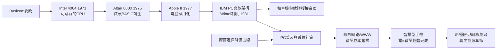

# 第 3 節 從微處理器（CPU）到個人電腦：電成為資訊處理的底層語言

## 1971 年：一顆晶片就是一台計算機

1969 年，日本計算機公司 Busicom 委託英特爾設計一系列計算器晶片。英特爾的霍夫（Ted Hoff）與費金（Federico Faggin）反其道而行：不做專用電路，而做一顆**通用的、可程式化的中央處理器**。1971 年 11 月，**Intel 4004** 問世：2,300 顆電晶體、10 微米製程、時脈 740 kHz，卻在 12 平方毫米的矽片上實現了一台完整 CPU 的功能。英特爾買回版權、以 60 美元單價向公開市場銷售——**微處理器從此成為可以購買的「積木」**，任何人都能把它放進自己的機器裡。計算能力從大型機房的神壇走下，開始流入千家萬戶。

## 車庫裡的革命：Altair、Apple II 與 IBM PC

1975 年 1 月，《大眾電子》封面刊出 Altair 8800——以 Intel 8080 為心的套件電腦，售價 439 美元。它沒有鍵盤與螢幕，只能撥開關輸入、看燈泡閃爍輸出，卻點燃了業餘愛好者的想像：阿布奎基一家小公司 Micro Instrumentation 的訂單排到幾個月後；兩位西雅圖青年保羅·艾倫與比爾·蓋茲為它寫了 BASIC 直譯器，並據此創辦微軟。1977 年，賈伯斯與沃茲尼亞克的 **Apple II** 把電腦變成消費電子：彩色圖形、內建 BASIC、塑膠外殼，個人電腦第一次像家電。1981 年，IBM 為了搶時間，打破傳統採用**開放架構**：向外採購 Intel 8088 晶片與微軟的 MS-DOS 作業系統，且不保留獨占授權。這個商業制度的選擇決定了此後四十年的版圖——IBM PC 相容機（clone）蓬勃生長，**Wintel 聯盟**（Windows＋Intel）取代 IBM 成為標準的實際主人；微軟靠「作業系統授權」這一制度設計，成為價值鏈的最高宰制者。硬體標準開放、軟體封閉收租——個人電腦產業的權力結構，由一紙授權契約寫定。

## 摩爾定律的紅利：崩塌式降價與普及曲線

微處理器把摩爾定律兌現成消費者可感知的奇蹟：每電晶體價格每兩年約腰斬，運算能力三十年成長百萬倍以上。1971 年 4004 的 2,300 顆電晶體，到 1993 年 Pentium 已逾三百萬，2000 年代破十億。單機價格同時從數千美元跌到數百美元。這條**崩塌式降價曲線**造就了史無前例的普及：從 1980 年代美國學校與家庭，到 1990 年代全球 PC 出貨年破億，再到新興市場以入門機型追趕——數位落差成為發展經濟學的議題，政府資訊化、遠距教育、電子商務隨之重構教育制度與商業形態。

## 網際網路與智慧型手機：電作為資訊的載體

個人電腦連上網路，完成了關鍵一躍。TCP/IP（1974–83）、全球資訊網（1989–91，柏納斯-李）、瀏覽器商業化（1995）把無數孤立電腦織成一張全球神經網；資訊的複製與傳遞成本趨近於零，報業、唱片業、零售業的舊制度接連瓦解。2007 年 iPhone 問世，智慧型手機把「隨身超級電腦＋永遠在線」放進口袋：晶片、感測器、電池與行動通訊的匯流，讓數十億人的一天從觸碰螢幕開始。回望全書：琥珀的靜電、伏打的電堆、法拉第的感應、麥克斯韋的場、愛迪生的燈、德富雷斯特的柵極、貝爾實驗室的接面、英特爾的晶片——**電完成了它的終極變身：從力量與光明，成為資訊與智慧的載體**。「被馴服的火種」至此已照亮文明生活的每個毛孔。

## 收尾：能量問題成為新極限

但凱歌之中暗藏新牆。晶片越快，越熱：處理器功耗密度一度逼近核反應爐，2005 年前後迫使產業放棄一味拉高時脈，轉向多核心與能效設計（每瓦效能）。資料中心用電占全球電力比重節節攀升，AI 訓練叢集動輒相當於一座小城的負載。摩爾定律在原子尺度（3 奈米已不到二十層原子）逼近物理與經濟的雙重天花板。電的時代把人類送到資訊文明的高峰，如今把一個更根本的問題推到面前：**我們從哪裡取得這一切電力，又如何不為此燒毀地球？**這正是下一章的起點。

## 因果鏈條

**文字鏈**：微處理器成為商品 → 車庫創業與消費者電腦 → 開放架構＋軟體授權制度奠定 Wintel → 摩爾定律降價驅動普及 → 網路與手機讓電成為資訊載體 → 能量需求浮現新極限。
