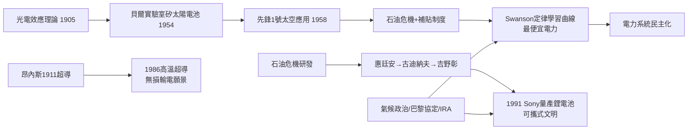

# 第 1 節 可再生能源與儲能技術：太陽能電池、鋰電池與超導體

## 1954 年：陽光變成電流

1954 年 4 月，貝爾實驗室的查爾賓（Calvin Fuller）、皮爾遜（Daryl Chapin）與傅樂（Gerald Pearson）公布第一塊實用的**矽太陽能電池**：以擴散摻雜形成的 p-n 接面，把約 6% 的入射陽光直接轉為電能。記者會上，一塊小電池驅動玩具摩天輪與無線電，媒體稱之為「太陽電池」。它的誕生地�非偶然——正是電晶體的故鄉：光生伏特效應（1839 年貝克勒發現、1905 年愛因斯坦以光量子解釋並因此獲諾貝爾獎）沉睡百年，直到半導體接面技術成熟才被喚醒。**理論（光電效應）與工程（接面製程）的百年時差**，在本書的規律中再次應驗。

太陽電池的第一個大客戶依然是太空：1958 年**先鋒 1 號**衛星以六片太陽電池供電，讓這顆僅 1.5 公斤的小衛星連續發訊號六年，遠超電池壽命。此後太陽能成為所有太空任務的標配——與 IC 一樣，**軍工與航太採購付了第一筆學費**。地面應用則由石油危機（1973、1979）點燃：政府補貼、淨電表制度、德國《再生能源法》（EEG, 2000）的固定電價收購（feed-in tariff）創造出穩定市場。矽片製造成本沿著學習曲線下滑，孫思奇（Richard Swanson）提出的**Swanson 定律**總結了這條曲線：累計產量每翻倍，模組價格約降 20%。2010 年代，太陽光電在陽光充沛地區成為**史上最便宜的電力**；中國大陸主導量產後，成本十年再降九成。電的來源，開始從集中式的燃煤巨廠，走向千萬屋頂的分散式藍海。

## 鋰電池：可攜式文明的動力庫

化石文明受限於「電難以儲存」。改變始於 1970 年代的石油危機：1979 年前後，英籍裔美籍科學家惠廷安（M. Stanley Whittingham）在埃克森以二硫化鈦做正極、鋰金屬做負極，製成第一個鋰二次電池——但鋰金屬枝晶易造成短路起火。1980 年代，古迪納夫（John B. Goodenough）在牛津發現**鈷酸鋰（LiCoO₂）正極**，能量密度躍升且更穩定；日本科學家吉野彰（Akira Yoshino）於 1985 年進一步以焦炭（碳）取代金屬鋰做負極，做出安全可用的「搖椅電池」。1991 年，**索尼（Sony）將鋰離子電池量產**，裝進攝影機與隨身聽。三人共同獲 2019 年諾貝爾化學獎。

鋰電池的社會衝擊與晶片同量級：筆記型電腦、手機、無人機、電動車、儲能電站——**可攜、可移動的電**，讓電子文明掙脫插座。產業鏈與制度亦隨之重構：亞洲主導電芯製造，鋰礦（智利、澳洲、剛果的鈷）成為地緣戰略資源，回收與「電池護照」成為新興法規議題。

## 超導體：零電阻的百年之夢

1911 年，萊頓的昂內斯（Heike Kamerlingh Onnes）把水銀冷卻到 4.2 K，電阻驟然歸零——**超導**現身，人類第一次見到電流可以毫無損耗地流動。昂內斯曾夢想以此建造無損輸電網，但絕對溫度 4 度的低溫太過昂貴。1986 年，貝德諾茲（Bednorz）與繆勒（Müller）發現銅氧化物**高溫超導體**（臨界溫度突破液態氮的 77 K），掀起全球競逐，1987 年突破 90 K——低溫物理從液氦實驗室走向工程門檻。超導至今已用於 MRI 磁體、磁浮列車、粒子加速器（LHC）與核融合的托卡馬克磁體；室溫超導若成真，電網將徹底改寫。2020 年代，室溫超導宣稱屢現屢滅（如 2023 年 LK-99 鬧劇），恰好提醒世人：物理極限不是公關稿能突破的。

## 制度驅動：氣候政治與能源轉型

太陽能、鋰電池、超導——三項技術同時在 2010 年代加速，背後是**氣候政治**的制度引擎：1992 年地球高峰會、1997 年《京都議定書》、2015 年《巴黎協定》確立碳預算框架；歐盟碳交易、中國的補貼與產業政策、美國《降低通膨法案》（IRA, 2022）以稅收抵免重塑投資流向；2022 年俄烏戰爭更讓能源安全成為地緣核心。化石能源時代，電源由壟斷公用事業規劃；再生能源時代，屋主、農民、社群都可以是發電者。**電力系統的所有權結構，正因技術成本曲線而民主化**——這是火種馴服史上最新、也最深刻的一章制度變革。

## 因果鏈條

**文字鏈**：量子理論解釋光電 → 太空採購啟動太陽能 → 危機與補貼制度創造市場 → 學習曲線帶來平價 → 鋰電池解放攜帶性 → 超導指向零損耗未來 → 氣候政治重塑電力制度。
