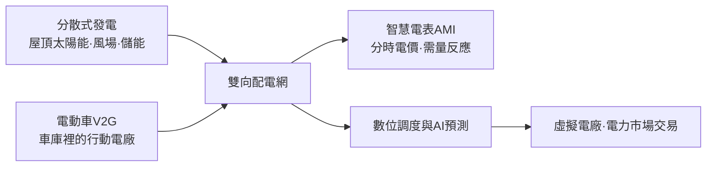
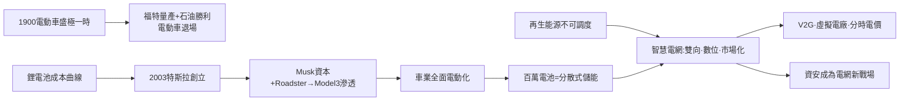

# 第 2 節 特斯拉電動車與智慧電網（Smart Grid）：電力系統的數位化重構

## 百年曲折：電動車的兩次人生

電動車其實比燃油車更早成熟。1900 年前後，紐約街頭的車輛中電動車曾占約三分之一：沒有手搖發動、沒有噪音與黑煙，愛迪生也押注鎳鐵電池，與當年的電力大王同氣連枝。但 1910 年代起，石油的勝利勢不可擋：亨利·福特的量產線讓 T 型車價格腰斬再腰斬，電動啟動馬達（1912，Kettering）消滅了手搖的劣勢，德州的石油如泉水般廉價——**燃油車靠「便宜的能量＋量產制度」完勝，電動車退場半個多世紀**。

它的復興來自三股力量的交會：1970–90 年代的空氣污染與石油安全焦慮（加州零排放車法規逼出 GM EV1）；鋰離子電池（1991 年量產後能量密度持續倍增、成本持續腰斬）補上了歷史短板；以及氣候政治對碳排的約束。

## 2003 年：資本、願景與「特斯拉」之名

2003 年，工程師艾伯哈德（Martin Eberhard）與塔本寧（Marc Tarpenning）在矽谷創立特斯拉（Tesla Motors），選擇了向尼古拉·特斯拉致敬的名字——這位曾與愛迪生打過「電流戰爭」、發明交流感應馬達與多相輸電的天才，百年後成了新創公司的圖騰。2004 年，剛從 PayPal 獲利的馬斯克（Elon Musk）領投 A 輪並出任董事長，此後以願景、資本與高壓執行成為公司的化身。

特斯拉的策略是教科書級的技術滲透路線：先造高端跑車 **Roadster**（2008，證明電動車可以快、酷、貴）→ 再造豪華轎車 **Model S**（2012，加自建的 Supercharger 快充網）→ 然後是大眾車 **Model 3**（2017）→ 再用內華達 Gigafactory 把電池成本沿規模曲線打下去。2008 年金融海嘯中特斯拉幾乎倒閉，靠美國能源部 4.65 億美元貸款與戴姆勒入股續命——**政府資本再次扮演火種保護者**。2010 年 IPO 之後，特斯拉的市值一度超越所有傳統車廠之和，迫使百年巨頭全面轉向電動化；2014 年更開放專利，賭的是「整個產業一起放大蛋糕」。此外，以 OTA（軟體升級）更新車輛、以自駕資料迴路重構汽車業的商業模式——車不再只是機械，而是輪子上的電腦。

## 智慧電網：從單向河流到活的生物網

愛迪生與西屋留下的電網，是一套**單向、類比、集中**的系統：大電廠 → 輸電 → 配電 → 用戶，一百年來幾乎沒有改變形態。再生能源把它逼到極限：風與光不可調度、午間太陽能過剩而晚間無光、屋頂人人發電——電網必須學會「雙向思考」。**智慧電網**（Smart Grid）以數位感測與控制重構這一切：

- **分散式發電**：電力從少數巨廠轉向百萬屋頂與社區電廠，輸配電從「河流」變成「神經網」。
- **V2G**（Vehicle-to-Grid）：百萬輛電動車的電池是史上最大的分散式儲能庫——停著的車可在尖峰時反向賣電，車主成為電力市場的微型交易者。
- **電力市場化**：1990 年代起，英、美、北歐先後拆解「發電—輸電—售電」壟斷，引入批發電力市場與競價調度。電從「公用事業的服務」變成「即時定價的商品」，馬斯克的兄長金巴爾參與的 SolarCity（後併入特斯拉）所販售的太陽能屋頂，正是這場制度變革的消費端面貌。

## 數位化的代價：資安與韌性

電網數位化把二戰以來「物理防禦」的邏輯改寫為「網路防禦」。2015 年烏克蘭電網遭駭客攻擊致數十萬戶停電，是史上首次以程式碼摧毀電力供應的戰爭行為；後續的 Stuxnet（對伊朗核設施）、Colonial Pipeline 勒索事件，都宣示：**控制電的軟體，就是控制國家的鑰匙**。電力部門因此誕生新的制度層——資安法規、關鍵基礎設施保護、跨國資安聯盟——這是火種馴服史上首次：保護電，需要防禦的不是風暴與短路，而是藏在電流裡的惡意程式。

## 因果鏈條

**文字鏈**：電動車百年起落 → 鋰電池與資本讓特斯拉復活 → 車業轉向創造行動儲能 → 再生能源倒逼電網數位化 → 電力制度從壟斷走向市場 → 資安成為新的電力安全議題。
