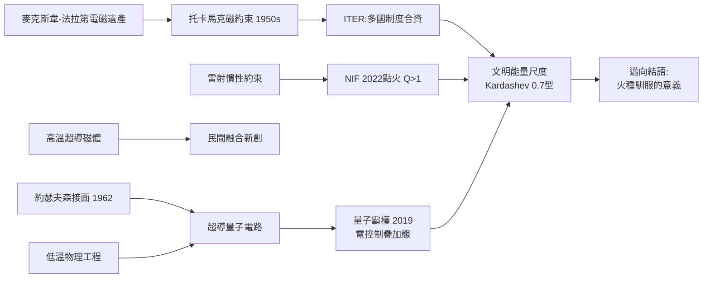

# 第 3 節 未來能源極限：核融合發電與量子計算中的微觀控制

## 托卡馬克、ITER 與 NIF：馴服恆星之火的競賽

人類的火種一直來自化學能——煤、油、氣的燃燒，本質上只是搬動原子外層的電子；而恆星的爐火來自原子核的聚合。1950 年代，蘇聯的塔姆與薩哈羅夫提出**托卡馬克**（Tokamak）：以強磁場把上億度的電漿懸浮約束在環形容器中，讓氘氚核彼此聚合。這是麥克斯韋—法拉第遺產的極致應用——**用電磁場本身，去囚禁比太陽核心更熱的物質**。七十年來，這場競賽逐漸成形為三條路線：

- **ITER**（法國，2006 年啟動，中、歐、美、俄、日、韓、印合資）：全球最大科學工程之一，目標產出 500 MW 融合功率、能量增益 $Q \geq 10$——以多國分攤的制度，把「國家級燒錢」變成「人類級投資」。
- **NIF**（美國勞倫斯利佛摩實驗室）：以 192 束雷射壓縮米粒大小的燃料丸，2022 年 12 月首次實現**點火**——融合產出能量（3.15 MJ）大於雷射注入能量（2.05 MJ），$Q>1$ 的淨增益首次在實驗室達成。儘管考慮雷射牆插效率後整體仍是淨耗能，這是七十年來的物理里程碑。
- **民間新創**（Commonwealth Fusion、Helion、TAE 等）：以高溫超導磁體把托卡馬克縮小十倍，靠創投資本壓縮時程。核融合從「永遠還差三十年」的笑話，變成資本與國家競逐的賽道。

融合的政治經濟學同樣精彩：燃料（海水中的氘）近乎無限、無熔毀風險、無長壽命高階廢料——誰先商用，誰就掌握能源的地緣解脫。工程經濟的難題也同樣清晰：第一壁材料、氚自持、電漿不穩定性，以及「每一瓦都來自罕見的極端工程」的鉅額成本——融合必須打贏的不是物理，而是**與太陽能加儲能的比價**。

## 量子計算：以電控制「疊加」的宇宙

另一個極端上，人類正在用電操控**單一量子態**。量子位元（qubit）的諸多實現中，**超導量子電路**（Google、IBM、京都 SuperIQB 等的路線）最為工業化：以約瑟夫森接面（1962 年預言，因量子穿隧效應在絕緣層中出現超電流）製成人工原子，在約 10 毫克耳文（比外太空更冷）的低溫中，以**微波脈衝**精準驅動其疊加與糾纏。2019 年，Google 以 53 位元的 Sycamore 宣稱達成「量子霸權」——一項計算在 200 秒內完成，傳統超級電腦估需千年。這是電學史的奇妙閉環：**當年電流驅動了繼電器，如今微波脈衝驅動疊加態——計算的載體一路下沉，直抵物理世界的最底層**。

低溫物理是這一切的共同基礎：昂內斯 1911 年的超導、稀釋冷凍機的毫開級製冷、高溫超導磁體——低溫工程從科學的奢侈品，變成量子產業的基礎設施。控制誤差、糾錯（需要上千個物理位元守護一個邏輯位元）、與經典電子學的混合整合，是未來十年的戰場。

## 終極問題：文明的 Kardashev 尺度

1964 年，天文學家卡爾達肖夫（Nikolai Kardashev）以能量尺度為文明分級：I 型文明動用其行星的全部能量流（約 $10^{16}$–$10^{17}$ 瓦），II 型動用一顆恆星的全部輻射，III 型動用整個星系。以此衡量，人類目前約為 **0.7 型**——我們的電網、晶片與資料中心，全部供養於化學燃料與行星表面能量流。可控核融合若成真，人類將首次以「恆星級核過程」為文明的基座；若再結合太空太陽能與量子計算的設計力，通往 I 型文明的階梯才真正可見。回望本書：從琥珀摩擦的微光，到托卡馬克裡的恆星火種——**電的歷史，就是人類對能量控制粒度的歷史**：從分子（燃燒）、原子（電池）、電子（電路）、到光子與核子（融合、量子）。每一次粒度的下沉，都是一次文明的重構。而在這條階梯的下一級，等著我們的是終極的整合與反思——那正是結語要回答的問題。

## 因果鏈條

**文字鏈**：電磁場理論撐起磁約束融合 → 國際制度（ITER）與資本（新創）並進 → NIF 點火證明物理可行 → 超導與低溫工程同時餵養量子計算 → 電的控制下沉至量子與核子 → 文明能量尺度提出終極追問。
