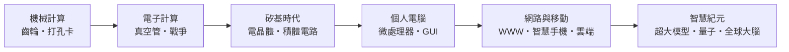

# 前言：計算的靈魂——人類如何用矽與電晶體鑄造超越肉身的思考機器

> 「我的職業就是打造全世界最快的機器。」——西摩·克雷
> 「我們要讓每張課桌、每個家庭都有一台電腦。」——比爾·蓋茲

## 電腦不是晶片的發明，而是一個兩百年的念頭

電腦從來不只是矽、電路與塑膠外殼的組合。它是一個想了兩百年的念頭：**讓「遵守規則」這件事本身，變成一台機器。**

從算盤上的撥珠，到巴貝奇黃銅齒輪裡的差分表；從提花織機穿孔卡片上的花紋指令，到圖靈紙帶上的抽象符號；從 ENIAC 嗡嗡作響的一萬八千支真空管，到貝爾實驗室那塊會放大電流的鍺晶片；從仙童半導體出走的「八叛逆」，到今天口袋裡比當年超級電腦還強大的手機——這段歷史的主角，從來不是機器，而是**人**。

本書要講的，就是這些人與他們的抉擇：

- 巴貝奇，與大英帝國財政部纏鬥二十年的固執老紳士，夢想著蒸汽驅動的計算機。
- 圖靈，用一篇論文定義了「什麼是可計算」，再用它的代價幫英國贏得戰爭。
- 蕭克利的八個年輕人，受不了老闆的 Harris 金字塔，集體出走一個叫「仙童」的公司，就此點燃矽谷。
- 摩爾的一個樂觀推測，變成半導體工業五十年自我實現的聖經。
- 賈伯斯、沃茲尼克與蓋茲，三個車庫青年如何瓜分了 PC 時代的靈魂。
- 伯納斯-李，把萬維網無償放棄專利，讓人類的知識在同一張網裡相連。
- 佩吉與布林，用一句「以連結投票」的數學，重新整理了整個世界的信息。
- 貝佐斯，把書店公司的多餘伺服器，變成如同水電般隨取隨用的基礎設施。

## 範式轉移的齒輪

如果你把這兩百年壓縮成一幅圖，你會看到計算范式的五次躍遷，每一次都由「人 + 時代」共同發動：

技術、經濟、制度、文化、政治、教育——這六股力量互相驅動：沒有美國大學數學博士泡沫，就沒有 Bell Labs 的諾貝爾舞台；沒有冷戰與登月，就沒有 IC 的信仰成本到零；沒有關於「相容性」的制度發明，就沒有 IBM 的帝國與 Microsoft 的軟體生意。

## 閱讀路線

本書共五篇十一章、三十三節，依時間軸推進：

1. **機械齒輪與算術狂想**（古代 – 19 世紀）：算盤、帕斯卡、萊布尼茨、提花織機、巴貝奇與雅達。
2. **密碼戰與電子計算的誕生**（1930s–1940s）：圖靈、Bombe、Colossus、ENIAC 與馮紐曼架構。
3. **矽谷崛起與 IC 革命**（1950s–1960s）：電晶體、八叛逆、仙童、摩爾定律與 System/360。
4. **PC 革命與作業系統之戰**（1970s–1980s）：Intel 4004、Altair、蘋果與微軟。
5. **網路、移動與雲端帝國**（1990s – 至今）：WWW、Netscape、Google、iPhone、AWS、超算與量子。

所有故事皆取材於真實歷史事件——專利文件、法院判決、論文與當事人回憶錄。有趣，但絕不虛構。

讓我們從一個在 1830 年代想用蒸汽驅動計算的英國紳士說起。
