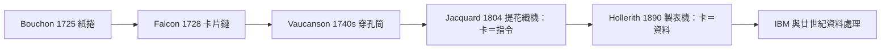

# 提花織布機與打孔卡：第一個程式指令的雛形

## 里昂的絲綢與織機的難題

十八世紀的里昂是全歐洲的絲綢之都。織造一件先進提花織物（damask、緞花綢），需要一位「draw boy」（拉花童）坐在織機上方，按花樣把數百根經線逐一拉起，讓梭子從中穿過。花樣越宏大，需要拉起的經線越多，織一幅壁毯式的複雜花紋可能需上千根經線，費時數月。製品昂貴，匠人生計艱難，行會為訂單技術而吵嚷不休。**「把複雜花樣自動重複實現」，是十八世紀法國最迫切的一個自動化難題**——不是由數學家提出，而是由市場。

## 穿孔控制的譜系

解法一步一步演化，像接力：

- **1725 年，Basile Bouchon**：里昂的織工之子，他把花樣扎在**穿孔紙捲**上，紙捲貼在針排前——有孔處針穿透、抬起對應的經線。這是「用孔洞編碼資訊、以孔位控制機器」的開端。
- **1728 年，Jean-Baptiste Falcon**：把紙捲改成**穿孔卡片串聯**成鏈，卡片可替換、可重印，比易損的紙捲更耐用、更容易組合新花樣。draw boy 由卡片取代，織工的勞動效率躍升。
- **1740 年代，Jacques de Vaucanson**：這位以「自動鴨子」聞名的機關偶師在里昂引入機械化織機，使用**穿孔紙筒（barrel）**與更完整的控制機構。然而他的機器笨重昂貴，遭織工抵制，裝置未普遍採用——技術先進不等於制度就緒。

## Jacquard 1804：把花樣變成程式

真正的綜合者是 Joseph-Marie Jacquard。这位里昂織工兼商人整合前人成果，1804 年製成**提花織機（ Jacquard loom ）**：花樣被編為一系列打孔卡片，卡鏈（chain）在織機上循環地通過針框；有孔處由對應的針推動、拉起經線，無孔處經線落下，由緯線成像。一張卡＝一行指令；一副卡鏈＝一支完整的花樣程式；更換卡鏈＝更換產品——**織機不變，程式改變即可改變像是另一台機器**。這正是現代計算機最具啟發性的架構原則：**指令與（資料的、硬體的）狀態分離**。

Napoleon 時代的國家意識到其戰略性——絲綢是法國的出口王牌。1805 年皇帝拿破崙與皇帝 Josephine 親臨里昂參觀，此機被置於「國家財產」之下給里昂市政府，Jacquard 獲終身年金。到了 1812 年，里昂已有一萬一千台織機運轉；到 Jacquard 死去的 1840 年，機器已超常規規矩。制度與經濟合流，這次自動化真正的成功了。但成本也真實：**織工的失業與起義**。1831 年里昂的 canut（絲織工）起義，既有工資與行會政治的因素，也有「機器替代手工」的恐慌。自動化的社會衝擊，在計算機誕生前一個半世紀，已上演了一次預演。

## 從花樣到人口：Hollerith 1890

打孔卡接著橫渡大西洋，換了一個完全不同的行業——**統計**。美國憲法規定每十年舉行人口普查（用以分配國會席次與稅賦；這是憲政制度對資料的硬性需求），1880 年人口五千萬，1880 年普查花費七年多手工統計，若 1890 年人口增至 6,300 萬，用舊法可能要到 1900 年才能算完——**下一輪普查開始前，上一輪結果還沒出來**，制度危機迫在眉睫。

在人口普查局工作的德裔青年 Herman Hollerith 得到啟發（據他自述曾與統計長約翰·肖·比林斯討論，鐵路／車票打孔的概念也起了作用），設計出一套「電動製表機」：把每一位居民編成一張**打孔卡**（對應年齡、性別、州籍等欄位），卡片插入機器時，壓針落在有孔處接通電路，驅動對應計數器跳動。1890 年普查中，這套系統在 6 週內報出初步總數，整體過程約花費一半時間、顯著省錢。**打孔卡自此從「控制機器的指令」升級成「機器處理的資料」——這一升級意義深遠**：同樣的孔位語言，既可以是織機的花樣，也可以是國家的人口。Hollerith 的製表公司（Tabulating Machine Company）在 1911 年幾經整合，於 1924 年更名為 **IBM**。二十世紀統治辦公室自動化的那家公司，其起點正是這場1890 年的資料搶灘。打孔卡經歷磁帶、磁鼓，直到 1970-80 年代仍是電腦輸入的主流媒介——一百七十年間，「以孔的有無代表位元」這個思想絲毫未變。

## 江河匯流的意義

回看這條河的流向：

織機證明了「機器可以按預先存好的指令序列，長時間自主地做複雜、精準、重複的工作」；製表機證明了「同樣的孔洞語言可以用來**代表世上的一切資訊**，而不只是花紋」。這兩個證明，正是即將出現的分析機（Analytical Machine）的兩大支柱——而當 Babbage 打算進一步把 Jacquard 花卡放進**計算機**時，我們的十九世紀就站在現代計算機的門檻上了。
