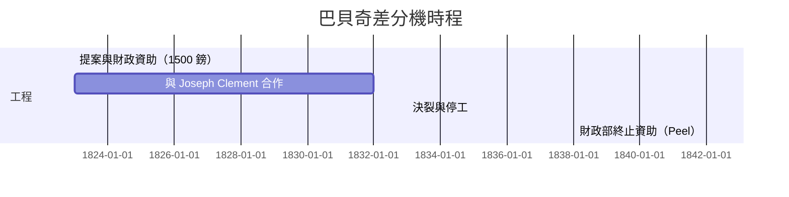

# 巴貝奇：未竟的差分機與蒸汽計算夢

## 銀行家之子與劍橋的叛逆

Charles Babbage（1791–1871）生於倫敦的富裕銀行家家庭，從小對一切機械著迷——傳說童年即拆解玩具研究其齒輪。1810 年進入劍橋三一學院時，他發現自己對牛頓以降英國數學的停滯深感不耐：歐陸早已改用 Leibniz 式的符號記法，英國卻拘泥牛頓的點記法。於是他與同窗 John Herschel（天文學家 William Herschel 之子）、George Peacock 共組**分析學會**（Analytical Society），口號是推動萊布尼茨記號與歐陸微積分的改革。這段經歷透露 Babbage 的人格底色：**不滿於現狀、致力於標準化，並且組織同好以制度力量推動改革**——他後來推動皇家學會改革、協助創立英國科學促進會（BAAS），甚至窮畢生之力向政府遊說「科學應被國家重視」。

## 兩位天文學家的玩笑

轉折發生在 1821 或 1822 年前後的一個夜晚。Babbage 與 Herschel 合作為天文學會校算一組數表，苦於錯誤叢生，兩人疲倦地對著人為疏失感嘆。Babbage 在自傳《一位哲學家的一生片段》（Passages from the Life of a Philosopher, 1864）中追述了那場對話——Herschel 嘆道：「天啊，我希望這些計算是用蒸汽完成的！」（I wish to God these calculations had been executed by steam），Babbage 則回道：「這是可能的。」這段著名的傳世語錄，標誌著一個深刻直覺的誕生：**人類犯錯的計算本能，可以被不會疲倦的機器取代**。十九世紀的航海、保險、稅收官僚體系，正被一場「數表錯誤災難」所苦——船員拿著錯誤的經度表觸礁沉船的情形相當常見。需求明確，且是國家級的需求。

## 差分機：數學的巧妙偷工

造一台會做任意乘除的機器很難；但 Babbage 用了一個漂亮的數學取巧——**有限差分法**。任何多項式乃至許多函數，其相鄰值之差經過多次差分後會變成常數：

$$\Delta f(x) = f(x+1)-f(x), \quad \Delta^n f(x) = \text{常數}$$

以一個二次多項式為例，$f(x)=x^2$ 的一階差分是 $2x+1$，二階差分恆為 2。這意味著**只要反覆做加法，就能製造出整張多項式數表**——不需要任何乘法機構。對數表、三角函數表，皆可以用多項式逼近到足夠精度，因此也可用純加法生成。Babbage 的差分機（Difference Engine）正是這個「多項式差分表自動擴張」的機械化：若干根數值輪儲存当前值，各階差分輪依序相加，結果輪送出列印。

## 一千五百鎊，一場災難的開幕

1822 年 6 月，Babbage 致函皇家學會會長 Humphry Davy 提出差分機計畫；1823 年英國財政部同意**資助 1,500 鎊**（Babbage 婉拒了受封爵士），並約定機器完成後由政府取用於航海年鑑（Nautical Almanac）之製算。這是英國政府史上首次大規模資助一項工程計算設備——**科學與國家財政的正式婚姻**。

婚姻立刻顯出性格不合。Babbage 聘請了當時英國最出色的工具機匠 **Joseph Clement**。要造差分機，先得造能造差分機零件的機器——Clement 為此開创了可互換標準件、標準螺紋、乃至工作圖樣制度；零件精度要求達**千分之二英吋**，在刀具鋼材、測量工藝都未成熟的年代，這近乎固執。Babbage 不斷修改設計（他有一種可怕的「再改一點」的習慣），Clement 拒絕「未經書面確認就施工」，工程一天天延宕。資助一度提升到 17,000 鎊以上，到 1832 年，一台小型樣機部分完工，足以演示生成數表並打樣——但整機從未完成。

1833 年起，兩人因工資與設計變更爭執而決裂，Clement 停工，並按慣例把場內另造的工具機一併留下查看。1842 年首相 Robert Peel 及財政部終止資助：對一個面臨大宗財政壓力的政府而言，一個十年交付不出成品、又不斷要求加款的項目，終止是理性決策。Babbage 愤而於國會對 Peel 訴說不滿——這位天才從不擅長官僚政治。**真正的教訓並非「Babbage 失敗」，而是：沒有可預測的專案管理、沒有可互換零件的工業基礎、沒有耐心超過十年的國家客戶，先進技術便無法落地。**

## 一個時代的縮影

值得注意的是，Babbage 的失敗發生在**英國工業革命最勝之時**：瓦特的蒸汽機已在工廠轟鳴，鐵路正在舖設，機器横越了傳統手工業的邊界；但計算機需要的，不僅是「能造出」的能力，更是「在預算內按時造出」的體系。Babbage 的 quarter-century 之夢，可視為凡爾賽宮式的、碩大而成不了事的一件「工程使徒」：

然而正是這場失敗，把 Babbage 的思維逼向一個更大的概念：既然問題不在數學，而在「所有計算的通用機械化」——**那何不造一台能夠做任何計算的機器？**

於是差分機未竟之處，誕生了分析機。
