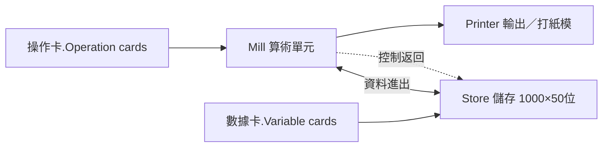

# 分析機：Store 與 Mill 的分離先驅

## 從「算一張表」到「算一切」

差分機中途未竟，Babbage 卻在 1834 年（甚至可能更早）想得更遠：**何不造一台「做任何計算」的機器？** 這台機器不再只為某類函數服務，而要像 Jacquard 織機讀取花卡那樣，讀取一系列「操作指令」，把數據照指令搬運、運算、輸出。他稱之為**分析機**（Analytical Engine），設計在 1837 年左右基本成形，其後十年持續演化，直至他去世——**這台機器從未建成，卻幾乎完整地預言了現代計算機的架構**。

## 一台蒸汽計算機的五臟六腑

分析機的架構，今日讀來驚人地熟悉：

- **Store（儲存庫）**：由機械輪軸構成的「記憶體」，設計規模為**儲存 1,000 個 50 位十進位數**。（Babbage 估計其體積如一座出軌火車頭；這個規模在十九世紀動力學下遠超可行，但概念上正是 RAM。）
- **Mill（磨坊）**：中央處理單元，由「齒輪＋槓桿」構成，按取自 Store 的數據執行四則與比較運算。這個取名極有工業時代的味道——資料像棉花一樣，被送進 Mill「磨」出結果。
- **打孔卡**：與 Jacquard 呼應的**外界程式媒介**，Babbage 清楚地分為兩種：**操作卡**（指定做加、減、乘、除、搬運等哪一種操作）與**數據卡**（載入常數與變數）。這即是「程式與其資料分離」的早期明晰化。
- **Printer**：自動把結果印製在紙上，甚至可打出紙模，供重印——把「自動產生無誤的印刷數表」作為最終目標。

## 條件分支與循環：第一位圖靈等價者

分析機最超越時代之處，是它不僅是流水帳式的一串指令。Babbage 設計了：

1. **條件分支（conditional branching）**：Mill 的某個機構根據運算結果的符號（正、負、是否為零）從**不同的操作卡序列**中選擇繼續走——即機械版的 if。
2. **循環／回跳卡（backward branching）**：一張卡片指示控制機構**回到某之前的卡**，重複執行一段指令若干次——即機械版的 loop。

因果地說，「if 與 while」正是現代計算的靈魂：**沒有它們，任何機器都只是固定流程的計算器；有了它們，機器就成為可按任意演算法重構的通用計算機**。Babbage 未必用了今天這些名詞，但其結構完全等價。今日計算機史家公認：分析機已達到「圖靈等價」的架構條件——只是它的實現是蒸汽與齒輪，而非電子。

## 差分二號與遲到的平反

在分析機的設計過程中，Babbage 順手完成了**差分機二號（Difference Engine No.2, 1849）**的圖紙——一個不再修改、更精簡的差分機新方案（約 8,000 個零件，31 位數精準度）。這份設計在 Babbage 生前也無人建造。直到 1985 年倫敦科學博物館的 Doron Swade 領導團隊按原理圖建造，1991 年機器完工運轉，成功生成、印出無誤的數表；2000 年又複製印表機。這次重建的意義在於：**以當時可取得的工藝是足以造出差分機二號的**——Babbage 之敗的主要原因，多半不在工程錯誤，而在**規模、工期、政治與個人性格**。

## 家族的最後一波

Babbage 晚年孤僻而固執，對同事、政府、評論者的攻擊（如他對皇家學會與官僚的綿厭）使他日益邊緣化。然而其幼子 **Henry Prevost Babbage** 沒有放棄這份遺產：他在父親死後，根據其遺留圖紙與他自己隨父學習的技藝，在倫敦組織工匠完成了**分析機的 Mill 部分模型與若干片段**，於 1888 年完成、1893 至 1906 年間幾經重裝，並送至哈佛大學陳列。據說哈佛青年 Howard Aiken 在 1930 年代末曾於此案前實驗、讀到其說明，而 Aiken 正是 1940 年代哈佛 Mark I（IBM 資助的機電計算器）的建造者。****分析機的機果，因此可能在史冊上多一個妙手回音：蒸汽時代未竟者的血脈，經由電類機而重煥光華。**

## 制度的缺席

從今天回望，分析機敗於三股力量：**技術的**（精密零件的加工與器可靠性）、**財政的**（英國政府無意再為一個無底洞撥款）、**認知的**（當時幾乎沒有人、包括許多科學家，能真正理解「通用計算機」的概念價值——它造的東西太超前於時代的需求措辭）。要等到一百三十年後，鐵路、人口普查、彈道、密碼、與工業規模的數表需求，才把世界重新帶到 Babbage 的問題前。

但有位人物看得比同時代所有人都清楚。她，是一位詩人的女兒。
