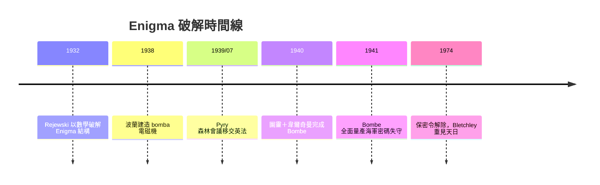

# 03.2 布萊切利園：Bombe 與 Enigma 的演算法賽跑

秘密從華沙開始。

一九三二年，波蘭密碼局年僅二十七歲的馬里安·雷耶夫斯基（Marian Rejewski）做了一件此前無人想過的事：用純數學破解 Enigma。在他之前，密碼分析是語言學家的戰場——找頻率、猜字母。雷耶夫斯基不是語言學家，他是數學家，而且是被波蘭密碼學校從波茲南大學招進來的。他拿到德國情報滲透取得的初期 Enigma 接線資料，加上對轉子線路的推導，用置換群論重建出整個機器的內部接線。

他隨後注意到 Enigma 一個致命的結構缺陷：機器的反射板（reflector）把每個字母的路徑摺回自身，因此**任何字母永遠不會被加密成它自己**。這個「自反性漏洞」讓他發明「循環環」(cycle of indicators) 分析法，並與同事造出名為 **bomba** 的電磁機器（一九三八），用六台 Enigma 並聯暴力搜尋每日鑰匙。

一九三九年七月二十五日，波蘭在華沙近郊的 Pyry 森林中，秘密把 Rejewski 的全部成果——Enigma 復原機、bomba、齊格斯基穿孔卡——移交英法。英國軍官震驚：他們自認一無所獲的戰場上，波蘭已經跑了好幾年。三週後德軍入侵波蘭，這份贈禮成了西方情報世界的開國文獻。

## 布萊切利園與 Station X

英國把密碼破譯司令部設在米爾頓凱恩斯附近的**布萊切利園**（Bletchley Park），代號 Station X。這是一場制度實驗：不是軍營，而是把劍橋、牛津的數學家、語言學家、棋手、縱橫字謎高手（每日電訊報的謎題徵稿成了招募管道）聚在破舊鄉间宅邸裡。哈特色彩濃厚的國王學院文化在這裡延續——圖靈在此不是孤僻的哲學家，而是「教授」（The Prof），會把值錢的茶杯用鐵鍊鎖在暖氣管上以防空襲。

圖靈接手的難題是：德國戰前用指針交換每日鑰匙，戰時改用「增強型」設定與更頻繁更換轉子次序，波蘭的 bomba 失效了。圖靈的解法登峰造極：他設計了一種新 attack——利用 **crib**（已猜知的明文片段，如天氣報告「WETTER」、德國空軍的固定電文格式）在密文上的位置反推接線矛盾。

他的機器就叫 **Bombe**（向波蘭 bomba 致敬），道地的思路卻是新的：讓電路「模擬」Enigma 的自反性邏輯，當推測的接線引發矛盾時機器自動中止。一九四〇年初原型落成，同袍戈登·韋爾奇曼（Gordon Welchman）發明了**對角線板**（diagonal board），利用「同一字母在內部接線一處為零則處處」的性質大幅縮小搜尋空間。圖靈負責數學結構，韋爾奇曼負責工程化——這是「演算法＋制度」的雙螺旋。

## 工廠化解碼流水線

破解不是一次性事件，而是每天午夜「重新開始」的流水線：德軍在每晚午夜更換每日設定，英國必須在每二十四小時內收斂出當日鑰匙。布萊切利園將此制度化成生產線——**Hut 6** 處理陸軍／空軍密碼，**Hut 8**（圖靈主管）處理海軍，譯出的情報交 **Hut 3** 翻譯、評估、分呈戰時內閣。到一九四五年，布萊切利園已有約九千人，Bombe 機兩百餘台，像一座沉默的工廠，二十四小時不斷把德國電文重新變成明文。

歷史學家估計這條流水線縮短戰爭兩年以上。北大西洋反潛戰中，Hut 8 的海軍解密讓護航艦隊繞開 U 艇狼群——圖靈本人親自赴華盛頓協調英美密碼合作，並推動美軍建造自己的 Bombe 變種。

另一條戰線後來被稱為 Tunny：德軍最高統帥部使用的 **Lorenz** 電傳打字密碼更複雜，不是靠 Bombe，而是由圖靈以「圖靈主義」(Turingery) 手工方法起步，最終交給他人以電子機器解決——那是下一章的故事。

## 戰後五十年沉默

一九四五年戰爭結束，丘吉爾政府下令**銷毀或封存**所有 Bombe 與文件，所有參與者簽署保密協議，家人朋友只知道「他們在郵政局做點文書工作」。圖靈的一生成就（包括這章的功勳）在他生前無人知曉，一九五四年他死時，訃聞只提他是劍橋的數學家。直到一九七〇年代原法國情報人員的洩漏與一九七四年 F.W. Winterbotham 的回憶錄《The Ultra Secret》，布萊切利園才重見天日；而圖靈在其中的具體角色，要到一九九〇年代以後才被逐步還原，成為今日公認的「電腦科學之父」與戰爭英雄。

歷史在這裡留下一個苦澀的註腳：國家要他保密，而不能給他榮耀；他向國家獻出「拯救生命千萬」的智能，國家卻以一九五二年的同性戀定罪回報。科學與制度的關係，從來不只是實驗室裡的自由探索——它也由保密、撥款、徵兵與偏見共同書寫。
