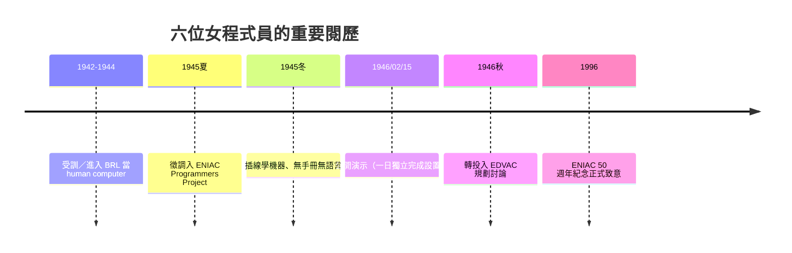

# 04.2 被遺忘的 ENIAC 六大女程式員

一九四五年夏天，費城的語言學界出了一樁「失蹤案」：陸軍把三位年輕女性數學名校畢業生從彈道計算的桌前抽走，派到賓大莫爾學院一個保密的機房。上級只告訴她們一句話：**「去學那台機器。」**

三人同時收到了她們要操作的機器的電路圖——僅僅是電路圖。沒有教材，沒有語言，沒有教科書，因為世界上還沒有任何一本。

## 六個名字

她們後來被稱為「ENIAC Girls」，正確的身分是**世界第一批程式設計師**：

- Kathleen 「Kay」McNulty（麥克努蒂）
- Frances Bilas（畢拉斯）
- Jean Jennings「Kay/Liz」 Jennings——正名 Jean Bartik（巴蒂克）
- Ruth Lichterman（里奇特曼）
- Elizabeth「Betty」Snyder（史奈德，後随夫姓 Holberton）
- Marlyn Wescoff（威斯科夫）

她們出身背景極相似：到大戰爆發、男性被徵召前線為止，美國大學數學系是「不適合女生」的偏見文化之一；大戰期間陸軍為彈道研究空前地**大量招募受過數學訓練的女性**（WAC「Women's Army Corps」），把彈道表的人肉運算人數推上上百人。McNulty、Bilas、Snyder 來自賓州切斯特的 Chestnut Hill 學院，同屆修了陸軍開設的彈道微積分課程，是全期近十名女生；Jennings 與 Lichterman 出自賓大，Wescoff 來自 Goucher。BRL 的招聘考試要求「會用會計手搖計算機＋修過微積分」，缺一不可。

## 「程式」不存在時怎麼寫程式

ENIAC 沒有儲存程式，而是由**單元**構成：累加器（accumulator）、乘法器、除法開根器、函數表（function tables）、恆常轉發單元（unit）、輸入輸出讀卡機。要解一個彈道方程，必須自己完成三件事：

1. **把數學拆成機器動作**：人類的代數運算，需手工轉成「累加器間的傳遞、乘法器的輸入端設定、電纜在接線板上的行走路線」。
2. **時序與面版邏輯**：機器的同步以示波器和單元間的循環脈衝訊號（盪到幾千訊號）為基準，她們得用示波器確保每個單元在同一微秒內收發。
3. **插拔線儲存**：程式「存」在插線板與函數表的紙卡上，改一條彈道要重插幾十處。

一九四六年二月十五日的公開演示，是這門手藝的畢業考：ENIAC 在眾人面前示範了砲彈軌跡與圓周率的高精度計算。為了演示順利，這組女性以**接力分工**方式操作不同區段——Jennings 在主面版上設定資料流程，Snyder 反覆推理邏輯流程的缺陷，McNulty 主導接力切換單元。這個「團隊模組化」的分工法，正是日後除錯與模組設計的萌芽。

「debugging」的字源常被歸功 Grace Hopper 的一九四七年 Harvard Mark II「蛾子事件」，但「把錯誤當作可追蹤、可分離、可修的實體」的思維，最早在 ENIAC 的除錯會議上已成形。此後 Betty Holberton 與 Grace Hopper、Kathleen Booth 一相繼，在 UNIVAC 早期開創了第一代高階語言與編譯器（A-0 及 FLOW-MATIC，再到 COBOL）的譜系——「女性是編碼的起源」，這一句話不是美談，是事實。

## 遺忘的機制

一九四六年戰爭結束，六人以「nominal」身分被陸軍遣散（她們大多以員工名義繼續，卻被排除在 ENIAC 計畫的正事與獎賞之外）。一九四七年二月新聞媒體報導 ENIAC 之時，Moore School 的記者會照片上全是男性工程師；Cardiac Covenant 的慶功晚會上，六個人被介紹為「在場女士」，無一人被邀請上台。而官方紀錄更嚴重：六位在證書和歷史文件上「不存在」，文檔把程式設計的功勞歸於 Mauchly 與 Eckert。

一九九六年 ENIAC 五十週年，賓大舉行紀念活動，這才**正式重新致意**，並將這六位（部分已故、四位仍在世）登記成「ENIAC 六人組」，二〇二〇年代後逐漸進入教科書。六人的口述歷史（主要由 Jeannine Mosely 錄製，及 Bryant 保存的文件）成為這段歷史的主要一手證據。

## 經人事業夾縫中的啟示

這一段歷史揭示的社會結構：**技術的功勞，是誰在場的問題，也是誰在場景中被「看見」的問題。**當程式設計從表格＋心理操作的無名手藝，走到成為一門「科學」與一門行業，命名權、作者權、講台位置，都專屬於男性的殿堂。ENIAC 六人被遺忘，不是因為她們沒做什麼，而是因為歷史的執筆者是鎂光燈後的另一些人。
