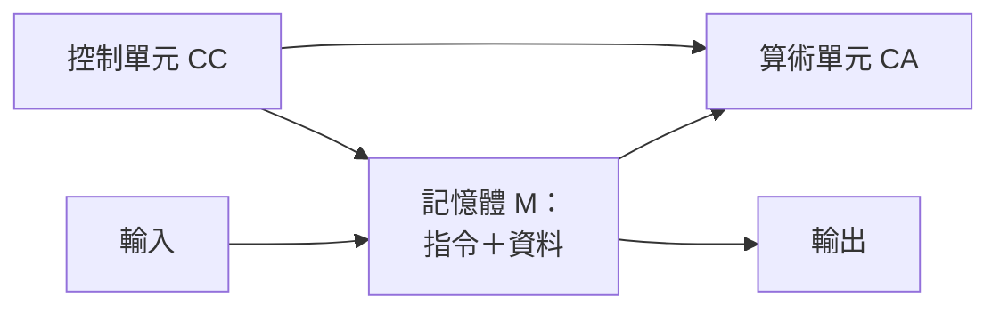
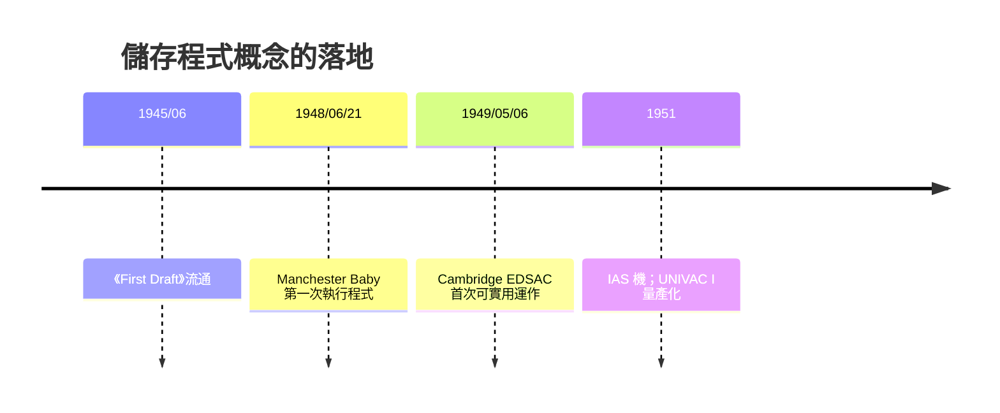

# 04.3 馮紐曼報告草案：程式與數據共存於記憶體

歷史上有時一次偶遇改寫千年。一九四四年八月，一列車停在亞伯丁試驗場（Aberdeen Proving Ground）的月台上，兩位乘客打了照面：一位是彈道研究實驗室的數學官赫爾曼·戈爾德斯坦（Herman Goldstine），一位是普林斯頓高等研究院的匈牙利超凡數學家約翰·馮紐曼（John von Neumann）。戈爾德斯坦引見自己正監造的一台「電子計算機」。史載，馮紐曼一聽立刻從寒暄跳進技術問答的加速器，語速快得像換了一個人；他過去戰爭期間忙於曼哈頓計畫，一個**以電子速度做算術**的機器恰好是他夢寐以求的氫彈與流體力學計算工具。戈爾德斯坦邀他到費城會 ENIAC 團隊。這列命運的信號開啟了本書最中央的一段。

## 一份 101 頁的草稿

一九四五年六月三十日，馮紐曼完成一篇題為《First Draft of a Report on the EDVAC》的手稿——**EDVAC** 是莫爾學院 ENIAC 團隊（Mauchly、Eckert）下一代機的設計書。稿子一百零一頁，以油印本在少數專家間流通。它的貢獻有兩層。

第一層是**工程**：馮紐曼吸收了 Eckert 的**延遲線儲存（delay line, mercury）**想法——水銀管中傳聲波做為記憶體，並把它從補作安排成**架構核心**，提出指令（code）可存放在同一個記憶空間中，與數據並列為「可被讀寫的編碼」。

第二層是**邏輯抽象**——這是他真正的獨門手筆。馮紐曼給 EDVAC 的細胞做的不是「機器描述」，而是**計算機的邏輯解剖圖**，把電腦拆成五個抽象器官：

- **CA**（Central Arithmetical unit）：中央算術／邏輯處理單元
- **CC**（Central Control unit）：中央控制 organ
- **M**（Memory）：記憶體
- **I / O**：輸入與輸出
- 以及記錄語意與資料流動的高階語言

請注意這張圖最關鍵的一件事：**指令與資料共用同一個管子（匯流排）**。這是刻意選擇——因為把一切化為同一種「可被編址的位元」，程式才被當成一個對象（資料），才能被寫、被存、被載入、被修改。這正是 1936 年圖靈「通用機器」概念的物理落地：程式即資料，機器即模擬器。

## 唯一的署名與決裂

但這份草案的代價是**人情**。文件上**只署了馮紐曼一個名字**。它是一份草稿，卻被引用、被翻印、被全世界視為設計之聖經，而結晶了 Mauchly 與 Eckert 二人多年設計（delay line 記憶、儲存程式概念）的關鍵部分，在歷史的書頁上事實上被「借走」。

Moore 學院此後瀰漫低氣壓，一九四六年春，Eckert 與 Mauchly 離開賓大、另立公司（Eckert–Mauchly Computer Corporation，UNIVAC 的前身），美國早期電腦業因此一分為二：「學院派」與「創業派」自此沿著這份報告的兩側走路。馮紐曼本人不否認那是合作的結晶；戈爾德斯坦晚年回憶也承認，報告的書寫至少「位移了兩位元老的署名」。科技史上一再重演的權與名之爭，在這裡以冷卻的友誼結尾。

## 全世界照抄與「馮紐曼瓶頸」

IAS 機在普林斯頓建成（一九五一），**不申請專利、允許自由複製**——這是知識史上少見的「對一切開源的巨製」。它成為其後多國計畫（蘇聯 BESM、IBM 701 等）的母版。但真正的驗證來自英國：

一九四八年的 **Manchester Baby**（英國曼徹斯特大學，Freddie Williams 與 Tom Kilburn）與一九四九年的 **EDSAC**（劍橋，Maurice Wilkes — 曾在一九四六年訓練期間自費來美參加 Moore School 講座、回英後建立劍橋數學實驗室）先後**證明了 stored-program 概念**。英國致的餐（導因於戰時保密解除的人才紅利）反而於工程上先行。歷史在兩條海岸同時完稿，而美軍那台「正式的」 EDVAC 直到一九五一年才完成。

但馮紐曼的架構也留下了一個「自我詛咒」：**CPU 與記憶體之間的單一通道**——指令要去記憶體取、資料也要去記憶體取，兩者不能同時到。這個結構性窄路，被後世稱為**馮紐曼瓶頸（von Neumann bottleneck）**。工程界的祖父級問題——它催生了**哈佛架構**（指令與資料分行，哈佛 Mark I 即此路徑的定名者）、**快取記憶體**（cache，加速器在瓶口前開一道旁路）、分支預測與指令管道（流水）——幾乎成為此後七十年電腦結構演進的主旋律。

## 統一記憶體的文化後果

**程式即資料**這一條設計選項，能量的溢出遠超硬體：正因為程式可以像資料一樣被讀、被修改、被分發，操作系統、編譯器、共享軟體、乃至今日的作業系統與開源運動，全都在這條概念的下游。我們今日下載安裝一個軟體，那個「資源管理器」的生活，是從一份一九四五年油印的、只有一個署名的報告草案裡警官公事化地流出來的。
