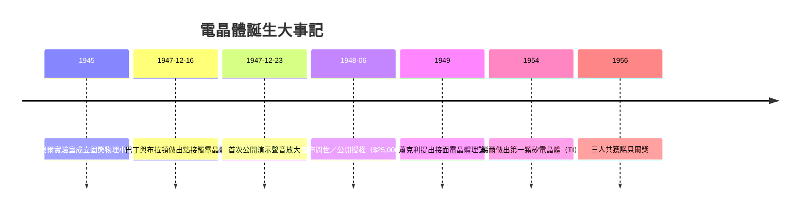

# 貝爾實驗室：電晶體的發明

## 真空管時代的黃昏

要理解電晶體為何誕生在貝爾實驗室，必須先看見一個龐大系統的焦慮。1940 年代的 AT&T 壟斷了全美長途電話網，它的命脈是橫跨大陸的中繼電路，而每一個中繼站裡都塞滿了真空管。真空管有致命的缺陷：玻璃管殼脆弱、燈絲耗電、壽命只有數千小時，故障的接收放大器（repeater）藏在新澤西到加州的鄉野之間，維修人員得逐一排查。貝爾實驗室的研究總監莫爾文・凱利（Mervin Kelly）算過一筆帳：一家用真空管做的電話交換機，其長期維修成本可能高達機器本身的數倍。他因此立下目標——貝爾實驗室必須找到一種「固態放大器」，它的可靠度要像教堂裡的石柱一樣，一放就是幾十年。

凱利的制度設計才是真正的關鍵。他在戰前就網羅了核子物理、量子力學出身的年輕學者，不是要他們修電話，而是要他們「研究物質的基本性質」。這是壟斷企業的奢侈：AT&T 的費率結構允許實驗室從營收中穩定抽成，研究員可以十年不問產出。這種「有產出的純好奇」制度，正是戰後美國企業研究的黃金模式，後來 IBM、奇異都想模仿，卻鮮少成功。

## 三個人的化學反應

1945 年，凱利成立固態物理小組，由三十二歲的威廉・蕭克利（William Shockley）領軍。蕭克利是理論奇才，MIT 出身，戰時做過雷達與反潛研究；他的最初構想是「場效應」——用垂直電場去調制半導體薄層的導電度，概念上接近後世的場效電晶體。他與巴丁（John Bardeen）、布拉頓（Walter Brattain）合作，但實驗一再失敗。

真正的突破來自巴丁。這位沉默寡言的理論家——他是普林斯頓出身、曾跟維格納做過金屬理論的雙棲人才——在反覆失敗後提出嶄新解釋：電子被束縛在半導體表面的「表面態」（surface states）上，把外加電場屏蔽掉了。要穿透這層屏障，得讓電解液或金屬探針與半導體表面之間形成可控的接觸。巴丁與布拉頓在 1947 年 12 月 16 日將一條金箔壓在鍺晶體上，再用刀片小心切出一道縫，形成間距僅約五十微米的雙探針；當時接上五伏特偏壓，輸入端的功率微米級變化便被放大了。這一晚的放大率約為 18，接著他們拉到 40 以上。12 月 23 日，布拉頓在一場正式演示裡用話筒輸入，耳機裡飄出的聲音粗暴刺耳卻真實——這是人類第一次用固體而非真空把訊號放大。

布拉頓是實驗室的「手」：資深、樂天、熱愛動手，年輕時在明尼蘇達的農場長大，喜歡在筆記本上畫圖與寫詩；巴丁是「腦」：內向、數學嚴謹、說話輕聲細語；蕭克利是「理念」。三人的化學反應之所以成立，正是因為三者互補。

## 蕭克利的怒火與接面電晶體

點接觸電晶體成功後，蕭克利的心情很複雜。他意識到自己最初的場效應構想被證明錯誤——原因是表面態屏蔽了電場——而真正的物理洞見來自巴丁。更刺痛他的是：三人外出吃飯慶祝，貝爾實驗室的公關部先把消息洩給報社，卻把蕭克利的名字放在最後；他的上司同事甚至不知道他在場。蕭克利在聖誕假期把自己關在芝加哥的旅館房間（他正要去參加物理學會），連續幾天窮思不解，最後誕生了影響更深遠的設計：**接面電晶體**（junction transistor）。

接面電晶體的概念是讓兩個性質相反的半導體區（n 型與 p 型）形成 p-n-p 或 n-p-n 三明治。電流由「發射極」注入，穿過極薄的基極被「集極」收集，因此不再是脆弱的表面接觸，而是由晶體內部整體控制。這個結構可量產、可預測、性能遠超點接觸版本。1948 年 6 月科學論文發表，1949 年實驗證實；而諷刺的是，巴丁不久便離開貝爾實驗室前往伊利諾大學，去研究後來讓他拿到**第二座諾貝爾獎**的超導理論（BCS 理論）。蕭克利成為三人中最富企圖心的一位——而這份企圖心，將在後來塑造半導體產業，也撕碎它。

## 專利、金錢與矽／鍺的分岔

1948 年 6 月 30 日，貝爾實驗室在紐約舉辦盛大記者會，宣布電晶體問世。為了防範反壟斷審查的批評，AT&T 採取了歷史上罕見的策略：以象徵性的兩萬五千美元授權費，把電晶體專利 pool 授權給所有願意付費的廠商，並在 1952 年舉辦盛大的技術研討會，把製程細節攤開。這個決定看似慷慨，實則戰略高明：電話公司自己不打算生產電晶體，把市場做大（讓數十家廠商競爭降價），反而能買到最便宜的零件；同時也向司法部展示「我們不壟斷」。

1956 年，蕭克利、巴丁、布拉頓三人共同獲得諾貝爾物理學獎。得獎的那個秋天，蕭克利剛剛在加州山景城成立了「蕭克利半導體實驗室」，準備自己創業。同年，德州儀器的戈登・梯爾（Gordon Teal）做出了第一顆**矽**接面電晶體——他在一次學術會議上以一句「多虧各位，我的報告是用矽做的」驚豔全場。梯爾長期主張矽比鍺更具潛力，因為矽可以在攝氏 150 度下工作（鍺只有攝氏 75 度），且氧化層天然形成，鍺則怕水汽。然而鍺製程成熟、良率高，多數廠商不願冒險，藍寶石般的矽工藝還要再等十年才統治產業。

## 制度與思想的雙重遺產

比較 1947 與 1954 的兩條路，會發現電晶體之所以成功，不只是物理，更是**經濟**：一顆真空管要持續耗電幾瓦，電晶體只需毫瓦等級，這意味著交換機、助聽器、日後的收音機成本曲線都會改寫。貝爾實驗室也因此確立了一條「企業諾貝爾獎」的除舊模式——但同時，單一件研究的榮耀在三人內部造成的裂痕，預示了這門產業的另一面：科學榮耀只是開場，商業利益的分配才是真正的主戲。

