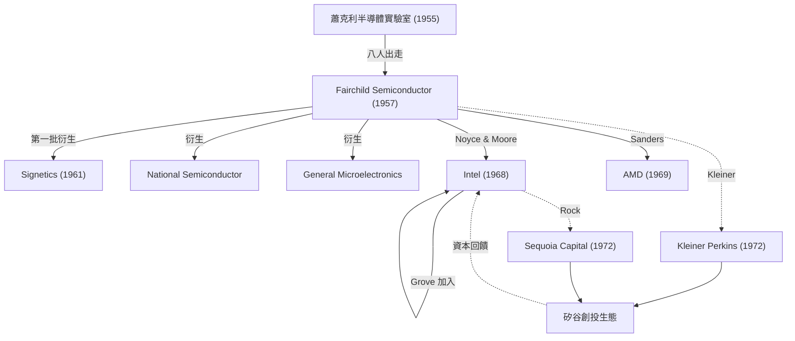
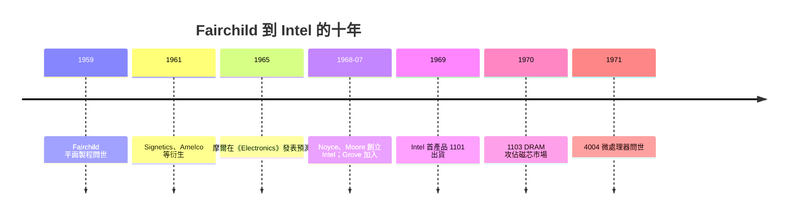

# 仙童孩子們與 Intel 的誕生

## 「做了兩三年，就該出去開公司」

1960 年代的矽谷有句流傳甚廣的話：「在仙童工作到兩、三年，就可以出去自己開公司了。」這句話的前半是讚美，後半是讖語。Fairchild Semiconductor 雖然技術領先，卻受制於母公司在東部的傳統企業文化：獲利要上繳，要跟照相與儀器部門共享預算，創辦人夏曼・費爾柴德與總經理約翰・卡特（John Carter）遠在紐約的長島，山景城的工程師們無法決定自己的錢怎麼花。諾伊斯升任總經理後，風格是煙嗓健談、人緣極佳，卻始終無法從母公司爭取到足夠的資金擴充晶圓廠。

難怪裂解層出不窮。克萊納與惠特尼沃爾克等人先行離開投資創業；1961 年，拉斯特與霍爾尼等另創 Amelco；1961 年，格利尼克與羅伯茨成立 General Microelectronics，用 MOS 技術做計算機晶片。整個 1960 年代中後期，最有代表性的衍生企業包括：

- **Signetics**（1961，保留了工程與市場的先鋒）
- **National Semiconductor**（1959 舊有，1967 被 Fairchild 前員工彼得・斯普魯克整併成半導體巨頭）
- **General Instrument** 與 **Intersil**（霍爾尼二次創業）
- **Advanced Micro Devices（AMD）**（1969，傑瑞・桑德斯）
- **Intel**（1968，諾伊斯與摩爾）

1960 年代末的統計常被引用：從 Fairchild 裡走出的公司超過十數家，多年後追溯記錄稱為「Fairchildren」（仙童孩子們）。這種裂解，和日本公司的終身制恰成對比——矽谷學反倒成了「換公司比換專案還快」，從當初的 8 人開始，一代又一代鍛鍊出既合作又競爭的關係網，技術與人才在高密度的都市網路上無止境傳遞。學者安娜李・薩克森尼安（AnnaLee Saxenian）後來回顧，正是這種崁入式網絡讓波士頓 128 公路落敗。

## 洛克的雛形風投

亞瑟・洛克 1961 年乾脆離開海登・史東，搬到灣區創立自己的投資公司；他後續與湯米・戴維斯、尤金・克萊納（1963 年加入 Fairchild 的克萊納，在 1972 年與比爾・佩里共創 **Kleiner Perkins**）、迪士尼華爾街的唐瓦倫丁（1972 年創 **Sequoia Capital**）一起，建立了後世稱為「VC 生態」的門檻：這是一種以「**股權換資金，資金換人才**」的制度創新，讓科技創業者不必再先靠家族或銀行。洛克的名言「**人比主意值錢**」成為日後風投的信仰。沒有這套制度，仙童的孩子們最多還是工程師，不能成為資本家。

## Intel：只有聽從是可恥的

1968 年 7 月，諾伊斯與摩爾決定離開 Fairchild，自己創辦一家公司。這段歷程有兩個關鍵：第一，戈登・摩爾此時已經觀察到後來被稱為「摩爾定律」的規律，而且**知道自己能靠量產降低價格**；第二，洛克答應為這個計畫找錢，他自嘲是「用 250 萬美元買諾伊斯的名字」。最後 Intel 以 250 萬美元創立，原名「Integrated Electronics」縮寫；安德魯・格羅夫（Andrew Grove）成為第 4 號員工，他是匈牙利裔難民、加州大學柏克萊畢業、Fairchild 的化學製程主管，也是摩爾一路提拔的心腹。

Intel 的第一件產品是 **1101**（1969 年的 256 位靜態記憶體），那是一個失敗之作；隨後 Intel 用 **肖特基 bipolar**與 MOS 技術做了 **1103**（1K bit DRAM，1970 年），以**每 bit 幾分錢**的低價取代磁芯記憶體市場，三年後擁有全球 DRAM 的 80% 訂單。英特爾的第二條產品線由日籍工程師嶋正利與霍夫（Ted Hoff）主導的 **4004** 微處理器（1971）則成為整個時代的起點。

## Intel 的商業邏輯

Intel 的崛起並非偶然工程勝利，而是純粹的經濟學。摩爾視「種種位元成本」為完全可預測的曲線：

$$C_{\text{bit}}(t) \approx C_0\,e^{-kt}$$

只要每年把每 bit 的成本壓到一半、性能抬高一倍，IBM、DEC、Data General 這些主機與迷你機廠商都逃不出「**換掉磁芯、換掉客製化電路**」的命運。Intel 看清了一件事：記憶體是**標準品**，客戶在意的是價格與容量，品牌就得靠最先進製程與一致良率，而這正是 Fairchild 練出來的能力。

這個邏輯也回饋到組織格羅夫「**偏執者生存**」的文化：圖表、週報、嚴厲的會議紀律，都是一種以「把不確定性消滅成表格式數據」為本的規劃手段，他所寫的《High Output Management》仍被今日的 CEO 奉為管理經典。

## 鳳凰與蝴蝶

仙童整體在 1967 年後逐漸被時代淘汰：諾伊斯 1968 年辭去總經理、曾多次要向母公司哭著要錢但無戰果；整個 1960 年代末，仙童合併計畫（被董座漢夫與董事會考量）折衝，最後諾伊斯出走，Lester Hogan 從摩托羅拉被挖角接任，但公司已無心可挽；1979 年仙童被法國油業公司 Schlumberger 收購；1996 年 National Semiconductor 收購主體後，Fairchild 之名雖在 1997 年復出，但早已不是當年的公司。

然而仙童的孩子們改寫了歷史：

仙童就像埃及神話裡的不死鳥，每個羽毛落下的地方都會長出一個產業巨頭；這樣的一代又一代乘者，正是矽谷這個「熱帶雨林」最偉大的社會發明。

## 教育與文化的迴響

還要看到制度面：斯坦福大學特曼推動「榮譽合作計畫」，允許企業工程師在職攻讀碩士，把校園的知識每隔幾年就灌進產業。矽谷的律師、會計師也同時學會了「股權激勵」這種標準化文件。這一切不是設計出來的，而是仙童的裂解與資本制度共同演化。仙童孩子們做的不是一種新技術，而是一種**新經濟法律體制下的新人格**：敢於從大公司出走、敢於向陌生人拿錢、敢於把公司當成可以被淘汰而人所不能淘汰的一種生物。

