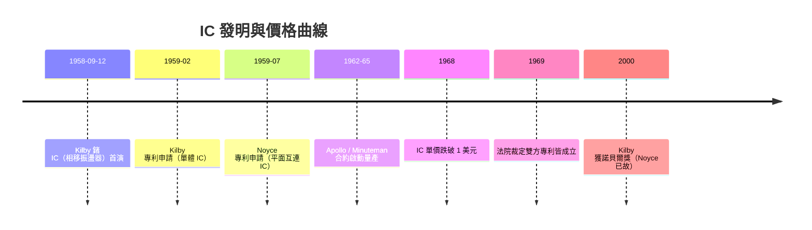

# 基爾比與諾伊斯：積體電路的發明與專利之爭

## 夏天的德州：一個人的沉思

1958 年夏天，德州儀器（Texas Instruments）的傑克・基爾比（Jack Kilby）剛剛入職。他是堪薩斯人、密爾瓦基的馬凱特大學夜間部出身，在 Centralab 做過十幾年工業工程，慢語速、中西部樸實、西裝外總掛著德州侉子風的約會——他自嘲一生的座右銘是「我做的都是沒人要的東西」。TI 規定所有新員工七月下旬到職，八月全員休假兩週，只有基爾比還在試用期不能享受休假。偌大的半導體廠房，只剩他一個人守著示波器。

在那無人的兩週裡，他要解決的是 TI 主管威利斯・阿岱科克（Willis Adcock）交代的難題：軍用的微型化模組（micromodule）之路顯然已經走死——把電阻、電容、真空管一顆顆縮小再拼裝，成本高且不可行。基爾比想通了一個相反的邏輯：**與其拼裝，不如把整個電路做進同一塊半導體裡**。九月初他寫了一段後世引用的話：「所有元件都可以由矽、鍺這類半導體來製作，來回的導線也可以直接蝕刻在同一塊晶體上」——這正是**積體電路**的宣言。

## 9 月 12 日：第一塊 IC

1958 年 9 月 12 日，基爾比在走廊上向主管們演示了他的史上第一塊 IC：一片**鍺**單晶上，把電阻、電容與一個電晶體，用熔融的金線連接成**相移振盪器**（phase-shift oscillator）。示波器上出現一個乾淨的正弦波。雖然這第一顆 IC 上只有五個元件，導線是以手工熔絲連結，但它證明了一件驚人的事：**「電子電路」不必再是分離零件的組合，而可以是晶體的一部分。**

然而鍺製平面製程還不成熟，導線得手工熔接，而且電阻和電容做出來的是阻性與容性不均的品質。基爾比的辦法是把不同元件做成鍺上不同的 corner（不同角落），成本低，但難以量化生產——這就是後來專利與產業路線的根本分歧。

## Noyce 的「連線」革命

同一時間，仙童的羅伯特・諾伊斯也在想同一個問題。他從工程主管的角度看到兩個麻煩：其一，平面製程的電晶體得**逐一在內部連結**，即使用手工熔線連接，產量大時成本與不良率仍然爆衝；其二，執行這個「手織導線」的是的操作工，使品質可控，甚至在晶片表面做氧化後相對容易**蝕刻金屬導線**並把**相鄰電晶體互相連通**。諾伊斯於 1959 年 1 月開始構思，7 月 30 日提交了以平面製程把多個元件集成是一片矽上、以鋁互連的 IC 專利申請案。

諾伊斯的關鍵洞察是：**與人手工焊接不同，互連本身可以在製程中自動完成**。這正是霍爾尼平面製程的天然延伸——把元件做進平面之下的雜質區、把導線做在平面之上的金屬層。Noyce 的方案成本可以隨著光刻精度自動加倍、隨良率批量降低，這是一條**可量產的路線**。基爾比的鍺 IC 則是一個天才式的小田試作，卻無法工業量產。

## 專利戰與「共同發明人」

事情的本質瞬間取決於兩個日期：基爾比 1959 年 2 月申請（claimed 1958-09-12 的實驗記錄），諾伊斯 1959 年 7 月提交（平面互連的 IC）。1960 年代，兩家公司開始專利戰，這場訴訟糾纏了將近十年，牽涉到半導體產業當時所有的許可與授權收入。

最終，1969 年法院裁決：**基爾比享有「單體 IC」概念的「先行」專利，諾伊斯享有「平面互連」的方法專利**——兩者都成立、互相不侵權，而 TI 與 Fairchild 都願意授權給對方與產業。此後大家洩壓地承認：**IC 的發明人是兩個**。經濟學家的理解其實更深刻：IC 之所以能在產業上普及，靠的是**製程的可量產性**，Noyce 的發明在經濟上更為關鍵。而日後的歷史紀念，即使 Kilby 的名字被更多地提到，紐約時報當時也照樣只稱呼 Noyce 一人為「The IC Boss」——這正是專利戰餘波的最微妙的迴響。

2000 年，基爾比因 IC 獲得諾貝爾物理學獎；諾伊斯於 1990 年逝世，按規定不可追授，成為諾獎史上最著名的遺珠之一。基爾比在領獎致詞公開說：若有諾伊斯在座，這份榮耀應該由我們分享。

## 軍備競賽：I.C. 的經濟推手

IC 一開始訂價高得驚人。1961 年 TI 的 Flamingo 系列，一顆 Logic 元件定價 **450 美元**——比電晶體或電阻電容拼裝貴上一百倍。工程師們看著它，只會覺得「這是玩具、是錢坑」。改變這件事的是**政府不是市場**：1961 至 1965 年，IC 的主要買主是美國空軍與 NASA。肯尼迪總統 1961 年承諾登月之後，**阿波羅登月船（Apollo）的導航電腦**便指定以 IC 構建，理由很簡單：在太空船的重量預算與抗輻射可靠性上，只有 IC 能達標。民兵（Minuteman）二型飛彈導引系統也召喚了 TI 的 IC。1962 至 1965 年，阿波羅登月計畫與 IC 的合約使 Fairchild 從售價一百美元降到每單位 **20–25 美元**，1965 年又跌到 **3 美元**，1968 年落到 **1 美元**以下。這不是摩爾定律自動發生，而是**軍費導致的量產**使價格曲線崩落，摩爾也在 1965 年的論文裡統計了類似的現象。

## 摩爾定律與晶片經濟的誕生

摩爾 1965 年的預測——每兩年（最初的說法是每年）晶片上的元件數翻倍——其實是一個「**工程經濟結論**」：光刻與平面製程、清洗化學品、摻雜與退火都有一種**規模報酬遞增**的特性。晶片上能做出越多的元件，單一任務就可以把更多邏輯塞在一片 wafer（圓晶片）上，**每功能的成本下降**。IC 的商業威力因此不是「性能更強那麼一點」，而是**經濟曲線的跨越**——隨著成本下降 IC 必然擠出所有拼裝電路，這即是日後所謂「**晶片化**」（chipification）的開始。諾伊斯的遠見在 1968 年於 Intel 延續：他自己說「IC 使我們可以不再追求拼裝而是追求整體晶片上的多核心架構」，而 VLSI（very-large-scale integration）在 1980 年代完成世界，根源正是這場把「拼裝」改為「一體」的發明。

積體電路的發明，本質上是把「**電路**」這個概念從建築學（走線）轉為**晶體內的物理結構**，也把電子工業的經濟模式從**拼裝業**轉為**製造業**。而這場改變的兩位主角，一個在德州孤獨的夏日沉思，一個在加州熱鬧的走廊討論；他們晚年於很多場合是朋友，也是**共同發明人**這一辭最有意義的證明。
