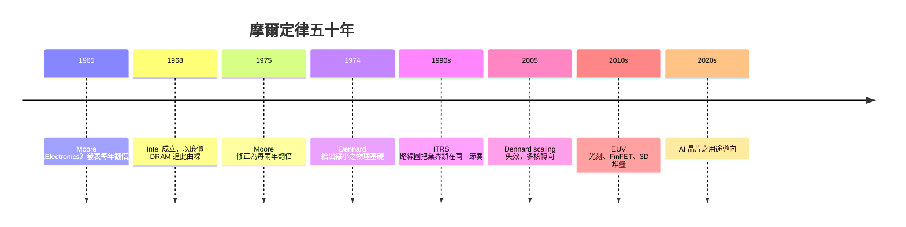
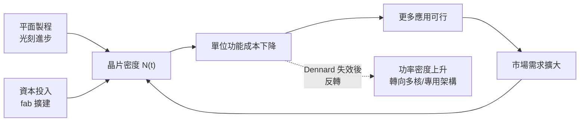

# 摩爾定律：半導體工業的聖經

## 一篇被編輯逼出來的文章

1965 年，《Electronics》雜誌為慶祝創刊 35 週年策劃了一期特輯，編輯請當年 36 歲的戈登・摩爾（Gordon Moore）預測半導體元件未來十年的發展。摩爾弄出了後來被稱為「**摩爾定律**」的觀察：**積體電路上可容納的電晶體數目，約每年翻一倍**；由此推論，未來十年可以把「整整一台電腦的電子電路」壓入一枚指甲大小的晶片上。這不是物理定律，而是一個工程師對**製程進步與成本曲線**的經驗歸納，藏在文章的第五節，一開始並不醒目。

摩爾自己後來屢次澄清兩點：第一，他畫的其實是「**最低成本的元件數**」——若晶片上做出恰好與良率分配最划算的元件數，每年翻倍；第二，這條曲線需要**產業持續投資**才成立，是一種自我實現的協議。後來 1975 年他修正為「每兩年翻一倍」，一般人又摻進來變成了「每 18 個月」，這一版本連摩爾本人都不承認，但已成民間流傳最廣的語言。

## 為何這不是物理定律

摩爾定律的動力來源有三，缺一不可：

1. **平面製程與光刻的規模化**。每代製程改進縮短特徵尺寸（feature size），一片晶圓上可放得下更多晶片（die），每晶片成本隨之下降。1960 年代末，Noyce 已估計這條曲線是：

   $$N(t) = 2^{t/T}$$

   $T$ 約為 1–2 年。
2. **市場要不斷擴大**。使用者對更便宜、更快的需求，支撑了產業持續投資，把**製造量**捲到指數級。若沒有 PC 與後來的行動電話與資料中心，摩爾定律只是一張紙上的曲線。
3. **產業選擇共同追這個目標**。一條路線一旦所有研發資源都押上去，就真的出現。摩爾本人多次說：「不是因為它必然會成立，所以我們照此工程；而是在產業如果把其當成目標，它就真的發生。」

## ITRS：路線圖的誕生與終結

1990 年代，美國半導體產業協會（SIA）與歐、日、韓、臺共推了一套官方路線圖，名為 ITRS（International Technology Roadmap for Semiconductors），每隔兩年列未來 15 年「應達」的節點（node）、導電層數、電壓、掃頻率等規格。這張路線圖的存在把**競爭**變成了一種「共同排程」：臺積電與 Intel 在製程上的你追我趕，其實是隨著路線圖一起跳。而當 2016 年 ITRS 停止更新時，業界許多人說：**摩爾定律正在瓦解**——不是物理不允許再往前，而是多國聯合「共同排程」的方法本身已不再有效。

## 物理的邊界與 Dennard Scaling

要談摩爾定律的天花板，必先談 1974 年 IBM 的羅伯特・鄧納德（Robert Dennard）提出的「**Dennard Scaling**」：在保持電場不變的條件下，尺寸縮小 $\alpha$ 倍，電晶體速度提高 $\alpha$ 倍，而功率密度不變。這解釋了為何 1970–90 年代晶片速度與能源效率得以同時改善。但 2005 年前後，閘極漏電達到基礎物理極限，Dennard Scaling 破產：**功率密度開始上升**。業界隨之轉向**多核**與**特殊化專用架構**（GPU、TPU、ASIC），這一轉向直接孕育了 2010 年代之後的 AI 晶片革命。

## EUV：最後的工程奇蹟

2019 年，ASML 出貨第一批**極紫外光刻**（EUV，波長 13.5 nm）機器。為了產生這個波長，要用雷射每秒五萬次轟擊鎘液滴，把鎘原子電漿化，再收集兩次反射到的光。ASML 每臺機器要價 1.5 億美元以上，高階機種 2024 年已接近 4 億。這一次性的「節點跨越」，把臺積電、三星、Intel 的資本支出都推到單廠 200 億美元量級，其結果是製程節點的**經濟門檻**急速上升：參與先進製程的商業玩家只剩三家，而未來一代的研發一次比一次漫長。3D 結構（FinFET→GAA，2D 到 3D）、晶上堆疊（Moore's Law「1958」）都不是在同一方向的延伸，而是一種**換更昂貴維度**的策略。

## 摩爾定律思想的末路與新革命

2010 年代中後期，摩爾定律已不再保證「每年更便宜」的全面延續，世界在 2020 年代又到一個新趨向：**不是所有需求都滿足這條曲線**。AI 訓練需要 GPU 與專用晶片，IC 設計的重心轉向**架構特異化**——HBM（高頻寬記憶體）、Chiplet 晶片堆疊、系統級封裝與軟硬整合。學界以「**後摩爾時代**」稱之；黃仁勳等業界領袖則常說「**摩爾定律已死**」：性能成長改由平行化、算力密度與系統架構達成，不再依賴元件逐代縮小的統一製程。

## 制度觀點：為何「聖經」是一套管理工具

若把摩爾定律看作**管理制度**，我們可以說它是一種把整個行業鎖在同一節奏上的制度性契約：客户、供應商、設計公司、大學、政府都照此排程，不進則汰，這種「**共同行業速度**」的代價是：一旦任何一家出現短缺或延誤，整體就卡住（2020-2022 年晶片荒就是明證）。但它的收益是：行業所受的指數進步、成本低降、初創公司（NVIDIA／AMD 後繼者，及 NVIDIA 的 NeMo 等公司）可以不斷在此基礎上層層累積，這正是「**為什麼半導體的進步連續性比原子彈更快**」的答案。

摩爾從不宣稱他是物理學家；他始終說，這條曲線是工程上「**人們必須繼續做，因為不做就會被淘汰**」的自證預言。這句話，是半導體工業五十年聖經的總角色所在。
