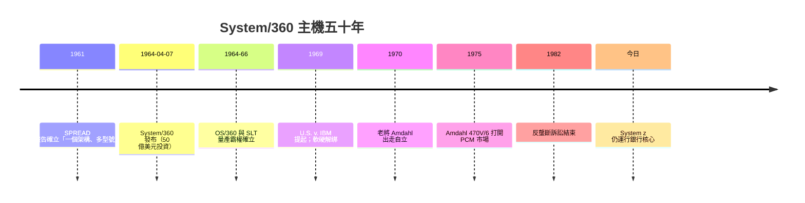

# System/360 大型主機與相容性標準

## 一場五億美元的豪賭

1964 年 4 月 7 日，紐約 Poughkeepsie。IBM 董事長小托馬斯・沃森（Thomas Watson Jr.）在記者會上宣布了一個革命性的產品家族：**System/360**。取「360」這個名字，是寓意它能覆蓋計算機應用的**每一個方位**——從科學計算到商業資料處理。這是商業史上最大膽的單一策略之一：**把 IBM 既有五個互不相容的產品線全部自斷**，推出一整套共享指令集架構（ISA）的家族，由低階 Model 30 到高階 Model 70，客戶買入任一型號，日後升級時**軟體原封不動可用**。

這個方案的投資規模常被引用為**五十億美元**——以當年幣值相當於曼哈頓計畫數倍的民間投資。計畫動用了超過六萬名人力。即使 IBM 年營收僅二十多億美元，這次賭注仍使許多老臣目瞪口呆：把自家五條各不相容的產品線一夜間作廢，客戶的既有機器與軟體投資等於報廢。

## 決策內幕：Watson Jr. 的「FETC」與兩個關鍵人物

戰後 IBM 的政體由湯瑪斯・沃森（Watson Sr.）交棒到小湯瑪斯・沃森與總經理 Vincent Learson。公司內部兩派對峙：一派認為 IBM 憑打卡機與 1400 系列已占逾七成市場，不該賭；另一派則由 SPREAD 小組（Systems Programming, Research, Engineering And Development）於 1961 年提出著名報告：**要中止「家族五分支」的分立，改為「一個架構、多種型號」**。小沃森拍板：全押。

技術決策的核心是**Gene Amdahl**。他負責設計新 ISA，關鍵啟發是：**指令集（ISA）不綁硬件實作**——同一份指令在低階主機上以微碼解釋執行、在高階主機上以高速電路直接執行，語義完全一致。客戶買了低階機，日後換高階機，程式碼原封不動。Amdahl 把「軟體連續性」當作**商業目標而非工程目標**：若不能兼容，客戶每次升級都要重寫程式，那只是把客戶忠誠度掏空的短視方案。

## 工程組織的奇蹟與夢魘：Fred Brooks

專案的軟體部分交給**弗雷德・布魯克斯（Fred Brooks）**管理的 OS/360。他此前是 7030 Stretch 與 8000 系列的主程式設計經理。Brooks 回憶當時他們**人數到一千多，共有數千工程師寫數百萬行程式碼**，但規劃長達五年的系統一路延誤，OS/360 直到最後幾個月才發布，而且第一年 bug 無數。這個經驗催生了布魯克斯的名著《**人月神話**》（The Mythical Man-Month，1975）：開發軟體的投入不是簡單地以人數乘以月份可以線性放大，因為**溝通成本隨人數二次增長**；他還提出「**Adding manpower to a late software project makes it later**」（替延誤的軟體專案增人只會更延）以及「**沒有一個單一開發者犯的錯，是團隊測試有一天會通通找到**」的理解。

Brooks 所讚揚的處理方式，是把軟體視作**一門社會學問題**：一個模組調用者（大 boss）與一組寫模組者（資深）都需一個總架構師，來**設定契約**（API），然後由成員自主完成任務。而 OS/360 之所以最終能部署，是因為 IBM 投入**新制度**：一個「**機能設計**」部門、設計文件每周更版、並由 **專案團隊**（如 Bob Creasy 掌的 Control Program）逐一船對船程式。很多人不知道的是：System/360 的軟體由 IBM **無償**捆綁銷售（因為當時無「軟體產業」的概念），這預見了 1969 年 IBM 正式推出的’unbundling’（解绑）政策。

## 硬件選擇：SLT 與微晶圓

System/360 首發機種使用 IBM 自製的**固態邏輯技術（SLT）**——把多顆電晶體與二極體焊到一片陶瓷小磚上，而捨棄新興的 IC。這是純粹的工程經濟決策：當年 IC 良率低、單價高，SLT 雖落後於 Fairchild 平面技術，卻能立即可靠量產。IBM 因此被稱為「落後尖端，先進量產」；要到 System/370 世代，IBM 才全面轉向單晶片 IC。

## 主機霸權、反壟斷與「Plug-Compatible」殖民族

System/360 的經濟後果立竿見影：1960 年代末，IBM 已占大型機市場七成，整個資料處理產業的科研與就業跟著這一條產品線轉動。**Fortran**（1957，John Backus 主導）與 **COBOL**（1959，Grace Hopper 等人推動的通用商業語言）成為兩大工業語言；資訊技術從工程師的機器房，變成一門**可計算、可管理**的企業系統，也預示了 1970–80 年代「**資訊長**」（CIO）這一職務的出現。

但霸權也招來反壟斷的質疑。1969 年，司法部 **U.S. v. IBM** 依謝爾曼法起訴 IBM 濫用市場支配地位，此案纏訟十三年、動員數百位律師直到 1982 年才撤銷。正是在訴訟陰影下，IBM 於 1969 年宣布 **unbundling**（軟硬解綁），讓「軟體」正式成為獨立產業；對手廠商也得以在相容市場上競爭出場。

## Amdahl 與相容機的誕生

被 IBM 留不住的 Gene Amdahl 於 1970 年創立 **Amdahl Corporation**，1975 年推出 **470V/6**——指令集與 System/370 完全相容、卻更便宜更省電的機器。「相容性」就此從 IBM 的戰略武器，變成挑戰 IBM 的武器。日立、富士通等日本廠商也加入「插拔相容主機」(plug-compatible mainframe, PCM) 市場，這個名詞的存在本身就是 System/360 造成的規範：其他公司不設計自己的指令集，而是去追 IBM 的。

System/360 至今的遺產則最奇特：**IBM 大型主機（System z）今天仍在營運，而且是銀行核心系統的主力**。這是一則有力的制度故事：**相容性自我強化**。因為一整套 COBOL、CICS 資料庫、事務處理系統自 1964 年以來兼容無誤，銀行不換機器的成本永遠高於繼續付 IBM 年費的錢。這叫「**軟體戶形成制度鎖定**」，我們現在每天刷的卡、買賣的股票背後，很可能還是 60 年前那套指令集在跑。

大型主機的故事不只是技術史的一部分，而是**軟體產業、資訊長制度、企業組織與反壟斷監管**在 1960 年代一齊誕生的故事：IBM 賭一個架構，世界便跟著說一種語言。1964 年 Poughkeepsie 的那個春天，不只是一場發布會，而是資訊時代的第一道制度基石。
