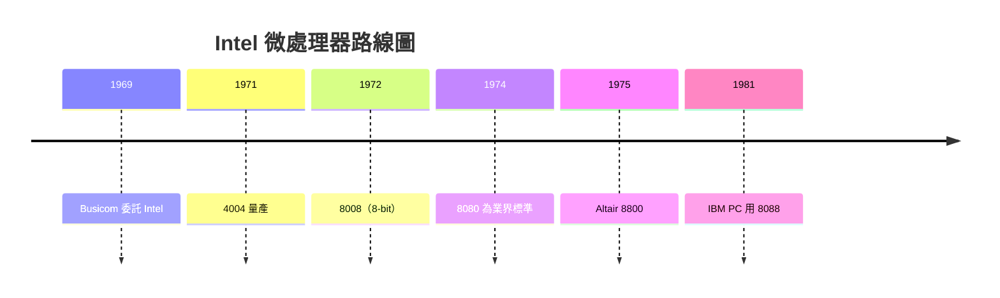

# Intel 4004：把電腦大腦縮進一顆晶片

1969 年春天，東京一家計算機公司 Busicom 的工程師嶋正利（Masatoshi Shima）飛抵加州矽谷，帶著一份委託案：他要 Intel 為 Busicom 的新款計算機設計一套晶片。原案是十二顆各司其職的專用晶片——控制、算術、鍵盤掃描、顯示驅動，一顆釘死一個功能。以當時 Intel 的工具能力，做十二顆不同 mask 的晶片，設計費與工時都很嚇人。

接下這案子的是 Intel 一位心理學背景出身的應用研究經理 Ted Hoff。Hoff 並非晶片設計科班出身，反倒因為「外行」，看問題的角度不一樣。他盯著那十二顆晶片的規格書想：這些功能何必做死在硬體裡？如果做一顆通用的中央處理器（CPU），把掃描鍵盤、驅動顯示這些邏輯寫進外掛的 ROM 程式，讓同一顆晶片靠軟體扮演十二種角色呢？一台真正的電腦，縮進矽晶之中。1971 年一起打天下的 Stan Mazor 加入架構細節的討論，把 Hoff 的粗略構想整理成可執行的指令集規格，兩人與嶋正利反覆討論指令與暫存器的折衷，完成了 4-bit 架構的設計。

這是「把程式當成正交於硬體的一層」的關鍵一步：**可編程性取代專用邏輯**，其思想深度不亞於晶片本身。

好的架構要能變成實物，還需要一個拿得出手的製程。1970 年，Federico Faggin 從 Fairchild 轉到 Intel，帶來他獨創的**矽閘（silicon gate）MOS 技術**——比當時主流的金屬閘速度快、密度高、耗電低，是讓 2,300 顆電晶體塞進一小片矽晶的關鍵。Faggin 是義大利出生的物理學家，親手為 4004 繪製每一層光罩的佈局圖，連續數月每天工作十幾小時。他不只是把別人的圖畫出來，更用矽閘技術解決了原設計裡無法實現的電路難題——4004 能夠誕生，他是從完善設計到確保良品率的第一功臣。1971 年 11 月 15 日，Intel 正式推出 4004：2,300 顆電晶體、時脈約 108 kHz、四比特資料寬度，性能足以驅動一台計算機。

量產時出了戲劇性的商務插曲。Intel 的合約寫明晶片專屬 Busicom——Intel 只是代工者。但 Hoff 與 Faggin 說服創辦人 Robert Noyce：這東西的市場遠不止於計算機。此時 Busicom 因過度擴張陷入經營困難，於 1971 年讓 Intel 以退款交換，收回微處理器的全部商業權利。Noyce 後來稱這是 Intel 撿到的**最大的便宜**——一家公司用六萬美元抵帳，取得了一票技術與市場的先機。

1971 年 11 月的《Electronic News》刊出 Intel 廣告，標題寫著：「帶來微電腦的革命性突破——單晶片的整台電腦（announcing a new era of integrated electronics: Intel's first microcomputer）」。4004 定價以日元計約五萬日元，換算成零件商可接受的價位，很快從計算機走到打字機、信號機、加油站、數字儀表——**通用微處理器**被證明了。

路線接續下去：Datalight 與 Datapoint 與 Computer Terminal Corporation 的合作，催生 8-bit 架構思想；Intel 1972 年推出 8008（3,500 電晶體），1974 年推出 8080（更快、6,000 電晶體，擁有 16-bit 位址空間），成為業界標準。Altair 8800 用的是 8080，Apple I 用的也是 6502（非 Intel），而 IBM PC 用的是 8088——這條血脈一直延續到今天的 x86 市場占有率。微處理器的誕生，先是讓「一台電腦」從**建築**縮到**機櫃**再縮到**桌面**，最終縮進**手掌**。Intel 買到的不只是一顆晶片的版權，而是把馮紐曼機器**商品化**的鑰匙——一件徹底改變工業質變的發明。

> 點睛之筆：Hoff 的洞見不在「做出了一顆晶片」，而在「**同一顆硬體，靠軟體扮演十二種角色**」。這是一場從**硬體定義功能**到**軟體定義功能**的範式轉移，產業史的樞紐之一。
