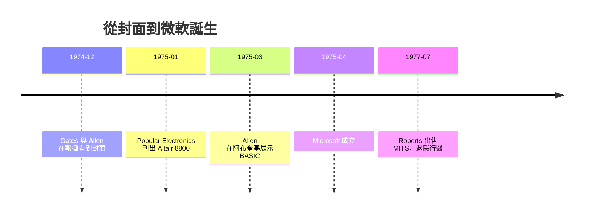

# Altair 8800 與 Popular Electronics 封面

1974 年的美國西南部，新墨西哥州的阿布奎基（Albuquerque）不是科技重鎮，卻醞釀了一場引爆個人電腦時代的爆炸。Ed Roberts——體型魁梧、性情急躁、當過空軍醫療單位電子技師的工程師——經營著一家叫 MITS（Micro Instrumentation and Telemetry Systems）的小公司，原本靠著賣給模型火箭迷的計算器套件維生。積體電路計算器價格崩盤，MITS 背著幾十萬美元債務，瀕臨破產。Roberts 賭上最後一口氣：用 Intel 剛推出的 8080 晶片，做一台**一般人都買得起的電腦**。

他的時機抓得奇準。《Popular Electronics》的主編 Les Solomon 一直在找一台「個人電腦」做封面故事。1975 年 1 月號，Altair 8800 登上封面——這名字是 Solomon 十二歲女兒取的，來自《星際爭霸戰》（Star Trek）裡的一顆行星。售價 397 美元，作為**套件**（kit）出售，你自己動手焊。封面故事刊出後，幾個星期內訂單如雪片飛來，短短幾個月收到數千台訂單，公司原以為能撐幾年的市場，一夜之間被引爆了。

這台機器窮酸得迷人：**沒有鍵盤、沒有螢幕**。輸入靠前面板的一排撥動開關，撥出二進位碼再按下一顆「載入」鍵；輸出靠同一排**紅色 LED 燈號**，燈亮與否代表位元 1 與 0。記憶體 256 bytes 起步。但這正合當時的客群——無線電迷、工程師、高中生駭客，他們不在乎優雅，他們在乎**擁有一台自己的電腦**。那是一個還不存在的市場被一台機器**憑空創造**出來的時刻。

第三個主角在華盛頓州讀高中。Bill Gates 與 Paul Allen 從小一起寫程式，Allen 幾乎把每一期《Popular Electronics》當聖經。1974 年 12 月，兩人在哈佛廣場的 Out of Town News 報攤看到 1975 年 1 月號，Allen 興奮地拿去給 Gates 看：這就是我們的機會。兩人大膽打電話給 Roberts，說已經寫好一套 BASIC 直譯器。事實上他們一行程式都還沒寫——**先接單，再生產**，這也是後來微軟的生意直覺。

接下來八個星期是極限風暴。Gates 在哈佛的宿舍連夜趕工，用 PDP-10 模擬 Intel 8080 的指令集；Allen 負責把程式移植並壓縮進 4K 記憶體。1975 年 3 月，Allen 帶著打洞的紙帶去阿布奎基見 Roberts——上機測試時，程式第一次跑通，印出「MEMORY SIZE?」與「READY」，BASIC 活了。Allen 由此成為 MITS 的軟體總監，Gates 也輟學搬來新墨西哥。兩人於 1975 年 4 月 4 日創立 Microsoft（Micro-Soft，microcomputers + software），**公司名號自此誕生**。而 MITS 的業務模式是：Altair BASIC 先**搭著機器賣**，微軟寄人籬下，直到 1977 年才脫離 MITS，拿回 BASIC 的完整權利。

MITS 自己的結局卻不風光。公司被訂單淹沒，交貨延遲、品質不穩、債台高築；1975 到 1976 年間，Pertec 買下 MITS，Roberts 在 1977 年以約 650 萬美元的價格出售公司，退隱到喬治亞州行醫。Altair 這個名字被記住了，公司卻消失了。Altair 的歷史角色不在於長成一個王朝，而在於**點燃引信**——證明了「每個人一台電腦」不只是幻想，而是可生產、可銷售、可組織成產業的現實。接下來的火種，就在加州溫暖的車庫裡燃開。

> 點睛之筆：Altair 8800 兩個扉頁的主角，各自代表了兩種**不同的革命路徑**——Roberts 賭的是「硬體民主化」，Gates 賭的是「**軟體是產品**」。Altair 贏了引信，微軟贏了火藥。
