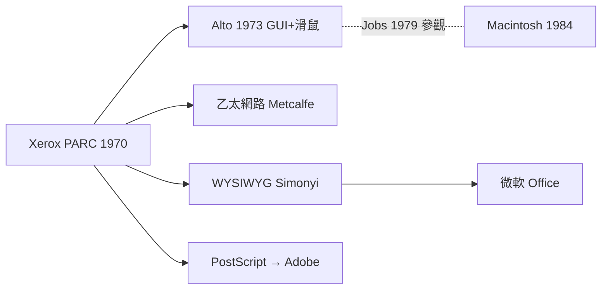

# Xerox PARC：滑鼠 GUI 與乙太網路的遺產

1970 年，全美最大的影印機公司施樂（Xerox）在紐約州羅徹斯特做得如日中天，卻害怕一件事：這世界正在從「紙」走向「數位」。創辦人 Peter McColough 於是在加州帕洛阿圖成立了 Palo Alto Research Center（PARC），刻意離總部三千公里遠，招一批最聰明、最想造反的電腦科學家，「去發明知識工作者的終端機」。第一任主任是從 Berkeley 來的 Robert Taylor——這位曾主掌 ARPA IPTO 的學者，把 ARPANET 社群的自由風氣整個搬進了 PARC。

PARC 最瘋狂的夢想來自 Alan Kay。這位學生物轉數學、當過空軍程序員的幻想家，在 1968 年構思了 **Dynabook**：一台小孩也能拿、重量像一本書的攜帶式電腦，用它**畫畫、作曲、模擬**，而不只是算數。「電腦應是**人人可用的媒介**，不是中央機關的官僚機器。」為了驗證這個概念，PARC 在 1973 年打造出 **Alto**：全世界第一台具有**位元映射顯示（bit-mapped display）**的工作站——螢幕上每一個像素都可以用軟體畫出來，視窗、圖示、**重疊的文件**取代了冷冰冰的文字列。配合**滑鼠**驅動游標，一種前所未見的介面誕生了：**圖形使用者介面（GUI）**。

滑鼠其實早了幾年。1968 年 12 月 9 日，Douglas Engelbart 在舊金山舉行的「所有示範之母」演示中，首次向世界展示了滑鼠、超文字、視訊會議與線上協作。他的木殼三鍵滑鼠——底下一對滾輪——被 PARC 的團隊接手，改良成光學感測的版本，配合 Alto 成為標準配備。Engelbart 想的是「**增強人類智慧**」，Kay 想的是「孩子的創作環境」，PARC 把兩者熔成一種全新的**互動哲學**。

PARC 的發明不止於此。Robert Metcalfe 的 **乙太網路**，讓一百台 Alto 可以在辦公室裡互相傳送檔案與電子郵件；Chuck Geschke 與 John Warnock 開發的頁面描述語言，後來演變成 **PostScript**，兩人於 1982 年離開 PARC 創立 **Adobe**，把「印出來和螢幕上一模一樣」變成可能，徹底改寫了出版業。Charles Simonyi 寫的 **Bravo** 文字編輯器，是世界上第一個 **WYSIWYG**（所見即所得）編輯器——你在螢幕上看到的粗體，印出來就是粗體。Simonyi 日後被微軟挖去，帶 Word 與整個 Office 的血脈。

最著名的一幕發生在 1979 年秋天。Xerox 當時剛投資蘋果一輪（一百萬美元取得部分股權），史考特與 Jobs 等人被帶進 PARC 參觀。Larry Tesler 示範了 Alto 上的 Smalltalk 環境：視窗、圖示、下拉選單、滑鼠操作。賈伯斯盯著螢幕，整個人在一分鍾內像是被雷打到——「你們坐擁**一座金山**，可是你們都不知道？」他立刻明白：這就是個人電腦的**未來**。PARC 的研究員 Bill Atkinson 被蘋果挖角不久，親眼見證了這段**技術與商業的驚人錯位**：擁有技術的公司看到了價值卻**無法行動**（大公司的組織免疫系統拒絕它），沒有技術的小公司看到了**馬上可以把價值商業化**的路徑。這段故事後來被 Jobs 濃縮成一句他自己的名言（其-original 來自畢卡索）：

> **「Good artists copy, great artists steal.（好的藝術家模仿，偉大的藝術家偷竊。）」**

他的意思不是拿走表面樣式，而是**偷走整個想法的靈魂**，並把它做到極致。Apple 在 1980 年推出的 Lisa（原 Kay 想反映的 Kay 的「體面」office工作站）與 1984 年 Macintosh，證明了語義上的對錯。

> 點睛之筆：PARC 的悲劇不在發明失敗，而在**組織的立場錯位**——一家影印機公司（紙本經濟的帝國）造出了數位時代的鑰匙，卻守著舊產業的政治與利潤結構無法兌現。技術可以被「偷」，但**眼光與決斷**無法被偷——那是 Jobs 真正帶走的東西。
