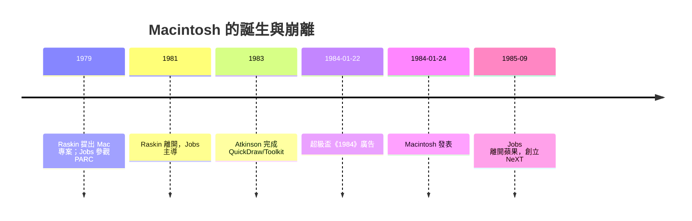

# 1984 年 Macintosh 與超級盃廣告

1984 年 1 月 22 日，第三屆超級盃中場，紐約巨人隊對奧克蘭突擊者的比賽中斷，電視畫面切進一段六十秒的廣告：一支灰藍色調的隊伍，一排**光頭的奴隸**在昏暗的大廳盯著螢幕上「Big Brother」訓話的臉；一個穿著紅色短褲的侵犯者女孩，**拿著鐵鎚奔跑**、回身擲出——大螢幕轟然爆碎，播音員的聲音：

> 「1 月 24 日，蘋果電腦公司將推出 Macintosh，你會明白為什麼 1984 年不會像《1984》。」

這支廣告由 Ridley Scott 執導（《異形》《銀翼殺手》的導演），Chiat/Day 廣告公司出品，製作費約九十萬美元、購買時段一百萬美元上下，Jobs 主導了整個創意過程。原始構想來自文案 Steve Hayden 與藝術指導 Brent Thomas。蘋果董事會看片時嚇壞了，一度想撤單，Jobs 與 Wozniak（當時意見一致）把時段保住。這支廣告在《1984》喬治·奧威爾「老大哥」的意象上，把自己的敵人設定為 IBM——那是當時統治企業電腦世界的巨無霸。美國三大電視網當晚反覆播放這支廣告的新聞片段，**免費的二次曝光**達成了廣告史上傳播效率最高的案例之一，徹底改寫了**科技品牌營銷的文法**：電腦不只是工具，是**抗暴的文化符碼**。

兩天後，1984 年 1 月 24 日，De Anza 學院的股東大會上，Jobs 從一個帆布袋裡拉出 Macintosh，接上電源，開機後螢幕上自動畫出圖形、字體旋轉，接著**內建的合成語音**播放：

> 「Hello, I'm Macintosh. It sure is great to get out of that bag.」

全場起立鼓掌。這一幕與超級盃廣告相加，構成 PC 史上最戲劇化的產品誕生。

Macintosh 的血脈比acute廣告更早。專案的原始推手是 **Jef Raskin**——蘋果在 1979 年招聘的電腦科學家，他早在 1979 年就構想一台**「人人買得起的電腦」（$1,000 上下）**，以他的蘋果品種 Macintosh 命名。Raskin 主張**低成本、以使用者為中心**的簡潔機器，並把 Andy Hertzfeld、Bill Atkinson、Burrell Smith 等天才招進團隊。但賈伯斯在 1979 年底參觀 Xerox PARC 之後，看到 GUI 的可能性，逐漸把 Macintosh 拉向「**Lisa 的簡化版**」，且在 1981 年 Raskin 與 Jobs 激烈衝突後被迫離開專案。Atkinson 開發的 **QuickDraw** 圖形引擎、Pull-down menus、選區與 **Macintosh Toolkit**，加上 Hertzfeld 寫出的 Finder 與 ROM，鋪出了 Mac 的軟體基礎。Susan Kare 畫出 Chicago 字體、垃圾桶、笑臉——**Mac 的臉**等於被她一個人畫了出來。

Mac 的成功與失敗同時上演。1984 年售出 27 萬台，可是在 1985 年，**沒有硬碟、記憶體不足、軟體生態不夠**的困難暴露無遺；Jobs 與 CEO John Sculley 的權力鬥爭在 1985 年 4 月公開化，Jobs 試圖發動「政變」把 Sculley 踢走，結果董事會站在 Sculley 一邊，5 月 31 日 Jobs 被解除一切營運職權，9 月黯然**離開蘋果**，帶著幾名員工創立 NeXT。他事後接受了採訪，說被自己一手創辦的公司踢出是「人生最大的打擊」，但也是他後來做出 Pixar 與重返蘋果的關鍵轉折。Wozniak 早在 1985 年就已離開（1981 年的墜機事故後他已淡出管理），Sculley 從百事可樂挖來的營銷MBA，把 Apple 做到了營收成長，卻沒能撐起技術的方向盤——在他手上，蘋果在 1980 年代後半依舊高成長與** High-end 高價路線**無法惠及平價市場，開放性的 Mac 陣營被 IBM 陣營的相容機大軍逐步蠶食，一直到 Jobs 1997 回歸才有轉機。

> 點睛之筆：Macintosh 是**技術預言的超前兌現**——GUI 十年後才成為主流（Windows 95 才真正把 GUI 推上大眾市場）。Mac 證明了**設計與人文可以嫁接工程**；但它的失敗部分也證明了：**好的介面，還不夠；要有開放的生態與時機**。Jobs 的名言在這裡最準確：領先一個時代的人，會先付上時代的代價。
