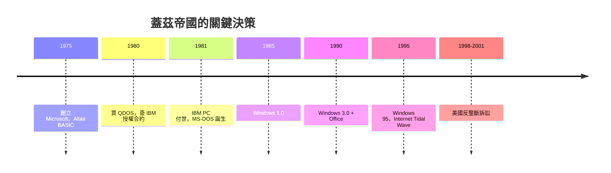

# 比爾蓋茲的軟體帝國：DOS 與 Windows

比爾·蓋茲（Bill Gates）1955 年生於西雅圖一個律師家庭，就讀私立湖濱學校時就接觸到分時終端機，與 Paul Allen 為第一台微型電腦寫 BASIC。他進了哈佛，1975 年讀到《Popular Electronics》的 Altair 封面故事，便與 Allen 狂寫 Altair BASIC，隔年輟學搬到新墨西哥，於 1975 年創立 Microsoft。Gates 從一開始就確立一個**前無古人的商業信條**：**軟體本身是有價的商品**——不是附贈品、不是免費服務。他 1976 年那封〈致業餘愛好者的公開信〉怒斥盜版，就是在為這個信條開路。

1980 年，命運的大門打開。IBM 進軍個人電腦，為了趕上蘋果的氣勢，IBM 選擇不關起門做、而是靠外購，並到佛羅里達博卡拉頓之外**向外採購**作業系統。IBM 先找 Digital Research 的 Gary Kildall（CP/M 的作者），Kildall 開出條件苛刻、談判一場雞同鴨講，IBM 轉而找 Microsoft。Gates 手上根本沒有作業系統，但他答應了，然後做了 PC 史上最關鍵的一步棋：回頭找到 Seattle Computer Products 的 Tim Paterson，以約 **75,000 美元**買下其 **86-DOS（原名 QDOS，「Quick and Dirty Operating System」，CP/M 的仿製版）**，並把它改寫磋磨成 **MS-DOS**。IBM PC 於 1981 年 8 月發表，搭載 PC-DOS（微軟授權給 IBM 的版本）。

真正的殺手鐧不在 DOS 本身，而在**授權結構**。Gates 與 IBM 的合約寫的是：**授權、不賣斷**；Microsoft 保有將 MS-DOS 授權給**其他任何廠商**的權利。IBM 当时認為硬體才是賺錢的東西，作業系統只是附屬品——這成了 20 世紀商業史上最昂貴的**誤判**。後 IBM 允許相容機（clones）爆發，Compaq 及幾十家廠商都得向微軟買 MS-DOS 授權，**每一台 PC 都付一筆授權費**。微軟的商業模式由此定型：**不做電腦，做所有電腦的地產之主**。軟體第一次成為**可複製、可按台收租的資產**。

1985 年 11 月，Microsoft 推出 **Windows 1.0**——一個套在 DOS 之上的圖形殼層，介面仍舊樸拙。Gates 當時已看過蘋果的 Macintosh（他與 Jobs 曾有摩擦，Jobs 認為 Windows 是抄的），但 Gates 的戰略是**不押單點、押市場規模**：不做最優雅的系統，做**相容機世界的共同語言**。1990 年 5 月的 **Windows 3.0** 是轉折點——配合 Intel 386 的硬體，圖形介面大眾化，PC 陣營首次在易用性上與 Mac 相抗；微軟並在 1990 年推出 Microsoft **Office**（Word、Excel、PowerPoint 綑飾），把 **Lotus 1-2-3** 與 WordPerfect 從主流寶座上擊落，軟體的**平台鎖定**（文件格式相容）成了企業市場的黏合劑。1995 年 8 月 24 日，**Windows 95** 上市，首日銷售、午夜排隊、滾石樂團《Start Me Up》的廣告曲，全球電視台直播——一個**作業系統的發售**成為世界級新聞，這在人類歷史上前所未有。

但時代在變。1990 年代中期網際網路爆發，Gates 一度低估 Netscape 瀏覽器的威脅，1995 年 5 月他著名的「**Internet Tidal Wave**」備忘錄急轉航向，微軟傾全力打造 IE、與 Netscape 打瀏覽器大戰，甚至將 IE **捆綁**進 Windows。這招殺傷了 Netscape，卻惹來美國司法部：1998 年聯邦對微軟提起**反壟斷訴訟**，指其**濫用 Windows 壟斷地位**打壓競爭者。2000 年 4 月，法官 Jackson 一審判決下令拆分微軟；上訴法院 2001 年推翻拆分，但肯定了壟斷濫用的認定，微軟最後以**和解**（承諾行為性修正）收場。這場訴訟揭示了 Gates 模式的完整邏輯與代價——**平台統治者的終點，往往就是反壟斷法**。

> 點睛之筆：Gates 真正的發明不是任何一行程式，而是一種**資產結構**——把軟體從「硬體的附屬物」變成**可以反複授權收費的主權商品**。軟體由此成為 20 世紀末的新資本。IBM 出租了自己的王座，微軟收下了天下。
