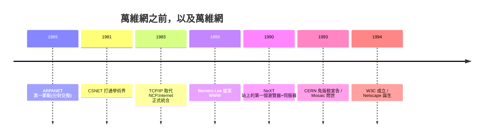

# 伯納斯-李與 CERN：HTTP 與萬維網的無償贈予

## 生於電腦世家的英國工程師

Tim Berners-Lee（提姆・伯納斯-李）1955 年生於倫敦，他的父母 Conway Berners-Lee 與 Mary Lee Woods 都是第一批電腦工程師——兩人在曼徹斯特參與了 Ferranti Mark I 的開發與程式工作，那是世界上第一部量產的商用電腦。可以說，伯納斯-李是在「電腦可以改變世界」的家庭信念中長大的：他曾回憶，小時候餐桌上聊的就是數學與工程。他後來在牛津攻讀物理，畢業後一度因私用電腦被禁止使用實驗室電腦，卻也因此自己動手焊接出一台 Z80 微電腦。這段經歷透露了他一生的性格：在正規制度之外，動手繞過限制。

## ENQUIRE：1980 年的私人心智地圖

1980 年，伯納斯-李以顧問身分到 CERN（歐洲核子研究組織）工作半年。CERN 當時有上萬名科學家與工程師，人員流動頻繁，一個人離職，他腦中的知識就隨之消失。伯納斯-李寫了一個小程式 ENQUIRE（取名自他童年讀過的維多利亞時代百科全書 *Enquire Within upon Everything*），用心智地圖的方式記錄人、軟體與設備之間的連結。這已經埋下了「資訊以連結方式組織」的核心思想，但 ENQUIRE 只能單機使用，他沒有繼續深究——十八年後回頭看，這正是萬維網在個人精神中的第一次「試車」。

## 1989 年的提案：從「找不到」的困境到「都能連」的願景

十年的時間裡，超文字（hypertext）技術已經存在（如 Apple 的 HyperCard、以及可上溯 Vannevar Bush 1945 年 Memex 的理想），但各系統互不相通，且超文字研究圈熱衷於封閉式商業系統。1989 年 3 月，已在 CERN 固定工作的伯納斯-李寫下《資訊管理：一項提案》，想解決 CERN 內部檔案資訊散亂的問題。他主管 Mike Sendall 在報告上用鉛筆寫下傳奇批註：「含糊但令人興奮（Vague, but exciting……）。」這張紙條成了萬維網的出生證明——Sendall 本人在 1990 年初就去世了，未能看到成果；而 CERN 為什麼會孕育出開放系統，也和它的機構文化有關：一個由 20 多個歐洲國家共同出資、必須向全世界學術界服務的科學機構，天然就有「資源要共享」的制度傳統。

伯納斯-李的洞見不同於以往超文字系統之處有三：**連結可以直接指到網路上任何機器上的任何文件**（以 Universal Resource Identifier，URL/URI 指定）、**協定簡單**（HTTP）、**排版語言極簡**（HTML，只定義語義標籤不規定外觀）。1990 年 10 月，他與系統工程師 Robert Cailliau 合作重寫提案、爭取資源；11 月，第一台 NeXT 工作站到位。12 月，他在自己桌上寫出了世界上第一個瀏覽器與第一個 HTTP 伺服器——萬維網誕生了。當時部門並不重視，名字不好聽也無妨；Cailliau 後來意識到，這提案在內部競爭經費時被人打了低分，最後靠 CERN 其他部門贊助兩萬法郎才勉強續命。

## 1993 年 CERN 的免費宣告：一個改變世界的制度決定

1991 年 8 月，萬維網在 Usenet 新聞群組 alt.hypertext 上公開，NCSA 等單位開始下載程式碼。但到了 1993 年，競爭者是明尼蘇達大學的 Gopher——它有強迫授權收費的政策。1993 年 4 月 30 日，CERN 法律單位正式宣布：**萬維網協議與程式碼以開放授權釋出，永久免版稅（royalty-free）、任何人可用於任何用途**。幾個月後，NCSA 發布了帶圖形的 Mosaic 瀏覽器，萬維網起飛，Gopher 在兩年內消失。

這是一個不經意的世紀性制度決定。伯納斯-李後來說，如果 CERN 當年堅持收費，互聯網的發展可能延宕數年，或分裂成五、六個互不相通的「網中之網」。1993 年 CERN 決定把協議規格移交給 IETF（國際標準組織），1994 年伯納斯-李離開 CERN，受 MIT 邀請創立 W3C（World Wide Web Consortium）——他頑固地堅持「網頁」不應成為任何一個公司的獨占品，而應該屬於全體使用者，W3C 就是為了讓瀏覽器廠商、使用者、研究員可以平等地共同制定標準而設計的中立機構。

## 接力與迴響

萬維網的命名也有故事：The World Wide Web 本來是 CERN 第二版本中「The Project」的名稱，因原專案名「Mesh」被嫌太抽象而換成 WWW，縮寫比「原域名」還好念，於是沿用至今。1991 年 8 月，伯納斯-李在 alt.hypertext 上發布公開啟事，他寫道：「這個專案結合了資訊檢索與超文字，試著讓世界上任何可以上網的地方，都可以讀寫共通的資訊。」並附上第一個網站資訊頁，這個頁面是舊時代最好的墓誌銘，也是新時代的出生登記。

伯納斯-李沒有從萬維網上賺到一分錢專利，卻因此在 2016 年獲頒 ACM 圖靈獎，表彰其「發明萬維網、第一個瀏覽器，以及使網路得以擴展的基本協議與演算法」。一個制度的決定（免費），加上三件簡單的技術（HTTP、HTML、URL），讓知識的公共性第一次成為全球基礎設施——這是工程少數直接創造制度史的時刻。
