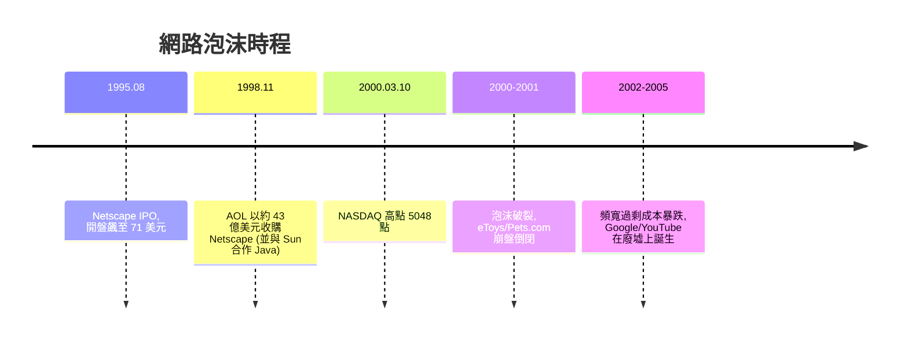

# Netscape 與 dot-com 泡沫狂潮

## Mosaic：伊利諾大學宿舍裡的「殺手級應用」

1993 年，伊利諾大學 NCSA 的 Marc Andreessen（馬克・安德森）與 Eric Bina 寫出了 Mosaic——第一個把圖片與文字放在同一個視窗、並在 Unix/PC/Mac 三平台上發布的圖形化瀏覽器。Andreessen 當時只是個打工的本科生，人格特質是速度至上與任何阻礙都要繞過；Bina 則是不眠不休的編碼快手。Mosaic 一釋出就爆炸：原本 Internet 是學術圈的工具，但 Mosaic 讓一般電腦用戶點兩下就能遨遊全球，更關鍵的是美國政府自 1992 年起的「全國資訊基礎建設（NII）」政策與 NSFNET 主幹網開放商用（1991-1995），大學生從校園宿舍第一批學會上網，畢業後把習慣帶入社會——教育佔有率先行的借力，讓瀏覽器在 1994 年輕易達到臨界大眾。

## Jim Clark 何許人也：第二次創業的老將

1994 年，Silicon Graphics（SGI）創辦人 Jim Clark 決定離開自己一手創立的公司——他厭倦了董事會的官僚與利潤率下滑，想找「一件可以快速跑起來的大事」。他看到 Mosaic 的威力，聯絡了畢業後已搬去加州的 Andreessen。兩人在一間小公寓裡成立 Mosaic Communications Corp（同年 11 月改名 Netscape 公司），以極快的速度從頭重寫一個瀏覽器（因為 NCSA 的程式碼不屬於他們），並加了 SSL 加密——這是改變歷史的一步：**信用卡號可以安全地在網路上傳送了**，電子商務從此才有可能。

Netscape Navigator 於 1994 年 12 月上線，策略是把完整版免費送給教育單位與個人（事後付費的「共享軟體」模式實際上很少人付），企業版收費。這是 Andreessen 學自傳播理論的行銷：先是教育市場免費灌萬級用戶，再快速升級。一年半內，Netscape 在瀏覽器市場拿下約八成市占，公司從零衝到市值二十多億美元——人類商業史上從未有過的火箭速度。Netscape 下一步在 1995 年發布 JavaScript（Brendan Eich 十天寫出的原型，本名 Mocha，後改 LiveScript，再因搭上 Java 聲勢而定名），讓網頁第一次有了程式邏輯——瀏覽器開始有取代作業系統的野心，這正是蓋茲視為「地盤之戰」而全力回擊的原因。

## 1995 年 8 月 9 日：沒有獲利也能 IPO

1995 年 8 月 9 日，Netscape 以每股 28 美元 IPO，原定發行價 14 美元在前一晚被投資銀行改為 28 美元，開盤即跳到 71 美元，當日市值突破 29 億美元——而公司一年虧損數百萬美元、尚未獲利。這一事件成為 dot-com 時代的心理起點：**投資人願意為「成長與概念」付錢，而不是為獲利**。Yahoo（1996 年 IPO，第一天漲 154%）、Amazon、eBay 陸續登場；到了 1998-2000 年，已經有人提出「眼球經濟」「黏著度」取代「本益比」的估值理論，eToys 與 Pets.com（賣寵物用品的網站，吉祥物是一隻會說話的襪子布偶狗）先後上市，然後用募來的資金以低於進貨成本「燒錢補貼」搶客戶——Pets.com 在超級盃打的廣告比雜貨銷售額還貴。

## 泡沫破裂與真實遺產

1998 年 11 月，AOL 以約 42 億美元收購 Netscape——收購本身就是泡沫年代的雙面鏡：Netscape 尚未獲利，卻已被炒作的巨頭以天文數字買下。Microsoft IE 免費綑綁 Windows 的瀏覽器大戰引發了反托拉斯案（US v. Microsoft, 1998），這是網路政治性的最高峰：1999 年地方法院判決 Microsoft 違法壟斷、一度要拆解公司，2001 年上訴法院變更判決、雙方和解，而 Netscape 已經陣亡。歷史的殘忍與仁慈在此交會：Netscape 之死促成了 Mozilla 基金會（2003 年）的誕生，開放原始碼的 Firefox 成為網景精神的真正繼承人。

2000 年 3 月 10 日 NASDAQ 衝上 5,048 點後崩跌，兩年內市值蒸發約五兆美元，Pets.com 在 2000 年 11 月關閉，1980 年代個人電腦產業的教訓驚人地重演。但泡沫留下了三項驚人的真實遺產：第一，電信公司與創投在 1997-2001 年推動鋪設了數千萬公里的光纖，其中大部分成為無人使用的「暗光纖」，泡沫破裂後以極低價出售，使頻寬成本下滑一個數量級，Google 與 YouTube 這種「塞爆頻寬沒關係」的商業模式才是可行的；第二，矽谷文化落定：選擇權（stock options）當薪水、快速募資、極速開發（「即錯即改」debug by shipping）成為常態資本主義的一支新品種；第三，AOL 在網景身上取下的 Java/JavaScript 開發能量，最後流入了開源界——Marc Andreessen 精神不滅，他在泡沫後站起來，成為現代創投 a16z 的共同創辦人。

網際網路的歷史告訴我們：投機性的狂潮確實驅動了基礎設施的過度建設（多到「浪費」，如 19 世紀的英國鐵路狂熱），而「浪費」在十年後被重新定義為「公共財」。制度上的另一關鍵，是美國聯邦電信委員會 1996 年《電信法》向資本開放網路與數據服務市場，讓光纖與 ISP 業者可以在競爭中鋪開，後來 Google、Amazon、eBay 得以自由成長，都必須追到這個供給驅動的環節。
