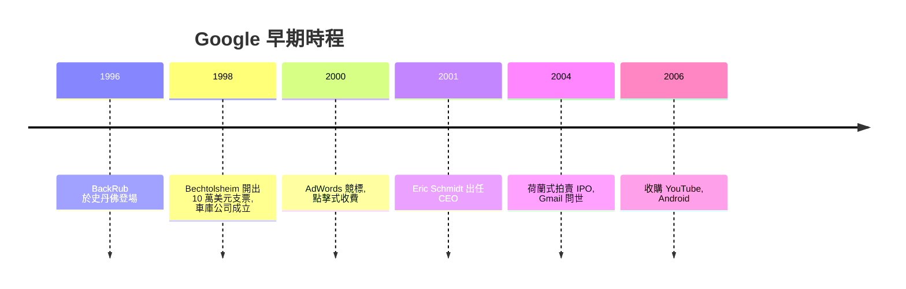

# Google：佩吉與布林的搜尋演算法

## 史丹佛宿舍的 BackRub

1995 年春天，密西根大學畢業的 Sergey Brin（謝爾蓋・布林，蘇聯移民之子，數學小神童）負責帶新入學的博士生 Larry Page（賴瑞・佩吉）參觀校園。兩人一見面就吵了整個週末，卻從此成為事業夥伴——他們後來都說，這種「在爭論中檢驗想法」的關係正是 Google 的文化基石。

1996 年，Page 選了 Terry Winograd 當指導教授，研究主題出乎意料地「無聊」：網頁之間的連結結構，觀察有哪些連結指向哪些頁面。這卻成為史上最值錢的博士題目。Page 洞察到：**一個網頁的重要性，可以由「誰連結它」來衡量**，正如學術論文的引用次數——他從科學引用分析（Science Citation Index 的啟發）中直接得到靈感。他和 Brin 在宿舍寫出一個爬遍全網的爬蟲 BackRub（以「back links」得名），並提出 PageRank：

$$\mathrm{PR}(A) = (1-d) + d\sum_{i} \frac{\mathrm{PR}(T_i)}{C(T_i)}$$

其中 $T_i$ 是所有連結到 $A$ 的頁面，$C(T_i)$ 是 $T_i$ 的出連結數，$d\approx 0.85$ 是阻尼因子。這個公式在數學上等價於一個馬爾可夫鏈（每個使用者隨機點連結、偶爾跳到隨機頁面）的平穩分布——整個網路的權威度和，正是隨機衝浪者在穩態下會站上每頁的機率。這是「以數學支撐資訊檢索」的典範轉移：Yahoo 的人工編輯目錄 vs. Google 的演算法排序，兩種資訊制度的競爭在此定局。1998 年，兩人將論文《大型超文字網頁搜尋引擎的分析》發表，自此奠定了現代網頁搜尋的理論基礎。

## 100,000 美元的支票：一張還不存在的公司抬頭

1998 年夏天，兩人決定休學創業（他們曾考慮把技術賣給 AltaVista 或 Excite，都被嫌「會損害公司廣告收益」而拒絕——在位者的教科書教訓：他們眼中的格局裝不下即將翻天的下一代技術）。Sun Microsystems 的共同創辦人 Andy Bechtolsheim 聽完十分鐘簡報就打斷：「與其討論細節，我用最簡單的方式直接投。」他開出一張 10 萬美元的支票，抬頭寫著「Google Inc.——**而這家公司當時還沒成立**」。兩人只好拿著支票先去建立公司。1998 年 9 月，Google Inc. 在 Menlo Park 的車庫正式註冊（房東是 Susan Wojcicki，她的妹妹 Anne 嫁給了 Brin；她本人日後成為 YouTube 執行長）。Brin 用便宜的二手硬體自組爬蟲伺服器，並設計出彩色拼寫 logo——「Google」正是「googol」（10 的 100 次方）的故意錯拼，宣示要處理天文數字般的網頁。

## 商業模式：拍賣式廣告與「不作惡」

好的演算法不等於能賺錢。Google 先是賣技術給網站（license 模式，收入微薄），並想過授權給入口網站，都走不通。轉捩點是 2000 年 10 月的 AdWords：**依點擊而付費（cost-per-click）、廣告位置靠競標而非出價最高者獨拿**（多付費者得；Google 更升級為位置由「出價×點擊率」共同決定，因此相關度不夠的廣告點擊率會下降）。這個設計保證了兩件事：廣告主按效果付費，以及搜尋結果與廣告**分開排序、不受金錢污染**——對比之下，當時的搜尋網站 Overture 曾有「付費排名混入搜尋結果」的醜聞。

「不作惡（Don't be evil）」在 2000-2001 年被寫進公司行為準則，背後是 Google 自身的利益：搜尋引擎的資本就是使用者信任，若結果可被買賣將摧毀商業模式。但佩吉與布林的「工程師至上」與投資人所要求的營運紀律之間張力漸大：2001 年 8 月，董事會（由 John Doerr、Michael Moritz 主導）請來 Sun 的元老 Eric Schmidt 擔任 CEO，佩吉讓出執行長位置、專注產品，Schmidt 負責資本與管理制度，「工程師文化＋財務紀律」的雙軌平衡就此制度化。

## IPO 與生態：網路經濟的基礎設施

2004 年 8 月 19 日，Google 以少見的荷蘭式拍賣上市，每股 85 美元，市值超過 230 億美元，募資 17 億美元——上市說明書裡洋洋灑灑寫著「不作惡」與長期主義，連華爾街都覺得傲慢。那一年 Gmail（1GB 免費信箱，愚人節發布）問世，隨後 Google Maps（2005）、Android 收購（2005）、YouTube 收購（2006）——Google 從搜尋擴張成資訊經濟的基礎設施。

度過樓起樓塌的網際網路泡沫之後，Google 成為一個矛盾的存在：它既是開放資訊的最大企業——Net Neutrality（網路中立）的提倡者、開源軟體的大金主（Chrome、Android、TensorFlow 皆開源或免費）——也是被歐盟 GDPR（2018）與《數位市場法》盯上的被規範者。PageRank 的數學把「連結即投票」寫進了人類文明的資訊結構，但同時它催生了 SEO 產業與注意力經濟的扭曲行為——當「重要性」可以演算，就有人學會演算「重要性」。搜尋，本身就是 21 世紀最重要的「數位制度」：誰定義「重要」，誰就定義了現實；而 Google 從宿舍演算法到處理全球數十億次每日查詢的工程系統，正是這條數學—經濟—制度鏈條最完整的一次示範。
