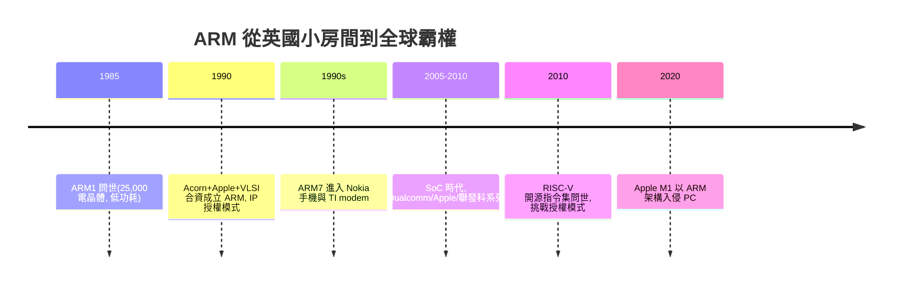

# ARM 架構與行動晶片崛起

## 劍橋小房間裡的省電設計

1970 年代末，英國劍橋的 Acorn Computers 靠 BBC Micro（英國廣播公司推動的教學電腦）賺到第一桶金，工程師 Sophie Wilson 與 Steve Furber 決定自研 CPU。他們的性格是典型的英國式節儉：Wilson 負責指令集與原始韌體（她早在 1981 年就寫出 BBC Micro 的 6502 軟體環境），Furber 負責硬體架構。1983-85 年，兩人在 Acorn 大樓的一間小房間裡設計了 ARM1（Acorn RISC Machine），採用 RISC（精簡指令集）理念：指令等長、多數指令單週期完成、3 級流水線。

關鍵的設計約束居然是「省電也省錢」：他們手上沒有先進晶圓廠資源，只能用簡單的 CMOS 製程，並以極簡設計把電晶體數壓到最低（ARM1 約 25,000 個電晶體，同年 Intel 80386 是 27.5 萬個）。他們甚至做了一顆沒有塑膠封裝、純粹為了驗證時序的裸晶。後來證明，這個**因陋就簡的低功耗，反而變成了最大的優勢**——低功耗意味著可以用電池跑，意味著可以塞進手機。

## Apple 來敲門：1990 年的三方合資

1988-89 年，Apple 想為其手寫輸入的 Newton PDA 找一顆低功耗晶片，試過各種方案都不滿意，遂找上 Acorn 的 ARM 團隊。1990 年 11 月，Acorn、Apple 與晶片廠 VLSI Technology 合資成立 Advanced RISC Machines（ARM），Apple 持股約 43%（以 Newton 專案資金入股），Acorn 約 43%，VLSI 約 10%，Robin Saxby 出任 CEO。Newton 本身在 1993 年上市後失敗，但 Apple 此後每一代產品（從 iPod 到 iPhone 到 Mac）都採用 ARM 架構晶片，對 Apple 而言，這筆投資是史上少數「失敗產品孕育出偉大資產」的例子。

Saxby 做出了決定 ARM 命運的制度選擇：ARM 不自己製造晶片，而是**把處理器核心（IP 設計圖）授權給任何想做的公司，收取授權費（license fee）與量產版稅（royalty）**。這個「IP 授權模式」在當時看來近乎自殺——一個只有十幾個員工的公司，如何與 Intel 這樣的巨頭競爭？但站在今天回望，它恰恰是這個制度的偉大之處。Saxby 的本領在於說服：他帶著一台裝 ARM 晶片的木殼原型機全球奔波客戶，把「人人可授權」變成 ARM 的核心制度資產：

1. **基礎設施化**：任何一家新創公司都可以付一筆授權費，拿到經過教戰的矽驗證的處理器，然後加上自家的設計；
2. **平台經濟**：越多公司用，工具鏈（compiler、debugger）、軟體庫與人才池就越豐富，這是網路效果的雙邊市場；
3. **中性中立**：ARM 不是競爭者的敵人，而是所有競爭者的供應商——不像 Intel，你永遠不會幫 Intel 培養出自己的對手。

## 手機革命中的霸權轉移

1990 年代，ARM7 把晶片帶入 Nokia 3210 等暢銷手機；德州儀器、Qualcomm 等廠商的 modem 晶片也內嵌 ARM 核心。2005 年後，手機主板上以 SoC（System on a Chip，系統單晶片）的形式整合 CPU、GPU、modem、影像處理：Qualcomm Snapdragon（ARM 架構＋自研或授權核心）、Apple A 系列（2008 年收購 P.A. Semi，2010 年推出 A4）、聯發科（MediaTek）以「turn-key 轉鑰匙」方案把功能手機與智慧手機的入門成本壓到極低，中國與非洲的智慧手機普及因此加速。ARM 已累計出貨超過三千億顆晶片，成為世界上最重要但大眾最不認識的公司。

## RISC 的第二回合：x86 被迫轉型 vs M1 的 PC 入侵

RISC 與 CISC 的競爭早有第一回合：1990 年代的 Alpha、MIPS、PowerPC 曾試圖取代 x86 的 PC 霸權，都輸在 Windows 與軟體生態（文化與制度的鎖定，比架構優劣更決定勝負）。第二回合則從行動端側翼包抄：ARM 的生態靠手機累積了數千億顆晶片的規模與軟體相容。2020 年 11 月，Apple 推出 M1——蘋果自研的 ARM 架構晶片，以 5nm 製程、統一記憶體架構與驚人的效能功耗比，讓無風扇的 MacBook Air 跑贏同期 Intel 機器。這是 PC 晶片霸權第一次在「效能領先」的維度上被非 x86 架構突破，Intel 也被迫走向「大小核混合架構」（其實 x86 的微指令內部早已是 RISC 式執行，只是外部 ISA 沿用已久）。

ARM 於 2016 年被日本軟銀以 320 億美元收購（孫正義的物聯網豪賭），NVIDIA 曾嘗試併購但因各國反托拉斯審查告吹，ARM 最後於 2023 年在英國上市（今仍屬軟銀控股）——這正好證明 ARM 的中立地位已成地緣政治資產。「ARM 架構授權」的制度設計，讓一個 1985 年從英國小房間誕生的精簡指令集，成為數百億部行動裝置的沉默統治者；而 RISC-V 開源指令集在 2010 年後的崛起，正是要在這個授權制度之外再下一次制度實驗——用不收費的方式再次改寫遊戲規則。
