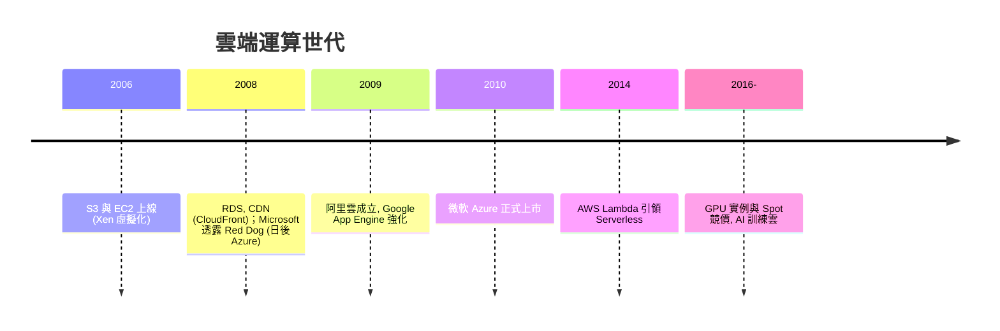

# AWS 與雲端運算：算力如水電

## Bezos 的 API 聖旨：從書店長成基礎設施公司

2002 年前後，貝佐斯（Jeff Bezos）向全公司下達一道著名的命令：內部所有團隊必須把自己擁有的資料與功能**以介面（API）的方式開放出來**，任何功能不透過介面就不能被別的團隊呼叫，抗命者直接解僱。他的邏輯冷酷而清晰：這是他在一次高層會議上以「API Mandate」之名頒布的規則——「組織不要彼此餵食，要如同對外服務般彼此供應，這樣才能在未來的某天，把任何一項內部能力直接變成對外的生意。」

這個制度決定，是雲端運算史的第一步。Amazon 自己就是這個制度的受益者：2003 年，基建團隊（Chris Pinkham 與 Benjamin Black）撰寫的內部報告指出，公司的基礎設施為了聖誕節尖峰購物潮而建造，一年中的大部分時間閒置——何不把這些容量賣出去？2004-05 年，Pinkham 回到南非，遠距帶隊以開源的 Xen 虛擬機器技術開發 EC2 原型。貝佐斯支持這個專案時懷抱的，正是多年來的願景：**像水電一樣，把運算能力變成隨開隨用的公共事業（utility computing）**——這個想法可以追溯到 Sun 的口號 The Network is the Computer，以及 Nicholas Carr 後來在《The Big Switch》中著名的「資訊公用事業」比喻。

## S3 與 EC2：2006 年的兩聲開幕槍

2006 年 3 月，Amazon S3（Simple Storage Service）上線，以每 GB 每月 0.15 美元的價格賣出儲存，按使用量計費，沒有最低消費。8 月，EC2（Elastic Compute Cloud）上線，開發者可以租一小顆虛擬機器，按小時計價，隨開隨關。這個定價策略背後是 Amazon 的「既有資產變現」思維：把尖峰採購的機器轉為可出售的容量，把「過剩」變成「商品」。2006 年雲端的第一批客戶是獨立開發者與新創公司，例如 Animoto 的影片服務一度以每天數萬美元的速度燒 EC2，短短九天就從 5,000 用戶暴增到 25 萬用戶——只有無限彈性的雲才接得住這種成長。

## 多可用區、Lambda 與後續追趕者

AWS 逐年從單純的 EC2 變成一片森林：RDS（代管資料庫）、CloudFront（內容分發）、Glacier（冷儲存）等。2007-08 年的 VPC（Virtual Private Cloud）與多可用區（Availability Zone, AZ）設計，把基礎設施做成「區域（region）內多個互相獨立的資料中心群」，可用性因此被制度化——一個 AZ 斷電，服務自動切換；跨區域冗餘成為雲端高可用經濟的底層。2014 年 re:Invent 大會發表的 Lambda 是另一道分水嶺：**開發者不再租機器，只上傳函式，按呼叫次數付費**——這就是 Serverless。基礎設施的計費單位從「一台機器、一小時」細化為「一次函式執行、幾毫秒」，資本支出被徹底打散成消費支出。

## 追趕者與中國雲

Microsoft 的雲端並非最早，卻走得穩：2008 年它在 PDC 宣布 Red Dog 專案（後稱 Windows Azure，2010 年正式上市，由 Ray Ozzie——擺脫了蓋茲退休前夕的 PC 中心路線——推動），以平台即服務（PaaS）為賣點，成為今天的 Azure。Google 在企業市場起步較晚，但以 BigQuery、GKE（2013 年的容器即服務）等技術逐漸站穩；中國的追趕者則有自己的故事：2009 年，阿里巴巴讓心理學教授出身、非電腦科班的王堅主持阿里雲，在內部「被公司拋棄」的質疑聲中，用飛天系統打造出中國自主的雲端技術。2013 年飛天 5K 架構成功，阿里雲成為中國雲市占第一。這是技術史少見的「非科班出身者主導國家級基礎設施」的案例。

## 資本財、主權雲與 AI 時代的樞紐

雲端從一開始就政治化：歐盟 GDPR（2018）要求歐洲人的資料留在歐洲，AWS 便推出歐洲主權雲專案，德、法政府也推動 Gaia-X 與本地雲計畫，以「**主權雲**」回應——資料管轄權成為雲端的制度性壁壘，這與 AWS 為美國政府提供 GovCloud 政府雲是同一枚銅板的兩面。經濟上，雲端把「資本支出（capex）」轉為「營運支出（opex）」，使新創公司不必先買機房，這是全球創業成本結構的一次永久性下移；從 opex 到運營者，雲端也把 IT 部門的工作從採購變成效能治理。

今天，雲端已不只是「賣機器」，更是資訊經濟的發動機：AI 訓練需要數萬片 GPU（如 H100）連成叢集，只有雲商能以百億美元級資本支出建得起的算力水庫；而 EC2 的 Spot 競價實例（以低價買斷被回收的閒置算力）成為科研與小型 AI 訓練的重要資源。回頭看，貝佐斯 2002 年那道「API 聖旨」，把一家網路書店變成了全球資訊經濟的中央發電廠。這提醒我們：**制度的設計（一紙內部命令）有時比技術本身更能改變世界**。
