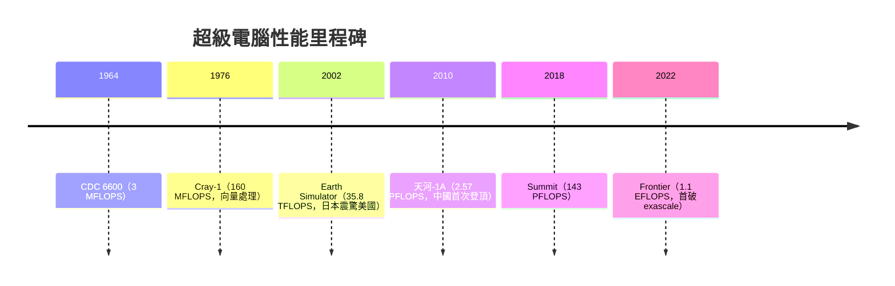

# 11.1 從 Cray-1 到 Frontier：超級電腦算力巔峰

一九六四年，Seymour Cray 在明尼蘇達州奇佩瓦瀑布的控制資料公司（CDC）實驗室裡，完成了 CDC 6600。這部機器以三百萬次每秒的運算速度，比當時最快的 IBM 7030「Stretch」快三倍以上。IBM 創辦人 Thomas Watson Jr. 在內部備忘錄中寫下一段流傳後世的話：CDC 的四人團隊竟能擊敗擁有數千人的 IBM，顯示小團隊在尖端工程中的爆發力。Cray 的性格由此奠定——他終生遠離總部、偏執於訊號傳輸長度、親手焊接原型機，認為「開會是工程師的毒藥」。

一九七六年推出的 Cray-1 是超算史的分水嶺。它以 80 MHz 時脈達到約 160 MFLOPS，最重要的創新是向量暫存器與向量指令：一條指令即可對八十六個六十四位元數據的向量做運算，列表式處理讓 Fortran 編譯器得以做向量最佳化。Cray 為了縮短訊號路徑，把機櫃彎成著名的馬蹄形（C 形），並以氟化冷卻液直接冷卻電路板，白色圓潤的座椅式控制台即使今日看來仍像太空船。挪威的科學家以 Cray 的向量思想（源自 CDC Star-100 與德州儀器的 ASC）發展 Pipeline 思潮，美國國家實驗室（洛斯阿拉莫斯首購 Cray-1，價格高達八百八十萬美元，相當於今日數千萬美元）成為忠實客戶，核武維護是超算最初、也是最隱密的推手。

一九八〇年代，日本入侵了這座堡壘。NEC SX-2、富士通 VP200 以向量性能與價格優勢威脅 Cray，美國甚至以「超級電腦貿易摩擦」為由，在一九八〇年代末限制 Supercomputers 進口，MIT 的報告與通產省(MITI)的「第五代電腦計畫」共同掀起了美日科技戰的第一波。二〇〇二年，日本地球模擬中心（Earth Simulator）以 NEC SX-6 叢集達 35.86 TFLOPS，是第二名 (ASCI White) 的近五倍，震撼美國科學界——「日本超算重新把美國打醒了」成為當年 HPC 圈的口號，直接促成美國加速推動 Teraflop 之後的十年路線圖。

二〇一〇年十一月，中國國防科大天河-1A 以 2.57 PFLOPS 居 TOP500 榜首，是美國首次失去第一名，媒體大做「美國算力讓位」的文章。二〇一二年橡樹嶺國家實驗室的 Titan（GPU 加速架構，Cray XK7 附 NVIDIA Kepler）奪回王座；二〇一三年天河二號連莊數年；二〇一八年 SUMMIT（IBM Power9 + NVIDIA Volta，在橡樹嶺）以 143 PFLOPS 再奪回。二〇二二年五月，橡樹嶺的 Frontier 正式突破 exascale——HPL 達 1.102 EFLOPS，換言之，一百京（百億億）次每秒。這也是人類第一次讓單一系統的浮點運算達到「exa」字首的紀錄。摩爾定律放緩的背景下，「百京」的達成不是靠單晶片時脈，而是數萬個 AMD EPYC CPU 加上 Instinct GPU，配合水冷與高速互連（Slingshot），並首次在超算層級實踐「異構運算」的規模化。

評測體系的演進同樣是制度史。一九九三年起 Hans Meber 創立 TOP500 榜單，以 Linpack HPL 為基準；但 HPL 偏好稠密線性代數，離實際應用遠，二〇一三年後學界推動 HPCG、Graph500 補足記憶體與圖計算面向；Green500 則以每瓦 GFLOPS 排行，將「能效」制度化——一屆 Frontier 排 TOP500 第一，Green500 上卻可能不敵日本的拓荒者。能耗不是抽象議題：百京機年耗電以千萬度計，電價與碳預算開始直接影響國家超算的設計，這正是科技與經濟、政治的交點。

超算的應用史也值得回望。氣象（ECMWF 的模式可見度）、核武 stockpile stewardship（美國停止實彈核試後，維護核武庫全靠模擬，這是國會願意每年撥數十億美元的真正原因）、藥物篩選、氣候模式（IPCC 報告背後的 CMIP 系列皆在超算上完成）；到二〇二〇年代，大型語言模型訓練成了新的算力黑洞——Frontier 曾短暫被用於 LLM 訓練測試，而微軟與 OpenAI 的 Azure 叢集將「超算」與「AI 基礎建設」合流，HPC 與 AI 的邊界逐漸消融。

NVIDIA 2006 年推出 CUDA 開發者生態系，Jensen Huang 以「一個免費工具換取整個產業的心智佔有率」的商業洞察，把 GPU 從遊戲帶入科學計算，這個決策在十五年後成為 AI 時代的護城河。二〇一九年起，美國商務部把超算與 AI 晶片納入對中國的出口管制；二〇二二、二〇二三年兩輪管制將高端 GPU 與 exascale 系統列入清單，中國則以華為昇騰等國產替代回應。算力，已與石油、晶圓同列為地緣政治的核心資源。從 Cray 造一台機器追求「快一點」的個人英雄主義，到國家級 exascale 與百億參數模型的算力競賽，超算的六十年，是一部工程極限、經濟規模與政治意志互相驅動的縮影——下一節，我們把鏡頭轉向晶片的物理極限，看摩爾定律的黃昏如何催生量子時代的黎明。
