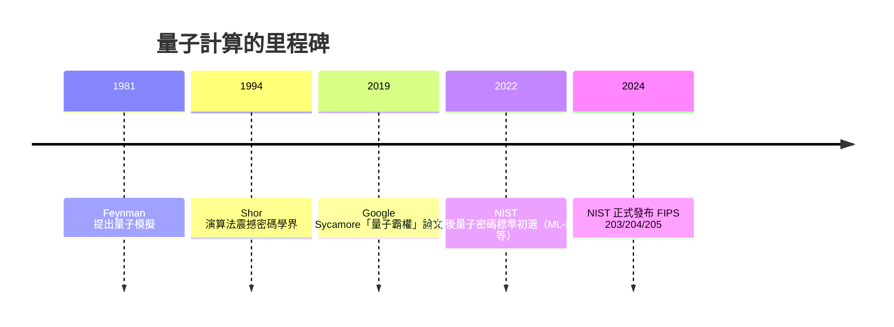

# 11.2 量子霸權與後摩爾定律時代

半導體的黃金時代有其內在的煞車。Dennard scaling——這個 1974 年由 IBM 的 Robert Dennard 等人提出的法則指出，電晶體縮小時，功率密度可以保持不變——在 2005 年前後正式終止：漏電流無法再隨尺寸縮小而下降，時脈因此卡在 3-4 GHz，「免費的頻率午餐」吃完，業界被迫轉向多核心。接著是「功率牆」與「暗矽」（dark silicon）問題：晶片面積足夠塞下更多電晶體，卻沒有足夠的電力與散熱讓它們同時運作。光刻則從 193 奈米浸潤式一再延展，極紫外光（EUV）由 ASML 自 1990 年代美國國家實驗室計畫接手研發，2019 年商用化時，一台機器報價超過一億五千萬美元，僅有台積電、三星、英特爾少數買家。摩爾定律並未「死亡」，但它從自然的饋贈變成了企業與政府每月數十億美元的意志工程。

在這樣的背景下，量子計算從哲學奇想變成國家級議程。1981 年 MIT 的「物理與計算」會議上，Richard Feynman 提出問題：模擬量子系統需要指數級資源的古典電腦，「如果我們造一部量子力學的機器呢？因為大自然不是古典的，天殺的，如果你想要模擬大自然，你最好把它做成量子力學的。」這句話開啟了一個新領域。真正讓軍方與情報系統坐立難安的是 1994 年 Bell 實驗室的 Peter Shor：他的質因數分解演算法證明，量子電腦可在多項式時間內破解 RSA——當今網際網路的密碼學地基。1996 年 Grover 搜尋演算法、量子糾錯閾值定理相繼問世，後者證明只要錯誤率低於某臨界值，用許多物理 qubit 糾錯出少數邏輯 qubit 是可行的——這把量子計算從「不可實現」重新定義為「昂責」。

qubit 的本質是物理學的多黨競賽：超導（IBM、Google，以約瑟夫森結在毫開爾文低溫下操作，速度快、可整合但退相干快）、離子阱（IonQ、霍尼韋爾與輾轉而來的 Quantinuum，品質高但速度慢）、光子（中國「九章」）、中性原子（QuEra、Harvard 的 Lukin 團隊）。2019 年 10 月，Google 團隊在《Nature》發表「Quantum Supremacy using a programmable superconducting processor」：53 個 qubit 的 Sycamore 晶片，做隨機電路取樣，宣稱十分鐘的工作需要 Summit 超算一萬年。IBM 立刻反擊：如果善用 Summit 的磁碟與最佳化演算法，同一問題兩天半可完成——「量子霸權」頂多是「量子優勢」，且隨機電路取樣在實際科學中用途有限。這場爭議本身極具意義：它逼使整個領域承認，基準測試（benchmark）在量子時代也必須如 HPL 對超算一樣被制度化；而超算與量子電腦的「混合作業」從此成為研發的路線。2023 年，中國的中科大潘建偉團隊另一路上，九光子（計算複雜度）也在推進，中國的 Quantum Exascale 國家議程、美國 2018 年 National Quantum Initiative Act（十六億美元）競相立法，量子成了國家工程。

制度面的回應以 NIST 為戰場。2016 年起，NIST 發起「後量子密碼學標準化」全球徵件，2022 年 7 月公布入選名單，2024 年 8 月正式發布 FIPS 203（ML-KEM，源自 CRYSTALS-Kyber）、FIPS 204（ML-DSA）、FIPS 205（SLH-DSA），背後數學從「因數分解難」轉為「格密碼學」。各國政府開始強制「crypto-agility」——密碼學必須可以像軟體一樣升級，因為情報單位已有「harvest now, decrypt later」（先存密文，等量子機出來再解）的戰略。密碼學從數學家福利會議的事，變成企業資安長的合規焦慮，這是典型的「科技—制度」聯動。

與此同時，後摩爾時代有三條「非馮紐曼」的明線。第一是類腦晶片（neuromorphic）：IBM TrueNorth 2014（百萬等效神經元）、Intel Loihi，以事件驅動、稀疏運算換取極致能效，模擬生物神經的脈衝式運算。第二是光子計算：Lightmatter、Lightelligence 以光為訊號做矩陣乘法，因為 AI 推論本質上是線性代數，光可並行、低損耗——「用光的干涉機做矩陣乘法」，被視為 AI 推晶片的一派新解。第三是 EDA 的智能化：Synopsys 的 DSO.ai 等工具用強化學習搜尋晶片布局，AlphaChip 的論文（Google DeepMind 2021）將 RL 套在 TPU 的 placement，雖曾掀起同儕審查風波，卻開啟了「AI 設計晶片、晶片再訓練 AI」的迴圈。

資本與政策的角度看，2022 年 8 月美國簽署「CHIPS and Science Act」，撥 527 億美元補助在美設廠（Intel 亞利桑那、TSMC 奧勒岡/亞利桑那、三星德州），同時出口管制切斷中國取得 EUV 與高端 GPU 的管道；歐盟推出 European Chips Act；日本以「經濟安全保障推進法」補助 Rapidus 做先進邏輯。台積電在 2020 年代成為「全球最被不了解的公司」——它掌握 90% 先進邏輯製程，使台海成為半導體的糾纏中心。這一切都反映了同一個時代精神：當物理極限逼近，創新不再是實驗室裡的個人，而是重工業式的資本、法律與同盟。Feynman 的問題得到的不只是一台量子機，而是一整套以物理極限為前提的全球產業重組。下節，我們把十億台電腦接成一顆「全球大腦」，回到這個物種對運算的終極想像。
