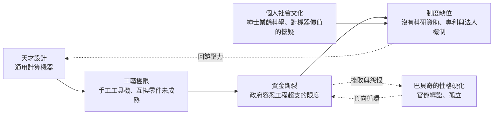

# 齒輪與打孔卡片的悲劇試煉

## 失敗是一種制度現象

巴貝奇的差分機與解析機器沒有建成，常被講成「時代的悲劇」，但真正的悲劇原因不止一項。它的失敗是由設計、工藝、資金、制度四種力量串聯成的一道斷鏈——只要任何一環扣得住，歷史可能改寫；而四環同時斷裂，便注定一個世紀的空白。

## 工藝：精度即是金錢

十九世紀三、四十年代，英國處於工具機革命的清晨。莫茲利（Henry Maudslay）的螺旋車床、惠特沃斯（Joseph Whitworth）的量規正把公差推向萬分之一英寸，但「互換零件」仍是軍械廠裡的稀有技藝。巴貝奇要求的零件精度遠超常規商用：數千枚齒輪、凸輪、軸心，每枚都須手磨而能互換。他的工匠克萊門特確實造出了驚人精度的成品——那具局部差分機至今能運轉——但每一步精度都以時間與金錢的指數級代價購得。工程超出手工時代的邊界時，超支不是管理問題，而是時代的不可能。

## 資金：財政部的容忍曲線

英國政府在 1823 年起陸續投入約一萬七千鎊——這在當時是罕見的「國家研發」，政府也沒有先例可循。它的期望很樸素：投入一筆錢，換回一台可用的製表機。但巴貝奇的野心像地質活動般不斷抬升：先從差分機一號轉向解析機器，精度標準一再上調。對一個沒有「科研」概念的財政部而言，這是無底洞；對一位視精度為科學尊嚴的發明家而言，這是時代良心。雙方的容忍曲線永不相交，裂口在 1833 年（克萊門特停工）顯形，1842 年（格萊斯頓正式終止）結痂。

## 制度：還沒有「研發」這個詞

更深的病因在制度。新生的工業資本的邏輯是「可販賣的產品」，而巴貝奇的機器沒有明確的市場買家——他的客戶是政府、保險局與天文台，都是官僚；英國的科學仍靠紳士的閒錢與私人恩庇，皇家學會不會組織大工程；專利制度保護單件發明，卻無法為一個持續二十年的系統工程融資。大陸那種理工學院（如巴黎綜合理工）支撐工程人才有系統養成的管道，英國還在萌芽。於是整個社會沒有任何一個機構——公司、大學、學會、政府部門——能夠「接住」這個世紀性的專案。這不是巴貝奇個人的失敗，而是十九世紀英國還不具備承載他野心的制度骨架。

## 文化：對「機器智能」的不信任

那時英國還瀰漫著一種道德焦慮：機器會不會搶走人的工作？盧德運動的記憶仍新鮮。一台「能取代人類計算員、能取代排字工」的機器在政治上天然危險。巴貝奇的政敵（如天文學家艾里）深信這台機器是「無用之燒錢」，他的批評甚至影射其中的私人利益；輿論也不斷重述「一個花了這麼多錢還拿不出成果的人」，把工程延宕道德化為個人品質問題。社會缺乏耐心，於是輿論先行審判，當 1842 年政府終結計畫時，公眾普遍鬆了一口氣。

## 三段復刻的審判

工藝是否阻擋不了巴貝奇？歷史後來給出了嚴厲的答案。

1985 年，倫敦科學博物館館長多倫·史瓦弟（Doron Swade）啟動「差分機二號」重建計畫，由工程師巴里·韋爾奇（Reg Crick 主持圖紙轉化）依巴貝奇原始圖紙，用符合他年代的工藝技術與材料（不含任何現代替代方案，以證明十九世紀確實能造）手工打造。歷經數年、耗資約五十萬美元（主要由私人基金會與志工捐助），1991 年——巴貝奇誕生二百週年——這台八千多枚零件、重五噸、高逾二公尺的機器正式啟動。它運轉完美：自動演算七階多項式、以每分鐘一次列印的速度直接印出表格，初次演示便讓全場屏息。2000 年，搭配的同款印表機也完成，整條計算—列印鏈無人值守地運轉起來。

這次重建是一場跨越世紀的實驗審判：它證明了兩件事——巴貝奇的設計在其所處的工藝條件下是可行的（設計並非超前到捏造）；而同樣的設計若由一個有決心的團隊在十九世紀追完資金與專注力，是能造出來的。換言之，擋住巴貝奇的從來不是純粹的技術不可能，而是資金與制度在同時不斷抽走他的時間與工匠。這個教訓十分殘酷：許多「時代的失敗」，其實是「制度的失敗」被誤讀為「技術的失敗」。

2008 年另一個私人團隊（Nathan Myhrvold 資助、科學博物館承製）再造了第 2 號差分機，如今華盛頓的電腦歷史博物館陳列著它——兩台機器同居於二十一世紀，以蒸汽時代的齒輪告訴我們：只要社會願意為一個人的偏執買單，未來可以提前一百多年抵達。
