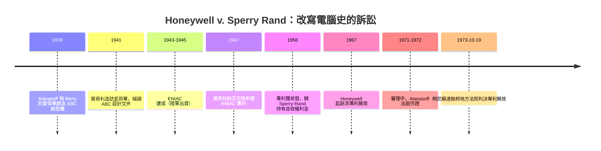
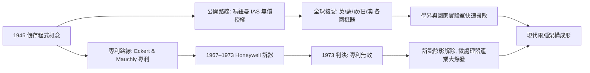

# 專利大戰與無償公開：現代電腦的誕生代價

## 一道岔路：公開還是壟斷

一九四五年前後，儲存程式電腦的構想已在賓州大學摩爾學院成形，卻隨即走向兩條截然不同的制度路線：馮・紐曼把《EDVAC 報告草案》印行成無專利限制的公開文件，並在普林斯頓 IAS 免費授權任何人複製設計；艾克特與莫奇利則憤而出走商界，把設計變成專利資產。這條裂縫真正發酵，要到三十年後的法庭上才見分曉。

## ENIAC 專利：從政府的機器到私人的資產

文化脈絡必須先講清楚：ENIAC 的建造經費來自美國陸軍，是用納稅人的錢、為二戰彈道計算蓋出來的「政府的機器」。一九四七年，莫奇利與艾克特申請 ENIAC 專利；一九五六年二月正式獲准（專利本身從一九六四年開始生效計算，至 1973 年仍有效），旋即透過他們創立的 Eckert–Mauchly Computer Corporation 併入雷明頓蘭德（Remington Rand）、隨後落入 Sperry-Rand 手中。從一九五〇年代後期起，Sperry-Rand 開始向 IBM、RCA、Honeywell、GE 等所有造電腦的公司收取主機專利權利金——業界叫苦連天。專利制度的本意在於以短期壟斷換取創新公開，但此時卻出現了荒謬情境：全行業的技術基礎，握在一家其實不是電腦領頭羊的公司手裡。

## 訴訟開打

一九六七年，Honeywell 起訴，要求確認 ENIAC 專利無效；Sperry-Rand 則反訴 Honeywell 侵權。此案最大爭點是「新穎性」：在 ENIAC 之前，是否已有人想到電子數位計算機的原理？答案指向愛荷華州立學院（Iowa State College）的物理教授阿塔納索夫（John Vincent Atanasoff）與研究生貝瑞（Clifford Berry）在一九三九至一九四二年間建造的 ABC 機器（Atanasoff–Berry Computer）：二進位、電子式加法、電容式再生記憶體——其解題思路在多處與 ENIAC 驚人地相近。

關鍵證據來自莫奇利本人：一九四一年六月他造訪愛荷華，在阿塔納索夫家借宿多日、長談數夜、細讀 ABC 的設計文件，返鄉後仍持續寫信追問設計細節；法庭上他卻稱「我已不記得那次造訪的細節」。阿塔納索夫當時沒有申請專利（Iowa State 未委託專利律師、二戰徵召又打斷了計畫），其部分文件曾在學界流傳——這些都動搖了專利的新穎性要件。

## 訴訟時間線

## 拉森法官的裁定

一九七三年十月十九日，聯邦法官厄爾・拉森（Earl R. Larson）在長達 249 頁的判決書中裁定：ENIAC 專利無效。理由有三：（一）專利標的缺乏新穎性——莫奇利確實「使用了」ABC 的構想，即其發明的概念源自 Atanasoff；（二）基於事實的判斷，莫奇利與艾克特未能證明是他們「自行做出」該發明；（三）以當時的技術水準衡量，專利標的欠缺非顯而易見性（obviousness）。判決並確認歷史定位：ABC 是「世界上第一台電子數位計算機」。一九九七年，愛荷華州立大學依原設計重造了 ABC 的完整複製品，作為致敬。

Sperry-Rand 沒有再上訴，全產業的權利金負擔就此一筆勾銷。

## 兩條制度路線的歷史後果

回頭看，兩條路線各有其歷史功效：馮・紐曼式的公開，讓戰後剛受創的歐洲、蘇聯與日本能在極低門檻上自建電腦（倫敦 NPL 的 Pilot ACE、劍橋 EDSAC 的路線也與這波知識流通相互刺激）；而司法終結專利壟斷，則為一九七〇年代的微處理器革命清出一條無王法的快速道。至於艾克特與莫奇利，兩人以 UNIVAC 推動了計算產業的商業化——兩人的一生糾纏，套一句最熟悉的句式：「同一件事，兩條路，共同造就了一個產業。」
