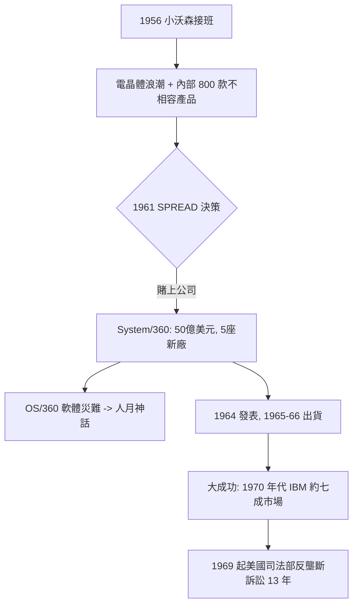

# 小托馬斯・沃森：五十億美元的世紀豪賭

## 緊張的父子

小托馬斯・沃森（Thomas John Watson Jr., 1914–1993）的童年，是在父親——IBM 創辦人老湯姆・沃森——的陰影下度過的。老沃森以近乎專制的方式塑造兒子：小沃森從小就讀 IBM 附設的學校、上學放學路上被要求「學著面對客戶」，工作後一開場做的是 IBM 的推銷員，吃盡了父親「全公司最紅的紅人」帶來的冷眼。他在回憶錄《父・子・與公司：在 IBM 長大》中坦言：對父親的畏懼與自我懷疑使他年輕時飽受焦慮與輕度抑鬱折磨，甚至靠開飛機逃避——一九三〇年代末考取飛行執照的那幾年，他形容「只有在天上、在我父親看不見我的高度上，我才能思考」。

## 接班與電晶體帶來的警鐘

一九五二年老沃森勉強把 CEO 交給兒子，十年之間父子倆仍在電話裡常爭。小沃森的判斷力在電子產業的浪潮裡被鍛鍊成型：他比父親及時看懂兩件事——電晶體將取代真空管，而 IBM 內部八百多種互不相容的產品彼此在浪費工程資源。一九五六年他以 CEO 之名大力推動 IBM 產品線轉向電晶體，更在一九六一年底做出他一生最大膽的決定：讓 IBM 賭一把，**統一整個公司的產品架構**。

## 賭上公司的 System/360

一九六一年十二月，小沃森主持的「SPREAD 計畫」報告得到他全力支持——這個提案要 IBM 同時發展六款新處理器、新系列周邊，並同時保留舊產品線繼續供應。他念出了那句後來被寫進無數教科書的話：**「這是在賭上公司（You bet your company）」**。一九六四至六六年間 IBM 為此投入了 50 億美元（換算今日約 500 億美元）：**超過曼哈頓計畫的總投資**；同時興建五座新廠（含北卡的 Research Triangle Park 與新罕布夏）與 6 萬名新增員工、並在短時間內把全公司 60% 的製造能力轉移到 S/360 上。小沃森的政商資源讓這一賭有制度後盾：一九六〇年代 IBM 正值美國反壟斷的關注期，但他仍敢於在市場份額衝刺（當時獨佔地位已相當顯著）。

## 軟體工程災難與《人月神話》

真正的痛苦來自軟體。OS/360 作業系統由 Fred Brooks 主導、動用上千名程式員，卻是一場噩夢：作業系統延遲交付、bug 疊出、版本分裂；小沃森親自主持的「霄禁式」審查會議臭名遠播。幾年之後，Brooks 將這段經驗寫成《人月神話》（The Mythical Man-Month, 1975），提出「加人反而延遲」的著名論斷——這本今日仍被奉為軟體工程聖經的經典著作，實際上是對 IBM 一場軟體災難的事後驗屍報告。

## 勝利與代價

一九七〇年代初，IBM 的美國資料處理市場占有率逼近七成。這個勝利也招來了代價：一九六九年一月，美國司法部對 IBM 提出反壟斷訴訟，此案纏訟十三年至一九八二年才由司法部主動撤訴——但在整整十三年裡，這樁官司像達摩克利斯之劍壓著 IBM 的每一個決策（包括後來對 Amdahl 離職的處理、以及對軟體另行計費的分拆定價）。小沃森本人於一九七三年卸任 CEO，晚年以飛行員姿態駕著私人飛機環球。《財富》雜誌後來稱他為「史上最成功的企業家」，他自己在回憶錄裡寫得卻謙遜：「我只是做了一個兒子應該做的決定——父親教了我怎麼避免猶豫，剩下的只是把公司推到懸崖邊、然後跳下去。」
