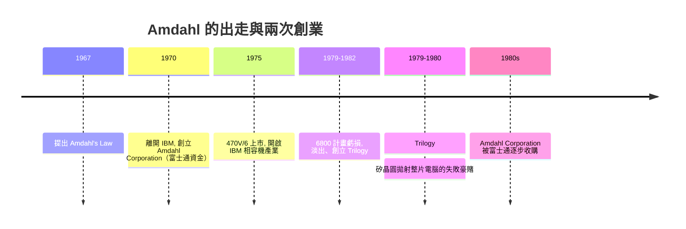

# 阿姆達爾的叛逆與阿姆達爾定律

## 一九七〇：在反壟斷陰影下出走

一九七〇年，吉恩・阿姆達爾離開了他服務近二十年的 IBM。原因並不單純：System/360 之後，他屢屢與 IBM 高層在性能取捨上衝突，最後一次爭執是他主張用最先進技術開發超大型主機（後來的 360/195 及進階計畫），管理層卻基於成本與反壟斷氛圍的考量遲遲不肯簽字。一九六九年美國司法部剛剛提出反壟斷訴訟，IBM 內部流動著一種「必須收縮、不可以再更快更貴」的恐懼——對一個以性能為信仰的架構師來說，這等於封住了他所有發揮的空間。他帶著幾位同事出走，創立了 Amdahl Corporation。

## Amdahl 470V/6：插接相容的開山之作

資金靠的是一個常被講成傳奇的細節：他找上的不是 IBM 的對頭，也不是矽谷創投，而是日本的富士通（Fujitsu）——一九七〇年代初，日本電腦業者急欲在美國市場找出通路，Amdahl 公司正是他們夢寐以求的形式。一九七五年，Amdahl Corporation 推出 **470V/6**，史上第一台「插接相容」（plug-compatible）的 IBM 主機：指令集完全相容於 IBM 370、可以插進 IBM 的通道與周邊、用戶連軟體都不必改——然後整台機器更小（採用富士通提供的 TTL 大型積體電路與電晶體邏輯）、更快、更便宜，而售價約 IBM 同級機型的六成。

IBM 曾尋求以法律手段（關於微碼與介面所有權）杯葛，但產業邏輯已經不可逆：插入到 IBM 主機市場中的「相容機」廠商——Amdahl、Itel/National Advanced Systems、日立、富士通——迅速成為一個新興子產業，並倒逼 IBM 自身的價格體系。「IBM 相容」從一個挑釁式的商業策略，變成主機市場的常態。阿姆達爾本人成了揶揄 IBM 最稱職的裁判：他曾在記者會上直接把 IBM 同級機型與 470V/6 擺在一起，用性能與價格兩組數字羞辱老東家。

## 1979：Trilogy，與整片矽晶圓上的瘋狂

一九七九至八〇年，阿姆達爾再度創業，成立 Trilogy Systems，目標是極端的下一步：**把整台大型主機壓縮在一塊拋射的整片矽晶圓（wafer-scale integration，WSI）上**。他把數百億美元的承諾建在這個近乎科幻的工程賭注上，融資一度超過 2 億美元（當時是新創公司的天文數字），卻敗於工業現實：整片晶圓上任何一個缺陷都會報廢整片、封裝與散熱技術都遠未成熟。一九八二年計畫失敗，Trilogy 解體；他後來又投入多處小型系統設計，直到晚年——八十多歲的他仍和工程師一起，親手打造個人的小型超級電腦 ttca/ODEN 型實驗系統，可以說把「偏執的性能信仰」堅持到了人生最後幾年（他在兩千零一五年故去前，甚至自費參展自己的新設計）。

## Amdahl's Law：提早五十年的預言

早在一九六七年 AFIPS 春季電腦聯合會議上，阿姆達爾就發表了一篇今天被稱為 **Amdahl's Law** 的短論。他質疑當時流行的「平行化可以無限加速」的樂觀預期：若程式中不可平行化的比例是 $1-p$，那麼即使使用 $n$ 個處理器，得到的最高加速比也不會超過

$$
S(n) \;=\; \frac{1}{(1-p) + \dfrac{p}{n}}
$$

並且上限為 $S_{\max} = \dfrac{1}{1-p}$。換句話說，就算把 95% 的程式平行化，200 個處理器也只能得到

$$
S(200)=\frac{1}{0.05+0.95/200}\approx 17.9
$$

的加速——「循序的部分永不會消失」。這條定律在多核處理器時代被反覆驗證，成為效能工程的基石。一九八八年，桑迪亞國家實驗室的古斯塔夫森（John Gustafson）以「擴大問題规模」的思路提出修正（Gustafson's Law）：$S'(n)=n-(1-p)(n-1)= n(1-p)+p$，指出在實際的科學運算中，處理器愈多、科學家會解愈大的問題，於是可平行部分占據主導，加速的空間遠比 Amdahl 的悲觀所允許的寬——這段學理上的辯論，正是今日雲端超大規模平行運算的理論前奏。

## 收束：架構師的三種命運

回顧阿姆達爾一生，可以寫出三種工程師命運的交疊：在 IBM 之內，他是以吵贏管理層而留下架構遺產的「沙皇」；在 IBM 之外，他是用插接相容撬開壟斷市場的「叛徒」；在學理上，他是以一條不到兩頁的公式，提早了五十年為今天的 GPU 與資料中心時代劃下性能界限的「先知」。二〇一五年他去世時，遺留的不只是 470V/6 與那條公式，還有一條源自南達科他農場的信條：不要浪費任何一個週期。
