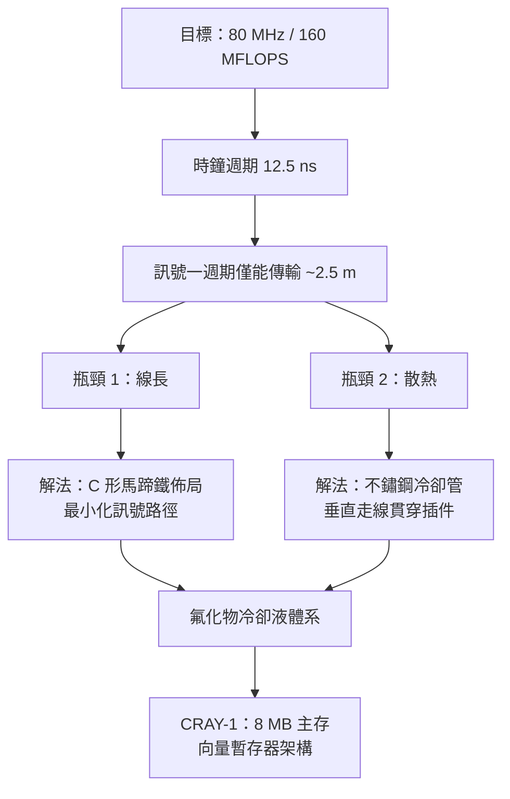

# CRAY-1：為光速而彎曲的馬蹄鐵

一九七六年，全球第一台超級電腦 CRAY-1 抵達洛斯阿拉莫斯國家實驗室（Los Alamos）。它的外觀在電腦史上空前絕後：底部張開的馬蹄鐵形（C 形）櫃體，白色玻璃纖維外殼、黑色稜柱面板，像一張被彎成圓弧的沙發。設計師西摩・克雷對造型的解釋很直白——那張「沙發」是裝飾，真實的理由有兩個：**散熱**，以及**光速**。

## 物理給出的設計題

CRAY-1 的時脈是 80 MHz，時鐘週期 12.5 奈秒，峰值達每秒 1.6 億次浮點運算（160 MFLOPS）。在這個速度下，克雷必須直面一條硬物理：

$$t \approx \frac{d}{c}$$

光在纜線中的速度約為真空中光速的 $\dfrac{2}{3}$，即每奈秒約二十公分。一個 12.5 奈秒的時鐘週期，意味著訊號在一個週期內最多只能傳播約 2.5 公尺，而扣除閘延遲後，實際上留給「繞線」的預算遠少於此。這給出一條鐵律：**機器的最大直徑，由時脈決定**。克雷的解法不是做小機器，而是把長櫃折彎——所有主要機櫃排成一個 C 形圓弧，直徑約 2.7 公尺，任何訊號都能沿弧線走最短路徑，中央凹處則安置電源與維修通道。馬蹄鐵不是美學，是光速的妥協。

## 向量暫存器：名副其實的躍升

CRAY-1 在架構上的真正創新是**向量暫存器**（vector registers）。此前 CDC 7600 一類機器逐字（word-by-word）餵進流水線；克雷則在 CPU 內放了八個各有六十四個 64-bit 元素的向量暫存器。向量指令一次宣告「對這六十四個數全做加法」，硬體便可全速灌入流水線，不必在存儲器與運算器之間來回奔跑。這一設計讓加載／存儲、乘法、加法三條流水線可以同時嗡嗡作響，也是後世所有向量機與 SIMD 指令集的直系祖先。主存約 8 MB —— 在一九七六年，這是天文數字。

## 冷卻：氟化物流體與不鏽鋼管

幾十萬顆小規模積體電路永久性緊密堆疊，功率密度前所未見。克雷採用冷離子氟化物流體（FC-77 一類氟碳化合物）在垂直貫穿每塊插件的不鏽鋼 U 形細管中循環，把熱量直接從晶片「背部」帶走。金屬管兼作結構件，也讓整機像被一具精密水冷泵驅動的活物。有人戲稱 CRAY-1 開機像一座小型化工廠。

## 為什麼 Los Alamos 第一個買

一九七六年，冷戰軍備競賽正處於高峰。核武設計的核心工作是三維流體力學與輻射—流體耦合模擬，沒有實驗驗證途徑，全靠計算。洛斯阿拉莫斯長期是 CDC 的忠實客戶，但克雷離開 CDC 後，國家實驗室也跟著合約走。CRAY-1 首台（已由 CDC 預定未交付的訂單轉化而來，編號 Serial 3，造價約八百八十萬美元）進駐 Los Alamos；氣象預測 NCAR、NSF、NASA，以及英國、德國的氣象與研究中心緊隨其後。

市場的結構性推力同樣重要：一九七三年石油危機後，油公司急須以地震波反演找油，地球物理計算成為僅次於軍方的第二大超算客戶；同時矢量運算恰好契合核爆、氣流、油藏三類問題的數學形式。冷戰軍費＋油價上漲＋向量架構，三者共同把「超級電腦」從實驗室玩具變成了穩定的產業。

## 資本到位：出走的時機

一九七二年成立 Cray Research 時，資本市場對「一人公司造全世界最快電腦」半信半疑。但掛牌後表現驚人——一九七六年上市當年，CRAY-1 即交付；到一九七零年代末，公司市值已使克雷成為億萬富翁。在風險投資尚未成為主流的年代，這是科技股純憑工程信用完成融資的教科書案例：制度（公開市場）為偏執的天才提供了不在官僚體系內工作的可能。

一九七七年，克雷把第一台量產機親手送到加州勞倫斯利福摩爾——他不信任物流，堅持由設計者本人交付。工程師的榮譽，在這件事上表現得比任何宣言都清楚。但克雷的偏執也在此埋下伏筆：他對積體電路之外的任何技術路線都疑心極重，包括下一代機器該用什麼電晶體材料——這條路，將把他引向一場賠上整家新公司的豪賭。
