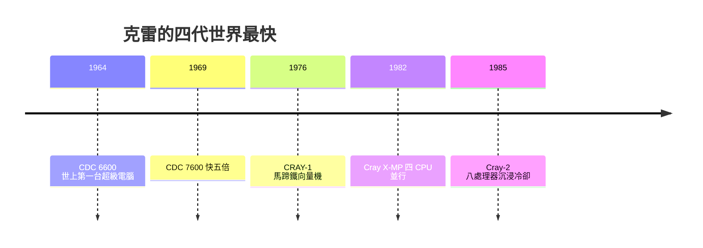

# 一人對抗國家團隊的極限狂人

一九九六年九月，科羅拉多州春季的一場車禍帶走了七十一歲的西摩・克雷。兩週後傷重不治。這位一生設計了四代「全世界最快電腦」的男人，死於汽車——他本人終生不喜歡開快車，認為那和他信奉的工程紀律相悖。他的訃聞寫道：一個人的職業是造全世界最快的機器，現在這個職業空缺了。

## 四代機器：小團隊的連勝紀錄

克雷的職業紀錄在工程史上近乎不可能：CDC 6600（1964）、CDC 7600（1969）、CRAY-1（1976）、Cray X-MP（1982，團隊設計）與 Cray-2（1985）——每一台交付時都是世界之最，且每一台的核心邏輯設計都出自極小團隊、多數是他本人。IBM 有一整個部門、整條產業學界、每年數十億美元的研發預算，卻連續三十年在「最快機器」這一單點上輸給一個住在家裡、不開會、不回郵件的人。IBM 內部那張著名的嘲諷備忘——「34 個人加一點清潔婦如何打敗 IBM？」——到一九八零年代仍是產業笑話，也是痛點。

## 元件潔癖：不肯用積體電路的人

克雷的第一條偏執是對元件的懷疑。CDC 6600 用手工繞線；CDC 7600 同樣用電晶體而非 IC，因為他不信任當時積體電路的散熱與可靠性——「你追加了太多層的不可控」。直到 CRAY-1，他終於被迫用 SSI 小規模 IC，但選了最保守的 ECL、每顆僅數個閘。他一生信奉的核心：**越接近物理極限，每一層抽象越是負債**。

第二條偏執在 Cray-2 上爆發。他知道此時積體電路密度不再是唯一瓶頸——散熱才是。Cray-2 的解法是驚人的「沉浸式冷卻」：整塊電路板浸在惰性氟碳液體裡，氣泡沸騰帶走熱量。八顆處理器、每顆 244 MFLOPS，一九八五年問世時再次奪冠。但真正的賭局在下一台。

## Cray-3 與砷化鎵：偏執的代價

一九八零年代中，矽的開關速度逼近極限，克雷押注砷化鎵（GaAs）：電子遷移率更高的材料，理論上能讓時脈再翻倍。這條路在學界並非孤例，但量產良率極糟。Kronos 等公司只做到實驗室。一九八八年，克雷更徹底：他把 Cray-2/3 系列從 Cray Research 剝離，另立 Cray Computer Corporation（CCC），自己再次變成「一人公司」——用一間公司在賭另一個物理分支。

一九九三年，Cray-3 首台交付（NCAR），但只有一台：良率、成本、也許還有他自己健康都沒跟上。CRAY-1 那種「一個人＋資本市場」的奇跡，在 GaAs 的工業門檻前失效了。一九九五年，CCC 破產；主流超算已轉向大規模平行——成百上千顆商用微處理器並行，單核速度不再是唯一戰場。換言之：**克雷模式終結了**。

## 克雷難題：個人天才對抗組織研發

後世稱這個困境為「克雷難題」：組織化大團隊必然輸給小團隊嗎？克雷用生涯證明至少有四十年之久，答案是「是」——而他死後這一結論逐漸被反轉： 大規模平行、晶片製程國際分工、開源基礎設施，使得超算的仗終究由國家級聯盟（ASCI、EuroHPC、ITRS 路線圖）打贏。「最快的機器」這一榮譽不再由個人設計師持有，而成為供應鏈與政治資源分配的產物。

制度為他留了紀念: IEEE 電腦學會設立了以其命名的 Seymour Cray Computer Engineering Award（西摩・克雷電腦工程獎），每一屆頒給「推進高效能運算系統概念與實作」的人；美國超算界至今仍把「一生能設計一台完整的高速機器」視作稀有榮譽，被稱為「做了克雷做過的事」。

回望克雷的一生，他留給世界的並不只是幾台藍色禮服般的機器，而是一個曾經真實存在的可能性：**在組織化科學的時代，一個偏執的天才，靠著資本市場的寬容與自家地下室的地道，真的可以和國家隊掰手腕**。那個可能性最終消逝了——但正因為消逝，它才值得被當作歷史，而非神話。
