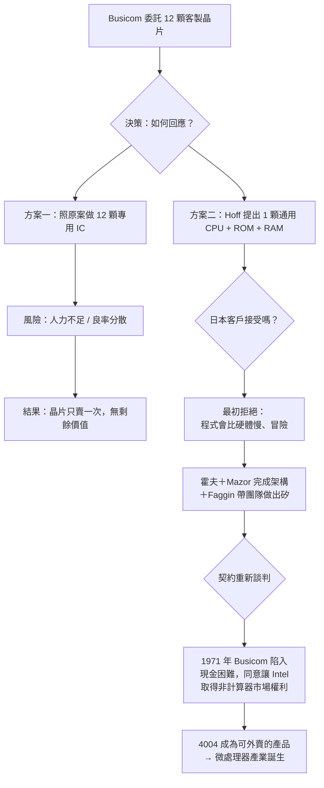

# 泰德・霍夫：通用晶片的構想者

一九六八年秋天，史丹佛大學的助理研究員泰德・霍夫聽了一場演講，演講者是剛離開仙童半導體、正準備創業的羅伯特・諾伊斯。諾伊斯描繪的新公司願景打動了這位年輕科學家；1969 年，他放棄了史丹佛的教職，成為這家新公司——英特爾的第十二號員工。他的名字是馬西安・愛德華「泰德」・霍夫（Marcian Edward "Ted" Hoff, Jr.）。

## 史丹佛出身的系統思考者

霍夫一九三七年生於紐約州羅徹斯特附近，父親是鐵路工程師。他念的是史丹佛，本科後跟著導師做的是靜電放大管一類「計算器時代人」的題材，一九六二年拿到博士。他的博士訓練讓他和同輩矽谷工程師有個不同處：他不只想「做一個電路」，而會問「這個問題的正確分解方式是什麼」。這種軟體式的思維，正是他日後最大貢獻的種子。

一九六九年初，日本桌面計算器製造商 Busicom 的工程師嶋正利（Masatoshi Shima）來到英特爾，委託開發一套新式計算器晶片組。最初的標案有 **十二顆客製晶片**——每顆對應一種加減乘除或鍵盤邏輯。嶋帶來的邏輯方塊圖是純硬體思維：每個功能做成一塊。英特爾當時僅有幾十名員工、資源高度緊張，接下這樁專案形同自殺。

## 一封提出不同方案的內部備忘錄

霍夫被指派守望此案、以提供技術意見。他看著十二晶片的規格表，問了一個改變世界的問題：**為什麼不把這十二塊的「聰明」，都搬到一顆通用處理器裡，再用軟體把計算器功能寫出來？** 他的提案是三項結構：

1. 一顆**四-bit 通用 CPU**，能執行任意指令序列；
2. 一顆 **ROM**，存放解釋計算器按鍵的程式；
3. 若干顆 **RAM**，暫存顯示與運算結果。

計算器的加減乘除，由 ROM 裡的程式實現。這樣，晶片從十二顆降到三∼四顆，而且**這顆 CPU 可能還能去做計算器以外的事**。

霍夫的哲學可以濃縮成一句：**以硬體的通用性換取軟體的靈活性**。他一九七二年對同事說：「我們賣的是一個『可以變成任何計算器』的東西。」他的檯燈下有個終年不變的信念：大多數人在看到硬體限制時收手，而通用機器把限制推給了可以反覆改寫的程式碼。

## Mazor 與 Shima：架構的三重奏

霍夫把架構想法與同事史丹・馬佐（Stan Mazor）化為可執行的指令集與微程式設計，與嶋正利往返辯論近半年。嶋起初強烈反對——在日本，運算用硬體邏輯做，速度可預測；用「程式」一名詞讓他們驚慌（那是還不存在產業的技術）。最後 Busicom 管理層對面臨成本與開發風險的英特爾讓步，採納了霍夫的單晶案。

## 關鍵合約：Intel 拿回微處理器的權利

一九七一年，Busicom 因現金困難，被迫在契約上重議：Intel 得以每顆六萬美元的降價，但**保留這套晶片在非計算器市場的獨家權利**。這紙合約是英特爾從記憶體公司轉進微處理器產業的轉運點。同年十一月四百零四（Intel 4004）正式 announced，二千三百顆電晶體、十微米製程、七四零千赫茲——全世界第一款晶片上的通用可程式電腦。

霍夫本人對「發明微處理器」這個生活榮耀的歸屬，一生保持学者的謙遜。他清楚 insisted：架構想法是他的，實作出自法金（Faggin）、嶋正利親手；他堅持三人共享這份榮耀。一九九六年他（與 Faggin、Mazor、Shima 一起）獲頒愛德華・賓·圖靈講座獎、而他被選為一九九九級 National Inventors Hall of Fame、二零零九年（與另三人繼續共彰）獲圖靈獎之外的最高工程榮耀——美國國家技術獎章。

霍夫晚年在本田汽車的論文裡引一句話說明他對自己的定位：「我做事的方式是——上帝給了我一個現代的運算思想，我只是發問拆解。」他自認不是「造晶片的人」，而是「重新描述問題的人」。微處理器這個概念——**晶片不再是零件，而是電腦**——這份翻轉，正是霍夫留下的遺產。
