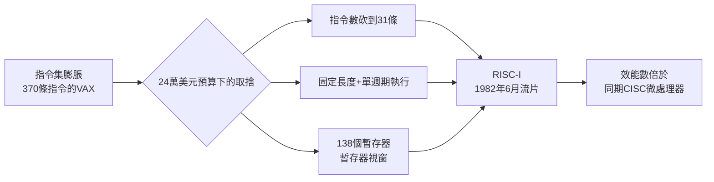

# 大衛·帕特森：伯克利 RISC-I 與讓數據說話

## 从洛杉矶到伯克利

1976 年的大衛·帕特森剛滿二十九歲。他在 UCLA 拿到博士學位——師資陣容並不顯赫，但他第七學期就通過資格考試，且以全班唯一被邀請留校任教的人自居。他卻做了一個讓同儕側目的決定：拒絕 UCLA 的聘書，北上伯克利。「我只是不想待在同一個地方度過一生。」這句話後來成為他的人生座右銘——無論是換學校、換研究題目，還是改變整個行業的思維方式。

初到伯克利，帕特森並非一夜成名的天才，而是新人面孔。他先與同事合寫教材、在研討會上從頭學習體系結構這門手藝。但真正讓他名垂青史的，是 1980 年前後一段短短的時間裡，他連續投下兩顆炸彈：一顆是後來稱為 RAID（容錯磁碟陣列）的儲存構想，另一顆，則是本節的主角 RISC。

## 一篇論文的觸電

由於合著者後來將思想發揚光大，這件事在歷史上常被簡化為一句話：Ditzel 帶來了貝爾實驗室對微碼膨脹的觀察，帕特森帶來了把它變成研究計畫的組織能力。兩人合寫的《The Case for the Reduced Instruction Set Computer》（精簡指令集電腦的論證），1980 年發表。題目裡那個「Case for」法庭式的措辭，正是帕特森的性格寫照：不下定義、不喊口號，而是提出證據，讓數據自己說話。

## 二十四萬美元的豪賭

1980 年，DARPA 的 VLSI 計畫批准了伯克利的提案，資助額度約 24 萬美元——在當年只夠付幾個研究生的獎學金和一些晶片製作費用。業界主流（Intel、DEC、Motorola）年投資數億美元在更複雜的 32 位元晶片上，帕特森只有研究生和一間小實驗室。

這個限制反而逼出核心洞見。既然不能像大廠那樣堆邏輯電路，就應該把晶片面積花在刀口上：

- **簡化指令集**：只保留最常用的簡單指令，複雜操作交由編譯器組合。
- **大量暫存器**：程序間函式呼叫太頻繁，記憶體存取是最大瓶頸，於是把 78 個實體暫存器組織成「暫存器視窗」（register window），每次函式呼叫只是滑動視窗，不需把參數存回記憶體。
- **單週期執行**：每條指令一個時脈週期完成，管線乾淨俐落，編譯器可以精確預測時序。

1982 年 6 月，RISC-I 晶片流片回來。團隊戰戰兢兢地插上示波器——它跑了。第一批晶片上只有一座正常運作，其餘的後續批次也很快除錯成功。研究生們徹夜奮戰的故事，後來成為伯克利傳說。這顆僅用約四萬五千個電晶體做的晶片，效能卻追平甚至超越同期複雜得多的 CISC 微處理器。

## 太陽微系統把想法變成生意

RISC-I 論文的引用數在頭三年幾乎為零——業界不以為然，認為這只是學術玩具。伯克利團隊最狠的反駁是 RISC-II：更小、更快，效能是 VAX 的三倍以上。

真正的轉機在創業圈。1984 年，伯克利團隊的經驗孕育出衍生公司 Pyramid Technology；同年，Sun 的 Bill Joy（與帕特森同屆的研究生同僚）力排眾議，說服公司以伯克利的理念打造下一代處理器。1987 年，Sun 正式推出 SPARC（Scalable Processor ARChitecture），直接植入 Sun-4 工作站。SPARC 並不是把 RISC-I 圖紙拿來量產，而是一次重寫——但 Sun 工程師手上的兩卷《RISC-I 技術報告》就是他們的聖經。當 SPARC 工作站在 1990 年代初成為工程設計市場主流時，帕特森的理念第一次以數十萬台出貨量證明自身。

## 思想革命與 Intel 的反擊

RISC 的崛起動搖了兩大信條：其一，複雜指令集無可取代；其二，計算機體系結構設計只能靠大型企業的資源，而非學術界的方法論。帕特森與 Hennessy 提出的是一種「工程科學化的設計方法」：以量化數據（如 cache 命中率、指令佔用比例、CPI）為基礎做決策。這不只是新技術，而是新的職業倫理——架構師不再憑直覺，而是憑證據。

Intel 的反擊堪稱史詩級。面對市場質疑 x86 是「過時的累贅」，Intel 工程師在 P6 微架構（Pentium Pro，1995 年）中做出妥協式革命：在晶片內部把 CISC 指令拆解成微操作，交由 RISC 式的亂序執行核心處理。P6 使 x86 保住 PC 市場，同時承認了 RISC 的技術正當性——你不需要打敗對方，只需要吸收對方。帕特森本人後來坦然承認：「RISC 的勝利不是指令集的勝利，而是設計原則的勝利。」

## 圖靈獎的另一句話

2017 年，帕特森與 John Hennessy 共同獲得圖靈獎。頒獎詞說：「他們奠基的方法論，持續推動整個產業。」在受獎演說中，這對老搭檔提出「新黃金時代」——領域專用處理器（DSA）將重演 RISC 革命，這一次的對象是 AI 加速器。帕特森從伯克利退休後仍以此為業，甚至成了 Google 訪問學者，投身 TPU 晶片相關研究。

他的故事教訓是制度性的：DARPA 以少量資金支持大學裡的「不可能想法」，再加上伯克利那種容忍 prolific 的教授放下主流題目的學術自由，共同催生了一場革命。二十四萬美元買不到一條產品線，卻買到了改變電腦的思考方式。
