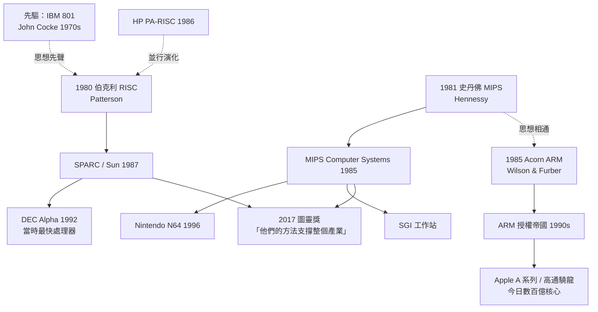

# 華山論劍：一本教科書統治三十年

## 兩間實驗室，一場友好戰爭

1980 年代的美國西岸，上演著一場技術史上最良性的競爭：史丹佛的 John Hennessy 做 MIPS，伯克利的 David Patterson 做 RISC。兩人相識於微處理器研討會的走廊，隨即發現彼此是思想上的鏡像——都相信微處理器重蹈了大型機的覆轍，都相信編譯器應該參與硬體設計，都相信答案應該由數據給出。

關鍵是：他們沒有互相拆台，而是互相校對。史丹佛的管線互鎖（硬體偵測冒險）挑戰了伯克利的無互鎖方案；伯克利的暫存器視窗被史丹佛團隊用量化數據質疑——視窗溢出時要保存/恢復 14 個暫存器， stores/loads 在某些程式碼中比想像中多。這種「我來測你，你來測我」的學術風氣，後來被總結為一個詞：**measuring 精神**——不迷信任何架構決策，先量化，再下注。

兩人很快意識到，這場戰爭真正的意義不在誰的晶片快幾個百分比，而在整個行業缺乏一套共同的設計語言。1980 年代中期，他們開始合寫教科書。

## 兩本書，兩個戰場

1990 年，《Computer Architecture: A Quantitative Approach》第一版出版（當時的 Morgan Kaufmann 出版社仍是一家創業型小社）。緊接著 1994 年，更入門的《Computer Organization and Design》（簡稱 COD）出版，以 RISC 的發明歷程作為教學主軸。兩本書分工明確：

- **COD（本科教材）**：從零拼出一台可以用 VHDL 實現的 MIPS 晶片，讓學生第一次理解「快」是設計出來的。
- **H&P（研究生/從業者）**：把 Amdahl 定律、CPI 分解、記憶體階層、管線冒險、指令級平行度串成決策框架，是工程師案頭的兵器譜。

這兩本書為什麼能統治三十年、出六七版、翻譯成二十多種語言？因為它們的敘事邏輯不是知識集郵，而是**案例史**——每一版都重寫「最新黃金時代」的案例，把當代最成功的晶片（從 MIPS、ARM Cortex 到 GPU、TPU）拆解成可預測的原理。教科書變成了一份持續更新的行業變革紀錄。

更重要的是制度效應：兩本書的每一版都聘請數十位來自 Intel、AMD、Apple、ARM 的頂級架構師當審稿人，這使得教材不僅是學術出版物，還是行業共識的策展。公司新人培訓用它，大學資格考用它，甚至專利訴訟中引用它。

## RISC 思想的擴散鏈

RISC 不是一個晶片，而是一組操作原則，它沿著人與技術的網絡擴散，最終覆蓋了整個行業：

這條譜系中有兩個常被忽略的事實。其一，IBM 的 John Cocke 在 1970 年代的 IBM 801 計畫已提出類似想法，是 RISC 的先驅；帕特森與軒尼詩的功績不在「先想到」，而在**把它變成一門量化科學並證明它可商業化**。其二，英國 Acorn 的 ARM 用最少的資金（一間車間、三名工程師）做出 RISC 理念最純粹的極簡變體，這個「窮人版 RISC」最終反而統治了行動時代——理論的擴散從不按資源多寡分配。

## 學術共同體：Measuring 的制度基礎

RISC 革命成功不可或缺的一環是美國的制度土壤：DARPA 的 VLSI 計畫願意把資金分散到多所大學，製作多個競爭性的原型（MOSIS 服務讓大學以郵寄、併單方式低成本流片，成本降了一兩個數量級）；頂級會議（ISCA、Micro）形成固定的思想市場；Morgan Kaufmann 這類專業出版社願意為研究生教材投入。沒有這個「大學–資助–出版–企業」的生態，帕特森與軒尼詩只是兩個聰明人，不是一場革命。

2017 年 3 月，ACM 宣布兩人同獲圖靈獎，授獎辭的措辭值得整段抄錄：「Hennessy 與 Patterson 創造出一種持續性、可重複的方法論——以量化方法做體系結構設計，其原則支撐了整個行業。」注意主語：不是「他們的晶片」，而是「他們的方法」。

兩位得主在頒獎演說中回顧其一生的偏執——起初幾乎所有人都認為 RISC 只是學術實驗，Intel 高層公開駁斥，兩人的論文引用數前幾年寥寥無幾。「預測太早等於預測錯誤，但時間站在理論一邊。」帕特森這句話，是所有長期主義工程師的護身符。教科書最新版已聚焦 DSA（如 Google TPU），意味著：四十年前那場讓簡單戰勝複雜的勝利，正在 AI 晶片上重演第二次。
