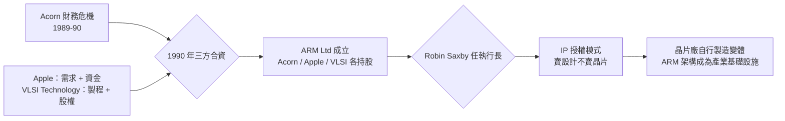

# 史蒂夫·弗伯：低功耗設計的驚豔之作

## 數學與工程的雜食者

Steve Furber 1953 年出生於英國曼徹斯特。他在劍橋大學先念數學，再轉攻工程，博士論文用電腦模擬空氣動力學問題——屬於當時少數用電腦做研究的前沿領域。1970 年代末，這樣的訓練讓他對一個問題上癮：**電腦如何有組織地做「艱難但簡單」的事**。

1981 年，Furber 加入劍橋郊外的 Acorn Computers。他的第一個任務是 BBC Micro 的硬體設計——英國推動全民資訊教育的一項國家級工程。BBC Micro 的硬體細節（從客製的 ULA 晶片到擴充匯流排）都出自 Furber 之手；而 BASIC 由威爾遜一人完成。這對黃金搭檔的關係，Furber 形容為「她寫靈魂，我造身體，而且身體要能開機」。

## 貧窮逼出的傳奇晶片

1983 年，Acorn 決定自製處理器。這個決定一半是志氣（英國不想再向美國或日本買 CPU），一半是財務絕望——公司快沒錢了，買不起大廠的授權。因此 ARM 的定義約束極為硬性：

- **沒有授權費、有限矽片面積**：去買 6 位元匯流排、發展性有限的現成晶片，不如自己做。
- **VLSI Technology 是唯一的製程夥伴**，製程落後，需要靠簡潔的邏輯結構補短板。
- **沒有金錢與空間做散熱**：電源設計不能超過幾百毫瓦。

1985 年 4 月，ARM1 鑄成：25,000 顆電晶體（同時期的 Intel 80386 超過 27.5 萬顆），功耗不到 0.5 瓦，而效能卻是 Intel 80286 的兩倍以上。它能省電的祕訣不在魔法，而在結構：無微碼、無複雜瞬態電路，全片都是簡單的 32 位元資料路徑。**「我們不是設計省電。我們只是簡單到必然省電。」**——Furber 這句話說明了 RISC 理念的最終極例證。而這個「窮困遺產」在十年後變成行動世紀最大的技術優勢：當 Nokia 工程師測試第一批手機處理器、發現只有 ARM 能在電池供電下連續通話幾天時，他們選的不是最強的晶片，而是最省的。

## 學術轉向：百萬處理器的夢

1990 年，ARM 改組為獨立公司，Furber 選擇留在學術界：他到曼徹斯特大學擔任 IC 設計教授，開始一項橫跨二十年的野心計畫——**SpiNNaker**。

這個計畫的名字（Spiking Neural Network Architecture）聽起來像科幻，核心問題卻極為基礎：大腦是有 860 億顆神經元、總功率只有二十瓦的處理器網路，為何我們的超級電腦卻要耗電達兆瓦級？Furber 的答案是「百萬處理器」架構：把數十萬顆（並朝百萬顆邁進）ARM 核心連接成事件驅動、極省電的網狀互聯結構，用來模擬大腦的尖峰神經元網路。2016 年，耗資約六千萬英鎊、十萬顆 ARM 核心的 SpiNNaker 機器在曼徹斯特上線，2018 年擴充到百萬核心，成為歐洲神經運算研究的重心。從 ARM1 到 SpiNNaker，Furber 一生只解一個問題：**用最少能量求最大計算**。

## Acorn 的商業失敗與 ARM 分拆的制度重構

Acorn 本身是一場悲劇性的教訓。它有 BBC Micro 的聲望、ARM1 的天才技術，卻在 IBM PC 兼容浪潮下節節敗退，負債累累，1985 年被義大利 Olivetti 收購多數股權。命運的轉折來自一樁意外：Apple 的 Newton PDA 團隊正在找省電處理器，找遍市場只有 ARM 合適。Apple 的談判給了 Acorn 一個救命的交易：

新公司的執行長 Robin Saxby（原 Motorola 工程師）做出幾個影響整個產業的決策：

1. **不再自己做晶片**。ARM 定義核心設計並把它**授權**給任何付費的晶片公司——這就是後來匯成洪流的「IP 授權」商業模式的發源。
2. **架構授權（architectural license）**：不僅賣核心，還賣「自己做出 ARM 兼容變體」的權利（1990 年代末高通簽下此類授權）——這看似把商業祕密交出去，實際上把整個產業變成自家生態。
3. **極小化公司規模**：最初的 ARM Ltd 只有十來人，延續了 Acorn 車間白手起家的集體記憶，制度設計與技術意識形態（簡單即強大）完美同構。

回頭看，Furber 與威爾遜當年在車間裡的選擇——不做散熱、砍掉乘法、只留 27 條指令——根本不是為了掌控行動世紀而來。真正的因果鏈是：**英國的教育政策（BBC Micro）→ 造就一代工程人才 → 窮困中的取捨被誤打誤撞地保存為技術 DNA → 一個國家的教育投資，間接決定了三十年後數十億人口手中的手機晶片**。歷史從不直線走，但它記得每一個起點。
