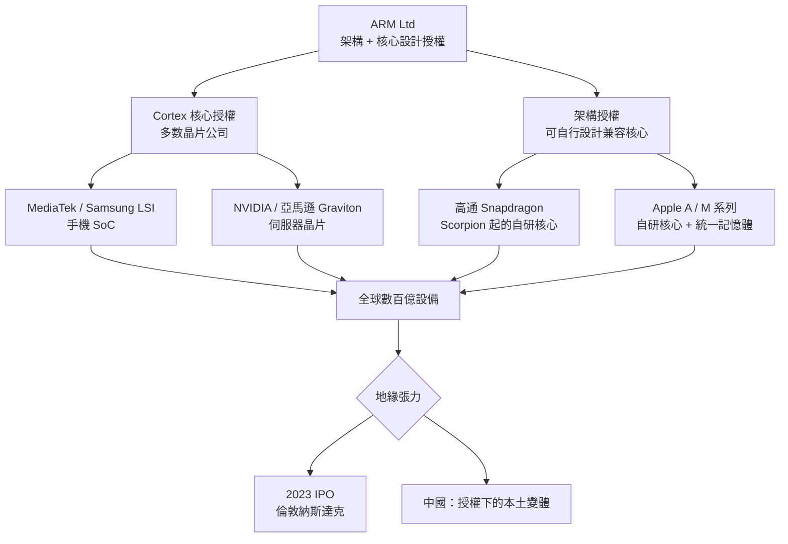

# 從小車間到數百億設備的心臟

## 車間裡的晶片找不到買家

ARM1 誕生於 1985 年，但它的技術優勢整整五年無人認識。Acorn 把 ARM 核心塞進自家的 Archimedes 電腦——性能是同價位 IBM PC 的數倍，銷量卻慘澹：英國教育市場被 BBC Micro 的成功「鎖住」，而家庭市場已被 PC 兼容機的規模經濟碾壓。技術上最純粹的 RISC，卻撞上商業上最無情的相容性之牆。

第一個政策上的突破來自 Apple 的 Newton 團隊。1990 年前後，Apple 工程師在尋找能讓 PDA 電池活過一天的處理器，試了 Intel、Motorola、日系晶片，全部過熱。ARM 的 demo 一舉結束了整個評估流程：同一顆晶片，功耗只有競品十分之一。這場失敗產品的選型，最終催生了 ARM Ltd 合資公司（Acorn、Apple、VLSI Technology 三方出資），但 Newton 本身 1993 年上市後叫好不叫座，1998 年被 Jobs 砍掉。ARM 的運氣好到令人嫉妒：它借到的第一批商業艙位來自一艘正在下沉的船，卻因此換上了截然不同的航行系統——**不賣整機，只賣設計**。

## 手機：命中注定的心跳

真正的轉機在芬蘭。1990 年代中，Nokia 需要為數位手機找處理器，設計約束是殘酷的：晶片要塞進巴掌大的手機、電池要撐數天待機、成本要壓到最低。GSM 手機的通信處理（通道編解碼等）需要不錯的算力，但功耗上限只有 PC 處理器的幾十分之一。市場上唯一同時滿足「低功耗」和「可授權（Nokia 要自己整合基頻）」的選項基本上只有 ARM7。1990 年代後半，ARM7TDMI 進入 Nokia 6110 等暢銷手機，徹底改寫了公司命運。1998 年，ARM 在倫敦與納斯達克兩地上市，手機占其授權收入的比重逐年攀升。

與此同時發生的是產業結構的巨變。1980 年代的半導體業由 IDM（整合元件製造廠）——Intel、TI、東芝——主導：一家公司包辦設計、製造、銷售。但摩爾定律使晶圓廠造價指數級飆升（一座先進廠從 1 億美元漲到 100 億美元以上），迫使產業分工：TSMC（1987 年創立）開創晶圓代工；Qualcomm、Broadcom 等公司拋棄工廠成為 fabless 無晶圓廠設計公司；而 ARM 站在最上游——連成品晶片都不做，只賣「設計的設計」。到 2000 年代，「設計–代工–封測」的全球分工體系成形，ARM 處於食物鏈頂端的 IP 層，每次出貨收取授權費與版稅。這個商業模式，正是大學研究成果演化為產業 IP 的直接例證，也是 RISC 思想的商業影子。

## 架構授權與生態的多樣化

ARM 的商業設計有一個精妙之處：它不追求同質化，而追求標準化之上的多樣性：

三個層次的授權（核心授權、物理 IP 授權、架構授權）造就不同的商業物種：多數公司拿 Cortex 核心直接用；高通在架構授權下發展出自研核心（後來的 Snapdragon 系譜）；蘋果收購 PA Semi 之後走得更遠——從 iPhone 的 A4 到自研筆電晶片 M1，ARM 架構第一次正面擊敗 x86 在個人電腦的王座。每一次生態擴張都是重大利益的重新分配，而 Apple 的出走證明了架構授權設計的先見：**把「設計權」下放，才能讓客戶長出比授權商自己更強的能力**。

## 軟銀、地緣與重新上市

2016 年，日本軟銀孫正義以 320 億美元收購 ARM——他賭的不是當時的行情，而是「物聯網時代每一顆感測器都會需要 ARM 核心」。2020 年，Nvidia 曾宣布 660 億美元收購 ARM，卻因反壟斷與地緣審查（ARM 是全球計算基礎設施、中立性不可讓渡）於 2022 年被否決，軟銀轉而推動 ARM 於 2023 年 9 月在納斯達克重新上市，市值一度接近七百億美元——一家員工不到萬人的晶片設計公司，估值卻如同一個國家的戰略資產。

地緣政治的另一端在中國。中國是全球極重要的 ARM 授權市場，華為的鯤鵬、飛騰的早期產品都基於 ARM 架構授權。2019 年美國制裁華為期間，ARM 曾一度暫停部分合作（後經法律釐清後部分恢復），這一事件促使中國全力扶植 RISC-V 作為「去美國化」的後備架構，Intel、高通、台灣晶片業也都設立了 RISC-V 部門。有趣的是，RISC-V 的開放指令集思想，恰恰承襲了帕特森倡議的「RISC 蘇生」——1980 年代誕生的簡化指令集哲學，繞了四十年，回來繼續攪動地緣棋局。

回頭看這幾十年：Wilson 與 Furber 在劍橋車間畫下的 27 條指令，先救了 Acorn 的命，再餵飽 Nokia 手機帝國，再被 Apple 舉起挑戰 Wintel，最後成為地緣棋局中的戰略籌碼。這條因果鏈的每一次轉折都不是設計出來的——但每一次都能被技術史家解釋：低功耗的物理優勢、IP 授權的制度優勢、教育普及的人才紅利，在適當的歷史時刻形成共振。簡單，最終統治了世界。
