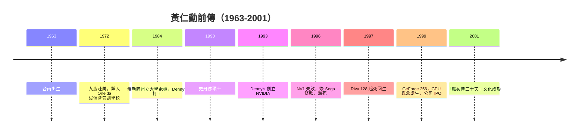

# 節標題：Denny's 餐廳裡勾勒圖形晶片的青年

一九九三年春天，加州聖荷西的一間 Denny's 連鎖餐廳角落，三個三十歲上下的工程師圍坐一桌。黃仁勳（Jensen Huang）用紙巾和餐墊紙勾勒晶片草圖，身旁是他自 AMD 找來的 Chris Malachowsky（常被寫作 Chris Malachovsky），以及曾在 Sun Microsystems 打造圖形加速卡的 Curtis Priem。那年夏天，三人合資創立了 NVIDIA。選在 Denny's 談事不是浪漫，是精算——那是黃仁勳少年打工的地方，他知道這裡咖啡續杯不要錢、沒人趕你走。多年後他自嘲：「我們太窮了，但 Denny's 至少有無限咖啡。」

## 台南到肯塔基：一截斷裂又重接的臍帶

黃仁勳一九六三年生於台南。祖父輩在日治時期經營成衣與雜貨生意，家族有種小生意人的務實與韌性。父親黃興泰是化學工程師，母親羅采秀是小學教師。九歲那年，為了讓兒子接受「美式的冒險教育」，父親安排他與哥哥遠渡重洋，寄住肯塔基州 Oneida 鎮的親戚家中。這段被反覆講述的往事比我們想像的殘酷：親戚誤信環境，將兄弟倆送進 Oneida 浸信會學校——一所專收問題少年與不良少女的管訓學校。年幼、瘦小、不會說英文的東方男孩，被同學誤認為是少年犯，他學會了擦馬桶、爬水塔、扛器材換香菸（他很坦白地說，那時他身上總是飄著煙味）。多年後他回憶，那段日子教會他「堅韌」，也教會他從眼前的爛牌裡打出結果來。

父母隔兩年輾轉移民到美國，他才真正回到正常教育軌道。高中時他在阿拉岡實驗室（Aloha, Oregon 的 ALOHA 高中）嶄露數學天分，提前畢業後進入俄勒岡州立大學（OSU）讀電機。大學時期他在 Denny's 當服務生、在洗衣店打工，日班洗碗、翻烤肉排，二十多份零工養活自己。他後來說，OSU 教務長在畢業登記時對他說「你是不是算錯了，怎麼五年半就畢業」——他只是把別人玩樂的時間都拿來打工與上課。一九九○年，他再到史丹佛大學攻讀電機碩士，那是他一生重要的資本累積期：名師同窗、矽谷氛圍、以及「工程師可以用矽改變世界」的信仰。

## LSI Logic、AMD，與一張餐墊紙

畢業後他先進 AMD 當晶片設計師，兩年後跳到 LSI Logic 做到技術行銷總監，學會了工程與市場之間的翻譯術——這種既是熱愛技術、又懂客戶口袋的角色，正是日後 NVIDIA 的靈魂。LSI 期間他結識了 Malachowsky 與 Priem，三人都相信：3D 圖形即將從工作站走進每台 PC。

他們的第一次創業像是走鋼索。NVIDIA 拿到紅杉資本 Don Valentine 的兩百萬美元投資，做第一款產品 NV1。結果 NV1 使用非標準的四邊形處理與 Sega 專屬聲音格式，微軟恰好推出 Direct3D，整個市場轉向多邊形標準，NV1 慘敗。在一般人眼中，NVIDIA 已死——公司只剩下三十人出頭的預算，黃仁勳把公司裁到剩約三十五人，話是這樣說的，實際上他接下 Sega 的訂單，簽下外人看來近乎羞辱的條款：Sega 預付的救命錢若做不出產品，NVIDIA 得退錢、賠掉整個公司資產。他賭。用這筆錢開發 SEGA NV2 未成，轉手把同技術做成符合 Direct3D 的 Riva 128，一九九七年上市，四個月內狂賣一百萬顆，NVIDIA 掙扎著爬出墳墓。

$$\text{1997 Riva 128 的成功} \Rightarrow \text{1999 GeForce 256：全球第一顆自稱 GPU 的晶片}$$

一九九九年，NVIDIA 上市，同時推出 GeForce 256——整合變換與光影計算（T&L），第一次把「圖形處理器」喊成一個獨立門類。同一時期他簽下與台積電在 0.35 微米製程上的孤注，在對手仍觀望時搶先量產，成本與良率風險全押，這是亞洲供應鏈與矽谷設計公司第一次如此深度地互為器官。

## 「離破產永遠三十天」的偏執

真正塑造 NVIDIA 的，是黃仁勳式制度文化。傳聞公司早年遭遇極重財務危機，他的名言在內部成為儀式：「我們離破產只有三十天。」三十天、九十天，年年代代地說，不是悲觀，是把危機感制度化為滾動式作戰節奏。他親自拍每一封郵件（「jhuang@nvidia.com」有五十人以上曾以為自己收到真信）、在新產品發布會上穿著他標誌性的黑色皮衣——那是對工程師身份的宣言而非時尚。他管理的方式嚴苛而直接，開會層層逼問到最底層細節，被稱為「top of the stack」式管理：他不相信組織中間層的稀釋，要求資訊直達。

從台南的雜貨世家，到肯塔基擦馬桶的少年，到 Denny's 餐墊紙上的晶片草圖，黃仁勳的人生是一條把屈辱煉成紀律的曲線。經濟上，他是移民勞工與新矽谷資本意識的合體；制度上，他把賭徒式決策與極端量化的危機管理縫在當時正好追上 PC 圖形革命與台積電製程王朝交匯的歷史縫隙裡。三十多歲的他當年並不知道，這間在連鎖餐廳裡誕生的公司，三十年後會撐起整個 AI 時代的算力地基。
