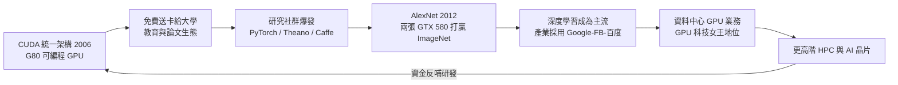

# 節標題：CUDA 豪賭——把 GPU 煉成通用平行計算

二○○六年，黃仁勳在 NVIDIA 內部做了一件董事會與華爾街都看不懂的事：要求公司往後所有 GPU，都要能讓工程師用 C 語言直接寫通用程式，並且把這套平台命名為 CUDA（Compute Unified Device Architecture）。當時 NVIDIA 的收入幾乎全部來自遊戲顯卡。分析師問：一家賣遊戲的公司，為什麼要燒數十億美元研發去做「科學計算」？財務上的邏輯是殘酷的——CUDA 短期內看不到回報，每顆晶片要多放電晶體、多花驗證成本、多寫一整個軟體生態。黃仁勳的回答是：GPU 的本命不是像素，是平行計算；圖形只是平行計算收益最高的一塊應用。

## 內部的 push 與靈魂人物

這場豪賭不只是黃仁勳一人意志。首席科學家 David Kirk 是 CUDA 誕生的重要推手，他早在 G80 架構時就主張：與其把可編程計算能力「塞進」流水線特定階段，不如做一個乾淨的、統一的平行執行模型。工程副總 Ian Buck是另一張面孔——他在史丹佛取得研究所學位後離開，帶著「Brook」這個 GPU 通用程式語言的研究成果加入 NVIDIA，把學術原形煉成 C for CUDA。G80（2006）與 GT200（2008）兩代架構，把「顯示晶片」重寫成「大量簡單執行緒的平行機器」，*shader 變 core，紋理變記憶體*。這在硬體上是反直覺的設計：遊戲市場不要求這麼乾淨的計算抽象，但黃仁勳強行要求一致——為的是十年後的生態。

> 黃仁勳的算盤：我們賣的不是晶片，是運算平台。

## 大學推廣：免費送卡，播種灣流

CUDA 推出的頭兩年幾乎沒有商業客戶，NVIDIA 卻在全球大學撒卡——直接寄送顯卡給資料探勘、分子動力學、金融工程、影像處理實驗室，開設 CUDA 教學課程、補助教材。這是制度性的教育投資：讓下一代替補教授的第一門平行計算課，就發生在 CUDA 之上。教育驅動人才、人才驅動論文、論文驅動產業——這是 NVIDIA 版的「培養物種 EcoSystem」。至 2010 年代初，全球超過數百所大學課程、上萬篇論文以 CUDA 為工具，形成沉重的生態轉換成本。

## AlexNet：二○一二年那聲惊雷

引爆點出現在一個多倫多實驗室。Geoffrey Hinton 的兩個學生——Alex Krizhevsky 與 Ilya Sutskever——用兩張 GTX 580 顯卡、寫自製的 CUDA 程式碼，訓練出一個八層卷積神經網路 AlexNet（一說九層、含池化共十一層運算模組），在 ImageNet 2012 競賽以 top-5 錯誤率 ~15% 痛擊第二名（錯誤率 ~26%）。關鍵不在演算法多新，而在「夠深的模型 × 夠多的資料 × 夠平行的硬體」第一次同時到位。GPU 讓以往數週的訓練縮到幾天，讓迭代試錯成為可能。學界隨即集體轉向深度學習，NVIDIA 股價在 2013 至 2016 年間悄然翻了數倍，CUDA 從燒錢項目變成護城河。

## 生態帝國的邏輯

黃仁勳常用一句話概括這盤棋：「我們賣的是運算平台，不是晶片。」CUDA 的護城河由三層組成：硬體（Tensor Core、高頻寬記憶體）、軟體（cuDNN、TensorRT、NCCL 等上百個函式庫）、以及人（受過 CUDA 訓練的百萬工程師）。每層都被前次投資疊高，後進者要同時翻越三座山。經濟學上，這是典型的雙邊市場加平台規模報酬：越多人用 CUDA，越多人優化演算法堆到 CUDA，晶片銷量越高，硬體再進化吸引更多研究者——一個自我強化的飛輪。文化上，CUDA 也改寫了「程式設計師」的心智模型：從單執行緒序列思維轉向「百萬執行緒同時跑」的思考方式，這不只是技術變遷，是一種 AI 時代的心智格式化。政治與制度面，這場賭甚至影響了各國的主權 AI 政策——當算力成為國家戰略物資，CUDA 生態的半壟斷狀態成為地緣政治的議題。但那都是後話；在 2007 年，這一切只是黃仁勳在法說會上被分析師一而再追問的「錢坑」，以及他反覆回答的那句話：

> 「我們不需要現在就證明，只需要不放棄。」
