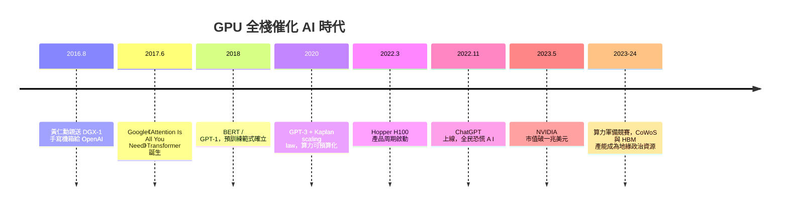

# 節標題：DGX-1 與 OpenAI——Transformer 時代的引爆點

二○一六年八月十五日，黃仁勳親自開車（更準確地說，是親自捧著）一台冰箱大小的黑色機箱，走進舊金山 Mission 區 OpenAI 的辦公室。這是世界第一台 NVIDIA DGX-1：八顆 Tesla P100、以 NVLink 全互連，170 teraFLOPS 半精度算力——相當於當年全球前一百大超級電腦的集合再壓縮進一個機架。Elon Musk 與 Ilya Sutskever 出面接收。黃仁勳拿油性筆在機箱上寫下一行字：

> 「The world's first computer designed for deep learning — To OpenAI & the team! Jensen. Spotlight Computing.」

他後來說，這輩子寫過很多簽名，只有這一行手寫字他視為歷史投遞——像把火種交給 Prometheus。他吃飯時與研究團隊一一相談，Musk 半開玩笑：「付錢買一台送到府上，還附贈現場支援。」黃仁勳回:「這是我們的使命，AI 將改變一切。」

## 那張送貨單背後的世界

這份「送禮」並非慈善。NVIDIA 需要一個能向全世界示範 DGX-1 極限的標竿客戶，而 OpenAI 正是在用無監督學習挑戰語言模型的難民營。歷史在這裡了一次三方接力：一年後，Google 的 Vaswani、Shazeer 等八人發表《Attention Is All You Need》（2017），Transformer 誕生——self-attention 讓序列計算可以完全平行化，這個架構天生就是為 GPU 而生的。訓練 Transformer 那篇論文本身，就是用 NVIDIA GPU（搭配 TPU 實驗版本）在 Google 完成的。

$$\text{算力需求（訓練 SOTA 模型）} \propto 2^{\text{年份}-2012/3.4\,\text{月倍增}}$$

二○二○年，OpenAI 的 Jared Kaplan 等人發表 scaling law：模型性能隨參數量、資料量與算力以冪律穩定提升——這不是玄學，是可預算的工程公式。這紙定律把 AI 從研究煉金術變成資本遊戲：誰能買到更多算力，誰就拿到更強的模型。GPT-3（2020）訓練用了上萬張 V100 的等效算力，而 GPT-4 用的 H100 叢集更是指數級躍升。

## ChatGPT 之後：算力軍備競賽與兆元帝國

二○二二年十一月 ChatGPT 上線，兩個月破億用戶，瞬間把「訓練大模型需要什麼」的問題推到每一家董事會：答案幾乎總是 NVIDIA。二○二二年下半年 NVIDIA 推出 H100，搭配 Transformer Engine，FP8 精度訓練性能較 A100 翻數倍，成為 AI 時代最搶手的硬通貨——黃仁勳戲稱它是「世界最重要晶片」。二○二三年五月，NVIDIA 單季營收指引較分析師預期高出逾七成，市值隨即突破一兆美元；其後一路攀升至三兆量級、一度成為全球市值第一的公司。黃仁勳那件黑色皮衣成為資本主義最新圖騰，人們稱他為「AI 時代最關鍵的軍火商」。

## 台灣供應鏈：皮衣與島嶼的共生

這場軍備競賽的物理基座，大多砌在台灣。台積電的 CoWoS 先進封裝——把 HBM 記憶體堆疊到 GPU 旁的矽中介層技術——是 H100/B100 產能的最關鍵瓶頸，NVIDIA 為此連年下注擴產，先進封裝收益成為台積電第二曲線。整機代工則由廣達、緯創、鴻海、英業達等台廠承接，AI 伺服器機櫃在桃園、台中組裝出貨。黃仁勳與張忠謀的忘年情誼、「Taiwan is the center of the AI revolution」的演講、以及他流利台語在 COMPUTEX 台上的演出，都是這段歷史的註腳：一個台南出身的工程師，回到島嶼採購全世界最缺的工業品。經濟上，這是少數由單一公司定價權驅動的產業重估；制度上，美中晶片禁令使 H100 成為出口管制品，算力徹底政治化；文化上，「皮衣、台語、萬人演唱會式 Keynote」讓科技傳播重新具備了宗教式魅力。而那台手寫字樣的 DGX-1，就靜靜站在 OpenAI 的歷史陳列裡——像一枚時空膠囊，封存著 AI 時代點火的瞬間。
