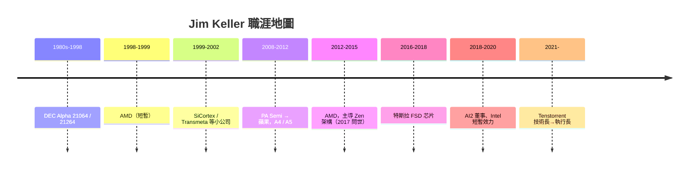

# 節標題：吉姆凱勒的傳奇軌跡——拯救 AMD、蘋果、特斯拉

半導體業有一種罕見物種：晶片架構浪人。Jim Keller 是其中最著名的一位。他的履歷像一份現代處理器史索引：DEC Alpha → AMD K8 → 蘋果 A 系列前身 → AMD Zen → 特斯拉 FSD → Intel → Tenstorrent。他自己的說法很樸素：「我一直都在做 CPU，只是到了不同房子裡做。」

## 康乃爾與 DEC Alpha 的黃金年代

Keller 沒有傳奇學歷——他在康乃爾大學讀的是電機工程（其實是先從社區及州立學院輾轉入學），一九八○年自康乃爾取得 BS EE 後，進入 Digital Equipment Corporation（DEC）。他趕上了處理器史上最輝煌的賭局之一：Alpha 架構。一九九二年問世的 Alpha 21064（EV4），是第一顆把 RISC 思想推到極致的商用晶片——200MHz 主頻，同期 Intel 486 只有 25-50MHz，業界為之瞠目。Keller 參與了 21064 的浮點與分支預測設計，並在 21264（EV6，1998）時代擔任關鍵架構角色：21264 採用亂序執行與模組化 design，一度是世上最快處理器，SPECint 分數碾壓一切。他從 DEC 學到最重要的一課是：架構是「一組長期不變的承諾」，指令集是合約，微架構是債。

## AMD K8：x86 進入 64 位元

一九九八年，Keller 轉到 AMD，主導後來成為 K8（Athlon 64 / Opteron）架構,於二○○三年問世。當時 Intel 傾全公司之力押注 Itanium——一款拋棄 x86 相容性、採 VLIW 的純 64 位元「革命」；Keller 選了相反路線：把 64 位元**加到 x86 上**，保留所有舊軟體。這個務實選擇逼得 Intel 最終不得不抄回 x86-64（EM64T），Itanium 慘敗成為半導體史上最大戰略錯誤之一。Keller 也主導了 HyperTransport 互連的整合，讓 AMD 在多核心時代拿到早期先手。

## 蘋果：iPhone 心臟的出生證明

二○○八年，Keller 加入剛被蘋果收購的 PA Semi（P.A. Semi），在 iPhone 4 之後主導設計 A4 與 A5 SoC 的 CPU——A5 的雙核 Cortex-A9 修改版。這是蘋果晶片帝國的地基：從 A4 開始，蘋果每年迭代自家處理器，最終形成今天 M 系列的整譜系。Keller 在蘋果只待到 2012 年，但團隊文化（小隊、自訂微架構、極度簡潔）是他留下的。業界常說：蘋果的晶片能力 = Keller 起的爐灶 + Johny Srouji 蓋的大樓。

## 再救 AMD：Zen 奇蹟

二○一二年，Keller 回到已瀕死的 AMD。當時 AMD 的 x86 業績在 Intel 的 Perf 架構前連年潰敗，公司幾乎準備放棄自研 CPU。Keller 主導新架構「Zen」——用 clean-slate 微架構 + 模組化 CCX 設計，保留 x86 ISA 之餘大幅重寫微架構：微指令快取、改善 branch prediction、提高每核心 IPC。他設定了不只「追上 Intel」，而是「每瓦性能翻倍」的目標。他本人於 2015 年離開 AMD，先後去特斯拉（設計 FSD 晶片）與 AI2（Allen Institute for AI），團隊由 Mike Clark 等人接手完成。2017 年 Zen 問世，Ryzen 桌面與 EPYC 伺服器一路反攻，AMD 從個位數市占爬到伺服器市場三成以上，公司市值一度超過 Intel——這是架構設計者離職多年後仍持續兌現的遺產。

## 浪人模式的獨特性

一九七○到八○年代，晶公司會養數百人的長期架構隊；九○年代後，pc 產業分工，安置架構人才的「長房子」愈來愈少。Keller 模式——每年在二至三家公司間移動、帶著同一套方法論——成為鮮活樣板：他不簽長約、不搏股權十年、只替需要重點的公司做「架構翻修」。他的名言既是自嘲也是宣言：

> 「我不是 genius，我只是一直重複做一件事：找出晶片裡的複雜度，然後把它砍掉。」

從 DEC 的 Alpha 頂峰，到 AMD 的瀕死病房，到蘋果的口袋、特斯拉的方向盤，Keller 證明了一件事：真正稀缺的不是晶圓廠，是能夠同時理解 ISA 合約、微架構語言、與商業現實的架構師。這也是 Tenstorrent 為何如此執著要他的原因——下章我們回到那間現代「浪人」的原油交易所。
