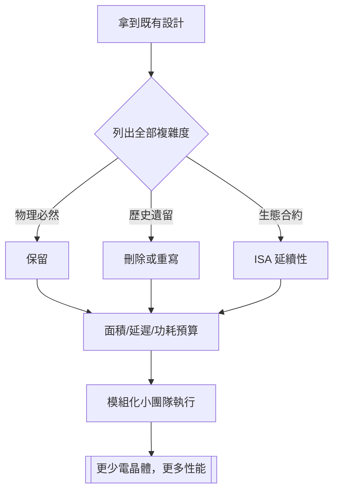

# 節標題：拆掉重來——凱勒的極簡設計哲學

Jim Keller 談晶片設計時，最常出現的動詞不是「設計」，是「刪掉」。他的方法論可以壓縮成一句話：**先問哪些複雜度是必要的，其餘全部拆掉重來。**這聽來像禪，其實是硬功夫——他在多次訪談中反覆演示這套思維：拿到一個架構後，先找出所有「歷史遺留的複雜度」，排序、分類，判斷哪些是物理定律的必然，哪些只是前人沒時間清理的 dead code。他常說，多數晶片專案失敗不是因為不夠聰明，而是因為「沒人敢問那個最笨的問題」。

## 微指令快取：小發明的大回報

Keller 的實務創新之一，是在 x86 微架構中強化**解碼後微指令快取**（μop cache / micro-op cache）。x86 指令長度不一、語義複雜，每次解碼都要付出晶片面積與延遲。把「解碼後的微指令」快取起來，讓迴圈與熱程式碼直接命中，可以跳過整個解碼器——這是 Zen、以及他日後參與 Intel 架構討論時一再強調的路線。他對 pre-decode、branch prediction、指令供給頻寬這些「看不見的管線」有近乎潔癖的執著，因為它們決定了真實 IPC（每時脈週期指令數）。他喜歡一句話：「頻率是市場奇怪的產物，IPC 才是工程師的誠實指標。」

$$\text{效能} \approx \text{IPC} \times f \times \text{核心數}， \quad \text{而 IPC} = \frac{\text{正確的指令}}{\text{每一個週期}}$$

## Itanium 的屍體與 x86-64 的勝利

Keller 哲學最漂亮的對照組，是 Intel 的 Itanium. Itanium 押注 VLIW：把指令平行調度的責任從硬體搬到編譯器，理論上省掉亂序執行的電晶體。這在論文上很美，在現實中是災難：分支密集的通用程式碼讓編譯器無法預測、相容性斷裂、生態遷移成本天文數字。Keller 主導的 K8 用完全相反路線贏下：64 位元作為 x86 指令集的**擴充**而非**斷裂**，舊程式碼零成本延續,新程式碼按需升級。他的解讀一貫務實：「工程師要照顧十億行既有的軟體。革命通常輸給演化的下一小步。」

## RISC vs CISC 的偽戰爭

Keller 對這場四十年爭論的立場極有代表性——他根本否認邊界存在。他在訪談中精确指出：今天所謂的 「x86」 內部其實是把 CISC 指令翻譯成 RISC 式的微指令（micro-ops）再執行；RISC 晶片則把指令長度擴充到跟 CISC 一樣複雜。兩者早已在內部互相抄襲、合流成「什麼都一點」的混合體。所以問題從來不是「ISA 哪個對」，而是：

1. ISA 的**擴充潛力**（能不能優雅地加新東西？）
2. 微架構的**軟體服務**能力（編譯器好寫嗎？虛擬機好跑嗎？）
3. 生態的**遷移成本**（誰替既有十億行程式碼務實負責？）

> Keller 語錄：「架構是給編譯器與軟體服務的接口，不是學術派系的家徽。」

## 拆掉重來的成本模型

他評估晶片專案的方式也偏執得有特色：與其問「這個功能能不能做」，他問「這個功能值多少晶片面積與驗證時間」。兩種度量在他那裡一律換算成工程師人年與物理佈局的機會成本。AMD Zen 專案採用模組化 CCX 設計、嚴格的物理設計外包（台積電 + 後段封測），都是這套「把資源花在有回報的複雜度上」的體現。他還是出了名的直言：在 Intel 期間的內部簡報毫不留情點出 Intel 製程落後與架構堆疊過度；後來公開受訪時佩服台積電的執行力，也直說 Intel「內部組織像一個手指按了很多開關的複雜機器」。他管理的團隊出名地小——PA Semi 時期他堅持「能用一個小天才隊完成的，就不要一百個平庸的人」。他甚至會在白板上跟你算：「一個設計錯誤在流片後代價是 $X，五位資深工程師的年薪是 $Y，所以我要先花 Y 防止 X。」

文化上，Keller 是個反「聰明暴政」的人：他鄙視會議炫技、鄙視往架構上貼個性化功能的慣性。他的工程哲學教育觀也很有現代性——好架構師不是天生的，是透過不斷猜測硬體行為、用效能計數器驗證、再修正，這種「師傅帶作坊」的方式訓練出來的。他帶過的徒弟散布在蘋果、AMD、Weta、Intel、Tenstorrent，這些人構成了當代半導體業的「暗影學派」——有時整個行業的走向，就取決於這些人站在誰的白板前面。
