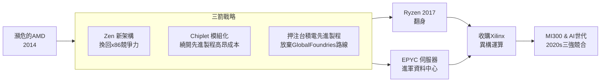

# 蘇姿丰：Chiplet 逆轉 AMD 的女掌舵者

## 台南的外婆、紐約的遥控車

1969 年，蘇姿丰（Lisa Su）出生於台南。她的外婆羅春桃與黃仁勳的母親羅采潔是親姊妹——換句話說，這位後來把 AMD 從死亡邊緣拉回來的 CEO，與輝達的創辦人黃仁勳是表舅甥關係。半導體史上最戲劇性的一對宿敵，其實血緣相連。三歲那年，她隨父母移民美國，父親在紐約皇后區重拾統計學的職業，母親做會計與行政工作。她回憶童年在紐約的公寓裡，第一次知道「工程師」這個詞時的興奮：「我在電視上看到工程師替建築物拉線、畫圖、計算鋼材， I 對自己說：這就是我未來要走的路。」

少年的她曾有一段拆卸遙控汽車的經歷。她把哥哥的遙控賽車整台拆開，賽車卻再也動不了——不是因為她笨手笨腳，而是她想知道「是什麼東西讓這台車動起來」。長大後她坦承自己最初動機不是純粹的工程好奇心，而是好勝心：她當時想的是「我要的一台跑得更快的遙控車」。日後她掌舵 AMD 的企圖心，其實早在那台啞掉的遙控車上已經現形——拆掉再重裝，只為了讓它跑得更快。

## MIT：世紀末押注一個冷門題目

蘇姿丰先後拿到 MIT 電機系學士、碩士、博士。她 1990 年讀碩士時搞的是薄膜量測——用飛秒雷射測半導體缺陷，那是一個還在起步的領域。1994 年的博士論文，她選了一個當時極冷門的題目：SOI（Silicon on Insulator，絕緣層上覆矽）技術。當時主流是體矽（bulk silicon），SOI 被視為一個昂貴而美麗的玩具。蘇姿丰的判斷邏輯很簡單：摩爾定律走到一定階段，漏電與功耗會逼你換掉基底材料。歷史證明她對——SOI 後來成為 IBM 高階處理器、乃至智慧手機晶片的關鍵技術。

1995 年她進入 IBM，在人數只有十幾人的寄存器團隊做次微米 CMOS 技術。她的積極讓人印象深刻：她後來回憶剛進 IBM 時，公司要求員工必須在下午五點半先讀完一疊內部備忘錄，她第一個月「敢於開口發問、直接挑戰資深工程師的假設」，很快被記住。在 IBM 的十三年間，她做對了兩件大事：一是參與銅互連專案。當時 IBM 是全世界唯一打算用銅取代鋁做晶片連線的公司，她親眼見證了這個改造整個產業的決策——用低電阻的銅把晶片運算速度往前推一大步。二是成為 IBM 首任 SOI 專案的領導者，把研究階段的技術推進到大量生產。IBM 有趣的組織文化讓她受用一生：主管們爭論一個技術題目時，「你必須拿出最鋒利的數據，否則就會被別人說服」。

2000 年她升任 IBM 科技長，負責新興產品部門。2007 年她跳槽到 Freescale 半導體，擔任 CTO 與研發副總，開始管理數百人的組織。在那裡她學到管理者的第一課：親自理解問題到可以拆解的程度，「問題不要一下子全然推給團隊，要拆小、要逐步找解」。2012 年一月，她接受朋友的再三遊說，加入了那時的 AMD。

## 臨危授命：二塊美元的 AMD

2012 年蘇姿丰接任 AMD 資深副總兼全球事業群總經理時，這家公司已經瀕臨死亡。它是全球唯一能設計 x86 晶片的公司之一（與 Intel 共享交叉授權協議），卻因為 2006 年收購 ATI 那筆 54 億美元的債務、以及連續多年與 Intel 先進製程進度脫節，財務幾乎崩潰：帳上現金不到十億美元，股價兩美元上下，裁員三成、外賣廠房與資產，靠質押專利與授權度日。半年後，她被當時 CEO Rory Read 視為少數「願意留下來救火」的高階主管之一。

2014 年 10 月，董事會任命她為 CEO——成為 AMD 半世紀來第一位女性最高主管，也是華爾街罕見的亞洲裔女性科技企業掌舵者。她的上任記者會，股價跌了 10%。投資界的邏輯很合理：半導體需要的是「救世主」級的人物，而不是一個之前帶過方案事業群的副總。

蘇姿丰上任的第一件事，就是定調 AMD 的存在意義：»做高效運算的先驅者「，並且推動了後來被業界稱之為「三箭」的賭注：

第一箭：Zen 架構。當時原生架構 Bulldozer 已被證明是失敗品，AMD 籌碼幾乎歸零。她在董事會上說動十二人（包括她自己）把整個架構團隊升級，並力保早已被挖走的神級晶片設計師 Jim Keller 回巢。Keller 在 2016 年接手 Zen 的終局設計，把每核心 IPC（每時脈週期指令數）提升了 52%，讓 AMD 的桌上型處理器重回競爭行列。

第二箭：Chiplet。這不是一個新發明，是向 IBM 主機時代多晶片模組技術的回歸，但 AMD 把它發揮到晶片產品層級。為什麼要切小？因為在 7 奈米以下，一片大晶片的良率會隨面積急速崩壞、成本急速攀升——晶片切小了，每塊 die 都可以單獨測試與更換製程，價格就可以壓下來。蘇姿丰的洞見是：當一代製程的微縮紅利慢慢枯竭， packaging（封裝）與 interconnect（互連）才是新戰場。Ryzen 用的是兩顆 8 核心晶片暫存到一個 package 的雙晶片設計，EPYC伺服器晶片更是多達九塊 die。

第三箭：台積電。當舊夥伴 GlobalFoundries 在 7 奈米製程上交不出來，蘇姿丰果斷地把 AMD 的先進產品全數轉往台積電。這個決策在當時大膽至極——台積電在2017-2019 年那幾年風險極大，但蘇姿丰親自到新竹，對供應鏈做了全面性的戰略布局。佐證是 EPYC 「Rome」在 2019 年以全球第一顆 7 奈米伺服器 CPU 之姿登場，一舉拿下市占率。這條「AMD＋台積電」的結盟路線，日後成為 AI 晶片時代的製造主幹道。

## Ryzen 翻身與 EPYC 深入虎穴

2017 年 3 月，Ryzen 上市。英特爾已經四年沒有實質性升級桌面 CPU，AMD 抓準時機以性能相近、價格減半的姿態切入，把死亡邊緣的市占率打到 20% 以上。蘇姿丰自己承認，那天早上她在家盯著股價，看著它大幅上揚，鬆了一口氣。

但 Ryzen 只是止血。EPYC 才是手術。伺服器是 Intel 的 cash cow、是 95% 佔有率的鐵桶，AMD 過去 8 年攻不上雲端客戶的大門。蘇姿丰的切入點是：賣給客戶「每瓦性能」與「每美元性能」——雲端業者算的是電費與機架空間，不是品牌忠誠度。EPYC 第一代（2017 年）只是敲門，第二代 Rome（2019）拿下 Google、Twitter等雲端巨頭的訂單，第三代 Milan（2021）在 Google Cloud 的內部基準測試打贏 Intel 到位。2024 年第一季末，AMD 在資料中心 CPU 的市占率已經攻上 20%——EPYC 也成為超級電腦（如 2022 年 getOrder Frontier 超級電腦）的主流選擇。

## Xilinx、MI300 與 AI 時代的再轉向

2021 年 10 月，蘇姿丰促成收購 FPGA 龍頭 Xilinx，金額 350 億美元——是 AMD 歷史上最大的一筆交易。輿論當時嚴重分化：有人說這是「AMD 走向多元的成熟」，也有人說是「收到頭重腳輕」。蘇姿丰的邏輯很清楚：AI 時代的晶片不是一顆單純的 CPU，而是 CPU＋GPU＋FPGA＋AI 加速器的異構組合（heterogeneous computing）。Xilinx 帶來的不只是 FPGA 產品線，還有 5G、汽車、防禦等非 AI 市場壯大收入，更能強化 AMD 的 chiplet 設計能力。2022 年完成，整合平平，但 FPGA＋GPU 的組合能力，直接喂養給 2023 年問世的 Instinct MI300 系列。

2023 年 12 月，MI300X 正式出貨。這顆晶片以 chiplet 組合出 1530 億電晶體，HBM 記憶體容量壓過 NVIDIA H100。AMD 拿微軟 Azure、Meta 做首批客戶，之後 OpenAI 也進入測試名單。它沒能在 AI 主力市場追近 NVIDIA 的壓倒性份額，但提供了「第二條供給線」的意義——如同當年 Google 建立 TPU 的動機：晶圓、算力不該被單一供應商卡脖子。

## 表舅甥的宿命對決

蘇姿丰與黃仁勳的血緣薄如一層紗，兩人的競爭卻頗為jarring：黃仁勳跑得早，蘇姿丰根基深。2017 年之後，AMD 股價從兩美元低點漲到一度超過 200 美元。2024 年她獲選時間雜誌百大人物，同年她任內的 AMD 市值從 20 億美元漲到超過 2000 億美元——千倍的成長曲線。

她把成功歸結於一個簡單的判斷方法：»不要去等待那個完美的時機，你必須在同時性的賭注裡找到那個唯一會贏的路徑。「 從台南的嬰孩到 AI 晶片時代的戰略家，她幾乎每一個關鍵決策都把「長期主義＋冒險」放在了「短期主義＋安全感」前面。2008 年看不懂的半導體趨勢，2012 年陪著她走進 AMD 經理層的朋友說：她自己也沒有把握能活下來，只是想把一件事做好——「贏」。
