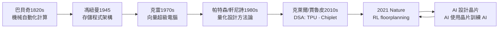

# 終極前沿：用 AI 設計 AI 晶片

## 一篇 Nature 論文引爆的爭議

2021 年 6 月，Google 的 Anna Goldie 與 Azalia Mirhoseini 在《Nature》上發表了一篇論文，標題直白：《晶片設計的深度強化學習》（*Chip Design with Deep Reinforcement Learning*）。故事起源於 TPU 的佈局問題：數百個巨型巨集（macro）——記憶體、運算核心、互連電路——要在數千平方公尺的晶片矩形裡找到各自的座標，並兼顧效能、功耗與面積。傳統做法是工程師靠累積幾十年的經驗＋商業 EDA 工具，跑一次佈局要數個星期，且沒有人敢說是全域最佳。

Google 團隊的做法是把佈局變成一個強化學習問題：把晶片視為一個可放巨集的網格，狀態是當前放置結果與連線圖，動作是「把下一個巨集放到哪一格」，獎勵混合了近似的線長、功耗與密度指標。他們用 Google 的內部 RL 基礎建設（正是 AlphaGo 的那套技術棧）訓練了一個策略模型，宣稱六小時內做出的佈局優於人類專家數星期打磨的結果，並且 TPU v5 的部分設計實際用上了這條流程。

這篇論文的影響超出了學術圈。2022 年，《Nature》把它選為該年計算領域亮點；媒體稱之為「AI 自己設計晶片」的開端。Google 數據中心主管甚至宣稱，這項技術為 TPU 的落地節省了大量時間。

但是，2023 年，ISCAD 會議上的一篇論文激起了業界的反彈。Synopsys、NVIDIA 以及多位學術界研究者公開質疑 Google 的基準：Google 比較的「人類專家」競態與 RL 的條件並不一致（例如有人類結果是用不同工具或不同約束做出來的），某些 RL 結果在標準佈局工具下重現時，可佈局性（routability）有疑問。2024 年，《Communications of the ACM》刊出 Did TechyPivotal 質疑的長文，而 Google 團隊在 2025 年正式回應（一篇於 Nature Machine Intelligence）並提交了補充數據。爭論本身沒有輸家：它促使 AI 佈局領域建立了更嚴格的公開基準——這正是帕特森學派方法的延伸。

## AlphaChip 的開源與產業化

2024 年 9 月，Google 把這套方法正式命名為 **AlphaChip**，開源權重與原始碼，並發布了預訓練檢查點。 dispensing 此時，這條技術路線已經不再僅是 Google 內部的事：Mediatek 宣稱在其晶片上用類似 RL 佈局技術改善了功耗；Amazon Annapurna 的六奈米 Trainium 晶片號稱部分模組也用 RL 佈局。

AlphaChip 的關鍵貢獻是把「經驗可遷移」具體化了：它先用簡單電路（如 FIR 濾波器）預訓練，然後遷移到 TPU 等大型電路上——正如人類工程師先做小專案再打大仗。從 AlphaZero 到 AlphaFold，這個團隊屢次證明了一個哲學：足夠好的模擬器＋足夠多的訓練樣本＋足夠大的模型，幾乎可以替代任何有明確評分函數的設計工作。

## 商業戰場：DSO.ai 與 Synopsys 的轉型

與此同時，老牌 EDA 巨頭也沒閒著。2020 年，Synopsys 發布 **DSO.ai**（Design Space Optimization），把強化學習打包成可用的商業工具，用於晶片設計空間的探索——時脈、功耗、面積的高維度取捨。2023 年，Cadence 跟進推出 **Cerebrus**。兩大 EDA 巨頭宣告了一件事：AI 探索晶片設計空間，已經不可逆轉地成為發貨管線的一部分。

Synopsys 官方宣稱 DSO.ai 讓設計團隊在相同面積下性能提升、功耗下降、設計週期縮短，截至 2024 年已被多家重量級客戶採用（其執行長 Sassine Ghazi 與蘇姿丰都使用過類似的說法）。而 EDA 產業的老問題也在此過程中顯形：**驗證成本佔晶片設計總成本的七成左右**——業界流傳的 70% 說法始終是設計的一大痛點。驗證的工作量隨系統狀態數呈指數級增長，只有 AI 驅動的驗證助手（自動生成測試向量、自動定位 bug、自動斷言 review）才有機會壓住這個曲線。2023 年，Synopsys 推出 **Copilot**（與微軟合作）、NVIDIA 推出用 LLM 輔助生成 Verilog 的研究；從此，晶片設計語言的寫作者不再只是人類工程師。

## 黃氏定律與 Rubin 的迭代節奏

在 AI 設計晶片的時代，黃仁勳提出了一個與摩爾定律對位的概念：**黃氏定律（Huang's Law）**——GPU 的性能提升不只依賴製程微縮，更依靠架構、演算法與系統設計的協同進化。摩爾定律以兩年一倍的速度推進，黃氏定律則宣稱 DNN 推理效能以「每年翻一倍以上」的速度進化。黃仁勳很清楚，這個數字不是單一技術給的，而是由製程（NVIDIA 依賴台積電先進節點）、互連（NVLink）、演算法（Tensor Core、稀疏化、混合精度）與 AI 輔助設計共同催生。

2024 年 GTC 大會，NVIDIA 公布 **Rubin 架構**——Blackwell 的下一代，預計 2026 年問世。黃仁勳在台上把迭代節奏定為「一年一代」，把推論與訓練的晶片分開（Rubin＋Rubin Ultra；最終再合併），並以 NVLink Spice 把整機架視為一個巨型 GPU。這個節奏意味著：設計週期不能再是傳統的三到五年，而是兩年以內。**只有 AI 參與的設計流程，才能餵養一年一代的迭代節奏** ——這是整個黃氏定律的政治經濟學。 NVIDIA 也大量開源，把技術棧（如 cuLitho 用 GPU 加速光罩計算，fdo 這些生產工具鏈）都瞄準「縮短設計與製造的周期」。

## 從巴貝奇到 RL Agent 的兩百年弧線

本書的故事從查爾斯·巴貝奇寫起——1820 年代的他，用黃銅齒輪和蒸汽動力試圖把人類的計算自動化，最終傾盡家產、壓在帝國官僚的推遲裡而未竟全功。兩百年後，計算已經回頭來設計計算機本身：

這條弧線的終點是個自我指涉的迴圈：**AI 用晶片訓練，晶片由 AI 設計**。AlphaChip 的訓練跑到 TPU 上，TPU 訓練了 Gemini，Gemini 幫助晶片工程師驗證 RTL、探索架構空間。當人類工程師的直覺與數十年經驗被轉錄為可被抽象的評分函數，架構師的角色正在發生質變：不再是「畫方框的人」，而是「定義評分函數與約束的人」。

問題也隨之而來：當 EDA 與架構探索都被 AI 接管，人類還剩什麼？歷史的回答通常是：**把問題的定義權留給自己**。巴貝奇設定的計算目標來自天文與航海表，那個「為什麼要算」的問題屬於他身處的大英帝國政治經濟；AlphaChip 的評分函數來自 Google 的資料中心成本結構。技術可以被自動化，但「要設計什麼、為誰設計」的問題，永遠需要有人站在經濟、政治與文化的交會處做判斷。這也是本書結語要回到的問題：從巴貝奇到 RL agent，兩百年來人類一直在做的，是把「判斷」一層層下沉到機器；而每一次下沉，都重新定義了「什麼是人不可替代的工作」。

晶片的故事還在加速。蘇姿丰的 chiplet 在往 3D 堆疊走；賈魯皮的 TPU 在往幾萬卡 Pod 走；黃仁勳的 Rubin 往一年一代走；而 Goldie 與 Mirhoseini 打開的那扇門——AI 設計 AI 晶片的門——才剛剛推開一縫。電腦設計者們，第一次要學會的，是與一個不睡覺、不結婚、不退休的同事共事。
