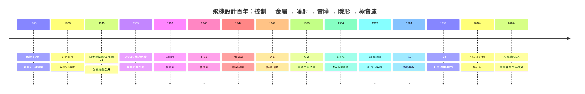

# 前言：剪斷重力的無形線——飛機設計者如何用空氣動力學在藍天畫出人類文明的航道

1903 年 12 月 17 日上午，北卡羅來納州 Kitty Hawk 的沙丘上，一個只飛了 12 秒、120 呎的木布機器，悄悄改寫了人類文明的座標系。此後一百年，飛機設計者不斷在同一組方程式上做極限運動：如何用最小的結構重量換取最大的升力，如何讓氣流乖乖貼著機翼流動，如何把數千度的高溫烈焰馴化為推力，如何在雷達眼裡把一架 20 噸的機器縮成一顆彈珠。

## 一、設計者的四重博弈

飛機設計從來不是畫出優美線條，而是五維約束下的生死博弈：

- **空氣動力學**：升力 $L = \tfrac{1}{2}\rho V^2 S C_L$ 是免費的，阻力則處處收稅——誘導阻力、激波阻力、摩擦阻力；橢圓翼、層流翼、後掠翼、面積律、乘波體，每一代翼形都是對阻力稅單的一次反叛。
- **推進系統**：從 Charlie Taylor 手敲的 12 馬力鋁缸，到 Merlin V12、Jumo 004、J58 變循環與超燃衝壓——推力曲線決定了飛機可以夢想多快。
- **結構與材料**：帆布與木材 → 硬鋁波紋板 → 應力外皮 → 鈦合金與碳纖維；每一公斤的減重，都是續航力與武裝的重量再分配。
- **控制與穩定**：賴特兄弟的三軸控制、Yeager 的全動平尾、Whitcomb 的面積律，直到靜不穩定飛翼靠線傳飛控每秒數十次的自救——「能飛」與「可控」之間，隔著一整個世紀的認知史。

## 二、歷史如何推動設計

本書堅持把每一個技術躍進放回它的歷史脈絡：

戰爭是最殘酷的催化劑：一戰逼出同步射擊器與全金屬機身，二戰逼出層流翼與噴射引擎，冷戰逼出 U-2、SR-71 與隱形技術；而戰後的制度遺產——從 Operation Paperclip 帶走的德國氣動學家，到 Busemann 的後掠翼數據——決定了誰在下一輪競賽起跑線的前面。經濟學同樣是設計變數：DC-3 證明民航可以自己養活自己，協和號則證明音爆與油耗可以把工程奇蹟變成商業絕響。

## 三、本書的紀律

- **史實可考**：賴特兄弟 1901 年風洞的 205 組翼型數據、福克同步器的凸輪連桿、Ufimtsev 1962 年那篇被蘇聯束之高閣的論文——每個故事都真實，迷因與傳聞會被辨偽。
- **機理可算**：誘導阻力 $\frac{C_L^2}{\pi AR}$、雷達探測距離與 RCS 的四次方根關係、乘波體的激波附着條件——每章至少一段可檢驗的工程推理。
- **因果可追**：科技、經濟、制度、政治、教育如何互相驅動——德國的材料短缺塑造了 Jumo 004 的耐熱鋼折衷，英法政治聯姻催生了協和號，冷戰預算曲線決定了 B-2 從 132 架砍到 21 架。

天空沒有天花板，只有尚未被寫下的方程式。翻開下一頁，我們從兩個賣自行車的兄弟說起——他們做的第一件事，不是造飛機，而是承認全世界教科書裡的升力數據都是錯的。
