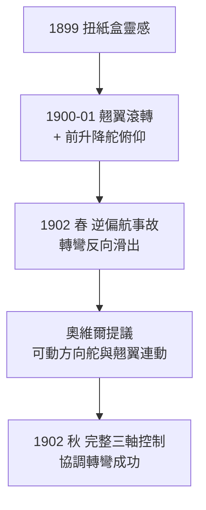

# 第 1 章 · 第 2 節 翹翼與三軸控制：從扭紙盒到馴服天空

## 1899 年的紙盒

1899 年 7 月，威爾伯在代頓的店裡向顧客解釋自行車內胎盒時，隨手扭轉一個長條紙盒：兩端可以朝相反方向傾斜，而盒身仍是剛體。他忽然停住——如果機翼也能這樣「扭」，左右兩側的攻角一增一減，飛機就能像騎自行車壓車過彎一樣傾身轉彎。這個靈感催生了**翹翼（wing warping）**：駕駛員搖動腳邊的搖架（hip cradle），以鋼索扭轉機翼後緣，達成滾轉控制。

為什麼自行車商會想到「傾身轉彎」？因為自行車本身就是不穩定載具：騎士靠持續的微小修正維持平衡，轉彎靠重心傾斜而非直接扳龍頭。賴特兄弟比任何學者都早參透——飛機應該是一台**不穩定、靠人不斷操縱的機器**，而非如 Langley 所信的、像船一樣天生穩定的浮體。

## 三軸控制的補完

氣動力學上，飛機有三個轉動自由度：俯仰（pitch，繞橫軸）、滾轉（roll，繞縱軸）、偏航（yaw，繞立軸）。1900–1901 年的滑翔機已用前升降舵控制俯仰；翹翼解決滾轉。但 1902 年初的試飛暴露了致命缺陷：威爾伯壓翹翼轉彎時，飛機竟朝**反方向**滑出，甚至一側翼尖擦地墜毀——這就是**逆偏航（adverse yaw）**。

原理不難：機翼一側攻角增大，升力增加的同時誘導阻力也增加，阻力的不對稱把機頭拽向升力較小的反側。仿照船舶的尾舵（vertical rudder）似乎是解方，但兄弟倆起初把方向舵做成固定的，問題依舊。

突破在 1902 年 10 月：奧維爾提議把方向舵改成**可動的，並與翹翼機構連動**——壓左翼時，方向舵同步把機頭轉向左側，抵消逆偏航。這組翹翼＋連動方向舵讓 1902 年三號滑翔機成為史上第一台能完全協調轉彎的載人重於空氣飛行器。加上前升降舵，**三軸控制體系就此完備**——今日每一架飛機的操縱邏輯，仍是這套架構的直系後裔。

## 制度與思想的爭議

翹翼也埋下法律戰火。1906 年，波蘭裔法國發明家 Louis-Pierre Mouillard 的專利被 Langley 的助理 Glenn Curtiss 購得並用於其飛機；賴特兄弟認定 Curtiss 的副翼（aileron） infringed 其翹翼專利，於 1910 年興訟。這場訴訟纏鬥近十年、間接拖累美國航空工業——專利制度從鼓勵發明异化為封鎖技術流通，最後由政府在一戰壓力下建立專利池（Manufacturer Aircraft Association, 1917）強制授權才解套。

思想層面，賴特兄弟的洞見更深遠：他們把飛行問題定義為「控制」而非「升力」。前人前仆後繼追求更大機翼、更強引擎，卻都栽在無法操縱；兄弟倆從自行車經驗出發，認定平衡是核心難題，於是先花兩千多次滑翔學會飛，再裝引擎。這種「先學飛、再上動力」的路徑，與當代航空界形成鮮明對照，也是他們唯一成功的原因。
